# ε-Kuantum Hata Düzeltme Kodları (R_Q halkası) — Bağımsız Yeniden Üretim ve Kuantum Devre Uygulanabilirliği

**Teknik rapor** · 15 Ekim 2026 · Tek makine: DESKTOP-RR5J4T0 (RTX 5060 Ti 16 GB, Ryzen 7 7700X, 63 GB RAM) —
Windows 10 + aynı makinede WSL2 Ubuntu 26.04 (yalnızca `lightning.gpu` devreleri için)

İncelenen çalışma: M. Güzeltepe, N. Aytaç, *ε-Quantum error correction codes over the ring R_Q*,
Finite Fields and Their Applications 117 (2027) 102881, doi:10.1016/j.ffa.2026.102881.

Bu rapordaki her sayı `results/` altındaki bir deney kimliğine (experiment id), bir pytest testine
(`results/tests/test_report.json`) veya açıkça yazılmış bir matematiksel gerekçeye dayanır.
Kimlikler `<ad>-<UTC zaman damgası>-<makine>-<config hash>` biçimindedir.

---

## 0. Yönetici özeti

| # | Makaledeki iddia / sonuç | Durum | Dayanak |
|---|---|---|---|
| 1 | \|C1\|, \|C2\|, K = \|C2\|/\|C1\| (Z25[i]: 25/125/5, Z85[i]: 85/1445/17, Z325[i]: 1625/8125/5) | **Doğrulandı** (eleman sayımıyla) | Phase 1, Phase 2, `test_sizes_by_enumeration_match_paper` |
| 2 | C1 ⊆ C2 ve C2^⊥H ⊆ C1 (Örnek 6–7, Tablo 1) | **Doğrulandı** — yalnızca dual *gerçek ortogonal tümleyen* olarak alındığında | Phase 2 |
| 3 | Tanım 6: C^⊥H := ⟨σ(α)⟩ | **Hatalı tanım.** Doğru dual: C^⊥H = Ann(σ(α)) = σ(Ann(α)) = ⟨σ(q/δ)⟩, δ = gcd(α, q) (Z[i]'de) — q ∈ {25, 65, 85, 125, 325} için tüm idealler (9/16/16/16/36) ve q başına 300 rastgele üreteçle doğrulandı. Tanım 6 yalnızca Ann(α) = ⟨α⟩ iken doğru (bu halkalarda tek durum: Z25'te ⟨5⟩); makale örneklerinin **α₂** üreteçlerinde de **α₁** üreteçlerinde de doğru değil. Tanım 6 ile örneklerdeki dual-içerme sağlanmaz ve Teorem 4 stabilizerleri komütatif olmaz (kod uzayı 0 boyutlu) | `review_checks`; `test_closed_form_*`, `test_definition6_*`; 5 `definition_consistency` testi |
| 4 | Lemma 1 (1)–(3) | Doğru dual (Ann) ile: **(1) yanlış** (α birim ⇒ C = R, C^⊥H = {0}), **(2) ve (3) doğru**. Tanım 6 ile (yazıldığı gibi): (1) doğru, (2) ve (3) yanlış → tek bir tanım altında üçü birlikte doğru değil | Phase 2 `lemma1`; 2 `paper_claim` + 1 `definition_consistency` testi |
| 5 | Tablo 1–2'deki Z9 satırı (\|C2^⊥H\| = 3, K = 1) | **Hatalı** (hesaplanan: 1 ve 3). Not: Z9 makalenin kendi hipotezinin dışındadır (3 ≡ 3 mod 4; makale de "yalnızca gösterim için" der); satır yine de kendi içinde tutarsız | 2 `paper_claim` + `outside_hypothesis` testi (sınıf güncellendi) |
| 6 | ε-decoder: Örnek 8 (y = 11+8i → e = 8+4i, c = 3+4i), Örnek 5 | **Doğrulandı** (orijinal kod + bağımsız kod) | Phase 1, `test_example8_y_11_8i` |
| 7 | Koset ayrışımı, ayrıklık, kapsama, tekil decode | **Doğrulandı** (tüm R üzerinde exhaustive) | Phase 1–2 |
| 8 | Decode karmaşıklığı O(\|ε\|) | **Üyelik testi sayısı olarak doğru**, ama ön-hesaplama/bellek gizli; \|ε\|'dan bağımsız O(1) bir doğrudan yöntem var | Phase 2 `scaling` |
| 9 | Teorem 4: stabilizer kodu, boyut K | **Doğrulandı** — R_Q-alt-modülleri için (makalenin Tanım 4'ündeki "additive code" = temel ideal), gerçek dual ile, 3 bağımsız boyut hesabı. Dual-içerme hipotezi bu yapı için gereksiz (hata değil, fazla varsayım). Genel toplamsal (Z_q-alt-grup) kodlarda \|C\|\|C^⊥H\| = \|R\|ⁿ bozulur (karşı-örnek C = Z_q·1: \|C^⊥H\| = 1); orada Hermitian dual yerine **sol iz duali** {v : Tr⟨v,c⟩_H = 0} gerekir | Phase 4, Phase 4 ek, `review_checks` B4 |
| 10 | **Önerme 5**: farklı ε temsilcileri farklı sendrom üretir | **X-tipi okumada çürütüldü** (makalenin Tanım 10 / Remark 4 / Örnek 8 okuması, hatalar X(e), e ∈ ε ⊂ C2): sendrom çekirdeği C2, X(ε) lojik operatör. **Z-tipi okumada** (hatalar Z(e)) koşula bağlı: \|ε\| farklı sendrom ⟺ (ε−ε) ∩ C₁^⊥H = {0}; makalenin üç örneğinde sağlanıyor, genel değil — makalenin kendi ayarında (n = 1, Teorem 4 hipotezleri) bile: Z25[i]'de C1 = ⟨10−5i⟩ ⊂ C2 = ⟨2−i⟩ (K = 25) için 25 temsilci yalnızca 1 farklı sendrom verir. C1^⊥H ⊆ C1 ise koşul her zaman sağlanır (yeterli koşul; 481/481 durum), değilse çoğunlukla sağlanmaz (16/282). Bağımsız yeniden kurulum Z5[i]⁴'te 21 transversalin hiçbirinde sağlanmaz (Bölüm 8.2) | Phase 5 (sayısal + PennyLane), `zreading_condition`, 3 `paper_claim` testi |
| 11 | Şekil 1–2 (kodsuz SER) | **Nitel olarak yeniden üretildi** (bağımsız yeniden kurulum) | Phase 3 |
| 12 | Şekil 3 "kodlama kazancı" | Eğri **yeniden üretildi**; ancak kazanç **farklı iletim hızlarının** karşılaştırılmasından geliyor. Eşit hızda (128-QAM) koset decoder ~2.5–2.9 dB **kötü** | Phase 3 |
| 13 | Fiziksel kuantum hata düzeltme (makalenin ε çerçevesiyle) | **X-tipi okuma için yanlış**: makalenin seçtiği X(ε) hata kümesi tespit edilemeyen lojik hatalardır; *bu hata kümesi için* hiçbir kurtarma yoktur (Knill–Laflamme). **Z-tipi okumada** (ε−ε) ∩ C₁^⊥H = {0} koşulu altında çalışıyor, ama genel değil (makalenin kendi ayarında karşı-örnek: Z25[i], C1 = ⟨10−5i⟩ ⊂ C2 = ⟨2−i⟩; yeterli koşul C1^⊥H ⊆ C1). Aynı stabilizer, doğru hata kümesiyle (R/C2 ve R/C1^⊥H transversalleri) kapı düzeyi devrede (kodlayıcı dahil) sadakat 1.0 ile düzeltme yapıyor (Bölüm 8.3, 8.6) | Phase 5–6, `gate_level_css` |
| 14 | (Makalede yok) gürültü altında davranış | Kod-kapasitesi modeli. **Qudit düzeyinde**, kodun tasarlandığı birim-kayma gürültüsünde Z25 kodu p = 0.01'de LER = 1.0×10⁻⁴ (aynı modelde kodlamasız K = 5 qudit: 1.99×10⁻²; K-qudit depolarizasyonunda kodlamasız LER = p = 10⁻²). **İkili kubit gömmesinde** (Düzen A: 10 kubit, Düzen B: 12 kubit) kod kodlamasızdan kötü: bit-flip'lerin çoğu halka elemanında büyük bir sıçramadır (ör. a'nın en anlamlı biti ±16; yalnızca en düşük bitler düzeltilebilir ±1/±i kaymasıdır), kod ise birim kaymalara göre tasarlanmıştır — sonuç gömmeye özgüdür. 10/12 kubitlik kodla 3 kubitlik kodlamasızın karşılaştırması kaynak bakımından adil değildir; aynı kayıt ve kubit sayısıyla kodlamasız referans da raporlandı (Bölüm 9) | Phase 6, `noise_layouts` |

Kısa sonuç: Makalenin **cebirsel çekirdeği** (halka, idealler, boyutlar, koset decoder, Teorem 4 kodu)
sayısal olarak doğru; Tanım 6'daki dual hatalı (doğrusu ⟨σ(q/δ)⟩). **Kuantum hata düzeltme iddiası**
(Önerme 5, Örnek 8 "Quantum context", Remark 4) makalenin **X-tipi okumasıyla** geçerli değil; **Z-tipi okumada**
(ε−ε) ∩ C₁^⊥H = {0} koşulu altında geçerli, ama genel değil. Teorem 4'ün stabilizer kodu, doğru hata kümesiyle
kapı düzeyinde (kodlayıcı, sıralı sendrom ölçümü, kurtarma) sadakat 1.0 ile çalışıyor. Gürültü altında ikili kubit
gömmesinde kodlamasızdan kötü, qudit düzeyi birim-kayma gürültüsünde ise belirgin şekilde iyi. **AWGN kodlama
kazancı** yorumu eşit hız karşılaştırmasında geçerliliğini yitiriyor.

---

## 1. Kaynak dosya envanteri

Çalışma klasöründe bulunan dosyaların tamamı (başka dosya, veri, notebook, MATLAB/Sage kodu **yok**):

| Dosya | Boyut | SHA-256 | Açıklama |
|---|---|---|---|
| `epsilon codes.py` | 10 211 B | `eb593509…f7029e1ca2e` | Yazarların Python kodu (tek dosya) |
| `1-s2.0-S1071579726000924-main.pdf` | 1 555 547 B | `1481e809…70e97a13747c`* | Makale, 22 sayfa |

\* Tam hash'ler: `results/original/phase1_original-20261015T001749Z-DESKTOP-RR5J4T0-d3f0ec9876/results.json`.

Her iki dosya `original_source/` altına **değiştirilmeden** kopyalandı (hash'ler aynı; `test_original_file_unchanged`).
Ek A'daki listeler (s. 21–22) elle `original_source/paper/appendix_A_transcribed.py` dosyasına aktarıldı
(yazar dosyası değildir; yalnızca karşılaştırma için).

**Kaynakta bulunmayan / eksik olanlar**

1. AWGN/SER simülasyon kodu (Şekil 1–3) — yalnızca Ek A.2'deki `gaussian_modulo` fonksiyonu basılmış; sembol
   sayısı, tohum, takımyıldız eşlemesi, normalizasyon ve alıcı yayımlanmamış.
2. Hermitian dual n = 1 için hiç hesaplanmıyor (`hermitian_dual` yalnızca n = 2) → dual-içerme koşulu
   yazar kodunda doğrulanmıyor.
3. Z5[i]⁴ örneğinin (Remark 8) üreteçleri verilmemiş; `search_css_pairs` yalnızca n = 2 ve tek üreteçli modüller arıyor.
4. Kuantum kısmı (Pauli operatörleri, stabilizer, sendrom) için hiçbir kod yok.
5. `random` modülü tohumlanmıyor (sonuç %100 başarı olduğundan çıktıyı etkilemiyor).

**Ortam sapmaları**: Bu makinedeki GPU "RTX 5060 8 GB" değil **RTX 5060 Ti 16 GB**'dir. Kullanıcı kararıyla
üç-makineli Phase 7 iptal edildi; tüm deneyler bu makinede çalıştırıldı. `pennylane-lightning-gpu` ve
cuQuantum (`custatevec-cu12`) native Windows için dağıtılmadığından orada kurulamadı (pip çıktısı ile
doğrulandı); Windows tarafında GPU hızlandırması PyTorch 2.11 + CUDA 12.8 (sm_120 desteği doğrulandı) ile yapıldı.
Kullanıcının önerisiyle **aynı makinedeki WSL2 Ubuntu 26.04** içinde `pennylane-lightning-gpu 0.45.0` kuruldu
(`wsl/setup_wsl_gpu.sh`, Python 3.12.13, aynı paket sürümleri); Blackwell (sm_120) üzerinde `lightning.qubit` ile
aynı durumu ürettiği doğrulandı (`wsl/verify_wsl_gpu.py`: sadakat 1.0 / complex64'te 0.999998). Windows'ta
genişlik nedeniyle çalıştırılamayan devreler orada GPU'da koşturuldu (Bölüm 8.5).

---

## 2. Makale denklemleri ↔ kod eşleştirmesi

| Makale | Yazar kodu (`epsilon codes.py`) | Bağımsız uygulama (`src/epsqec/…`) |
|---|---|---|
| Tanım 3: Z_q[i], i² = −1 | `GaussianInteger` (+, −, ×, conjugate) | `ring/gaussian.py: GaussianRing` (vektörize) |
| Tanım 4: I(α) = {αr} | `GaussianCodeN._generate_elements` (tüm r üzerinden) | `ideals/code.py: AdditiveCode.principal` (bitmap) |
| Tanım 5: ⟨x,y⟩_H = Σ x_j σ(y_j) | `GaussianVector.hermitian_inner_product` | `GaussianRing.hermitian` |
| Tanım 6: C^⊥H := ⟨σ(α)⟩ | — (uygulanmamış) | `hermitian_dual_def6` |
| Örnek 6–7'deki dual {z : z·σ(α₂) = 0} | `hermitian_dual` (yalnız n = 2, tek üreteç) | `hermitian_dual` (gerçek tümleyen, her n) |
| Teorem 2–3: koset ayrışımı | `find_epsilon`, `find_epsilon_canonical`, `verify_epsilon` | `decoder/coset.py` (greedy, katlar, `check_transversal`) |
| Tanım 10 / Ek A.1: ε-decoder | `decode(y, eps, C1)` | `decoder/epsilon_decoder.py` (3 üyelik oracle'ı, sayaçlı) |
| Ek A.2: `gaussian_modulo` | — (yalnız makalede) | `simulation/constellations.py` + torch sürümü |
| Tanım 8: X(u), Z(v), χ, Tr | — | `stabilizer/pauli.py: QuditSpace` (matris-içermeyen) |
| Teorem 4: S = ⟨X(C1), Z(C2^⊥H)⟩, K | — | `stabilizer/code.py: RingCSSCode` |
| Önerme 5 / Remark 4: sendrom | — | `RingCSSCode.zsyn/xsyn/measure_state_syndrome` |
| (Kuantum devre) | — | `pl_circuits/ring_circuits.py` (PennyLane) |

---

## 3. Phase 1 — Orijinal kodun çalıştırılması (exact reproduction)

Deney: `phase1_original-20261015T001749Z-DESKTOP-RR5J4T0-d3f0ec9876` · Komut: `python experiments/phase1_original.py`

* `epsilon codes.py` doğrudan iki kez çalıştırıldı (çıktılar `results/original/original_run_{1,2}.txt`, birebir aynı, ~0.74 s).
* Yazar sınıflarıyla üretilen C1, C2 kümeleri bağımsız sayımla **eleman eleman aynı** (3 halka).
* ε kümeleri: yazar kodunun `find_epsilon_canonical`'ı **{0, iα₂, 2iα₂, …}** üretir (ör. Z25[i]: {0, 24+2i, 23+4i, 22+6i, 21+8i});
  bu makaledeki Örnek 7 kümesi {0, α₂, …, 4α₂} ve Örnek 4 kümesi {0, 10, 10i, 15i, −20i} ile **aynı değildir**, fakat
  hepsi geçerli transversaldir (bağımsız `check_transversal`: ayrıklık + kapsama + |ε| = indeks).
* **Örnek 8**: y = 11+8i, ε = {0, 2+i, 4+2i, 6+3i, 8+4i} → yazar `decode` ve Ek A `decode`: **e = 8+4i, c = 3+4i** ✓.
* **Örnek 5**: y = 2+i, ε = Örnek 4 → **e = 15i, c = 2+11i** (= 12i(3+4i)) ✓.
* Yazar `decode` ile **R'nin tüm elemanları** üzerinde exhaustive decode: Z25 (625), Z85 (7225), Z325 (105 625) — yanlış,
  çoklu veya eksik çözüm **0**; C2 dışındaki sözcükler doğru şekilde `None`. Ek A sürümü ile yazar sürümü her sözcükte aynı.
* `run_simulation` (sabit tohumla) 5000/5000 başarı verir; ancak hatalar **yalnızca ε'dan** çekildiği ve C1+e
  ayrışımı tanım gereği tekil olduğu için bu oran yapısal olarak %100'dür (bilgi taşımayan bir test).

**Yazar kodunda bulunan hata (sessizce düzeltilmedi):** `GaussianCodeN.hermitian_dual()` dönen nesnenin
`.generator` alanını sıfır vektör bırakıyor; dualin duali alınınca tüm uzay döner (Z5[i]², C: 25 eleman →
çift dual: 625; doğru değer 25). Ana akışta kullanılmadığı için makale sonuçlarını etkilemez.
Test: `test_original_hermitian_dual_twice_returns_C` → **FAIL** (sınıf: implementation (original source)).
**Düzeltilmiş sürüm ayrı tutuldu**: `original_source_fixed/epsilon_codes_fixed.py` (5 satırlık değişiklik,
`hermitian_dual_fix.diff`: ortogonallik yalnızca `.generator`'a değil kodun tüm elemanlarına karşı test edilir).
**Etki ölçümü** (`phase1_fixed_impact-20261015T082424Z-DESKTOP-RR5J4T0-5402557e8c`): yazarların `__main__`
çıktısı (makale örnekleri) düzeltilmiş sürümde **bayt bayt aynı**; n = 2 dualleri her iki sürümde bağımsız
uygulamayla aynı; çift dual düzeltilmiş sürümde doğru (25), orijinalde yanlış (625). Yani hata makalenin
yayımlanmış sonuçlarını etkilemiyor. Orijinal dosyanın hash'i değişmedi (`test_original_left_untouched`).
Diğer gizli riskler: `max_elements=10**7`'de sessiz kesme; `search_css_pairs` K'yı |C1|/|C2^⊥| ile hesaplar
(Teorem 4'teki |C2|/|C1| ile yalnızca |C1|² = |R|ⁿ olduğunda çakışır); O(q⁸) arama.

---

## 4. Phase 2 — Bağımsız cebirsel doğrulama

Deney: `phase2_algebra-20261015T002351Z-DESKTOP-RR5J4T0-37dbf23676` (PASS, 119 s)

**Halka aksiyomları**: q ∈ {5, 13, 25, 85} için tüm çiftler üzerinde (değişme, σ'nın çarpımsallığı, normun
çarpımsallığı, iz eşlemesinin dejenere olmaması), q ∈ {5, 13, 25} için tüm üçlüler üzerinde (birleşme, dağılma)
exhaustive kontrol; birimler: norm kriteri = çarpım tablosu (q ≤ 85), Euler formülü ile aynı (Z25: 400 birim).

**İdealler ve dualler (tamamı eleman üretilerek):**

| Halka | \|C1\| | \|C2\| | K | \|C2^⊥H\| gerçek | \|⟨σ(α₂)⟩\| (Tanım 6) | \|C2^⊥\| Öklid | C2^⊥H ⊆ C1 | Tanım-6 ⊆ C1 |
|---|---:|---:|---:|---:|---:|---:|:-:|:-:|
| Z25[i] | 25 | 125 | 5 | 5 | 125 | 5 | ✓ | ✗ |
| Z85[i] | 85 | 1445 | 17 | 5 | 1445 | 5 | ✓ | ✗ |
| Z325[i] | 1625 | 8125 | 5 | 13 | 8125 | 13 | ✓ | ✗ |

* Boyutlar makaleyle aynı; makalenin |⟨α⟩| = q²/N(α) formülü bu örneklerde doğru sonuç verir çünkü α | q
  (genel doğru formül q²/N(gcd(α, q)); ikisi de sayımla karşılaştırıldı).
* Makalede basılı dual üreteçleri doğru: ⟨10+5i⟩ (Z25) ve ⟨75+50i⟩ (Z325) gerçek duale eşit.
* Gerçek dual: |C2|·|C2^⊥H| = |R|, (C2^⊥H)^⊥H = C2, iz-duali = Hermitian dual (her üç halkada).
* **Öklid duali** (eşleniksiz) C1'in alt kümesi değildir → makalenin Hermitian (eşlenikli) form seçimi gerçekten gereklidir.

**Z5[i]⁴ (Remark 8) — bağımsız yeniden kurulum**: makale üreteç vermediği için rastgele arama ile
|C2| = 5⁶, |C1| = 5⁴, |C2^⊥H| = 25, C2^⊥H ⊆ C1 ⊆ C2 sağlayan bir çift 5 denemede bulundu (üreteçler
`configs/phase4_stabilizer.toml`). Bu yapılandırma makaledekiyle aynı olmak zorunda değildir.

**Koset decoder (bağımsız):** tüm transversaller (greedy/Teorem 2, katlar, yazar kanonik, makaledeki basılı
kümeler) geçerli; tüm R üzerinde exhaustive decode: Z25 125/125, Z85 1445/1445, Z325 8125/8125 tekil ve doğru;
C2 dışındaki 500 / 5780 / 97 500 sözcük reddedildi; geçersiz ε (Z25'te C1 içinde bir fark) "non_unique" olarak yakalandı.

**Karmaşıklık (O(|ε|) iddiası):** Her decode 1 + |ε| üyelik testi yapar (Ek A sürümü tüm ε'yu tarar).
Ölçüm (`decoder_scaling.csv`, 4000 decode/nokta, Python):

| Aile | \|ε\| | \|C1\| | bitmap µs | Python-set µs | cebirsel µs | doğrudan bölüm-eşlemesi µs |
|---|---:|---:|---:|---:|---:|---:|
| A (q = 5p) | 13 | 65 | 58.5 | 29.1 | 28.4 | 0.94 |
| A | 53 | 265 | 221.8 | 109.4 | 106.0 | 0.99 |
| A | 197 | 985 | 816.4 | 398.3 | 387.6 | 1.11 |
| B (\|ε\| = 5) | 5 | 65 → 985 | ~26 | ~13.5 | ~13.2 | ~1.0 |

Doğrusal uyum (Aile A): ~2.0 µs/ε-elemanı (set/cebirsel), r² = 0.9999. (Bitmap'in Python setinden yavaş olması
algoritmik değil, test başına numpy çağrı yükünden kaynaklanır.)

Exhaustive decode sayaçları (tüm y ∈ R; her oracle'da aynı sonuç; süre en iyi 3 tekrar, Python):

Deney `phase2_algebra-20261015T082717Z-DESKTOP-RR5J4T0-37dbf23676`.

| halka | oracle | test edilen sözcük | başarılı decode | C2 dışı (reddedildi) | çoklu aday | yanlış | üyelik testi | toplam s | µs/sözcük | oracle belleği (B, tahmini) |
|---|---|---|---|---|---|---|---|---|---|---|
| Z25 | bitmap | 625 | 125 | 500 | 0 | 0 | 1250 | 0.00597 | 9.56 | 625 |
| Z25 | pyset | 625 | 125 | 500 | 0 | 0 | 1250 | 0.00329 | 5.27 | 2.8e+03 |
| Z25 | algebraic | 625 | 125 | 500 | 0 | 0 | 1250 | 0.00322 | 5.15 | 0 |
| Z85 | bitmap | 7225 | 1445 | 5780 | 0 | 0 | 31790 | 0.139 | 19.2 | 7.22e+03 |
| Z85 | pyset | 7225 | 1445 | 5780 | 0 | 0 | 31790 | 0.0719 | 9.95 | 9.52e+03 |
| Z85 | algebraic | 7225 | 1445 | 5780 | 0 | 0 | 31790 | 0.0696 | 9.63 | 0 |
| Z325 | bitmap | 105625 | 8125 | 97500 | 0 | 0 | 146250 | 0.659 | 6.24 | 1.06e+05 |
| Z325 | pyset | 105625 | 8125 | 97500 | 0 | 0 | 146250 | 0.356 | 3.37 | 1.82e+05 |
| Z325 | algebraic | 105625 | 8125 | 97500 | 0 | 0 | 146250 | 0.347 | 3.28 | 0 |

 Yani **test sayısı olarak O(|ε|)
doğru**, fakat (i) her testin sabit maliyeti bir ön-hesaplamaya dayanır: bitmap O(q²ⁿ) bellek/zaman,
Python seti O(|C1|) bellek + O(|R|) üretim; bellek gerektirmeyen cebirsel test yalnızca temel idealler için
mümkündür (x ∈ ⟨α⟩ ⇔ gcd(α, q) | x, Z[i]'de bölünebilirlik); (ii) aynı koset etiketini **|ε|'dan bağımsız**
O(1) aritmetikle veren doğrudan yöntem vardır (C2/C1 ≅ Z[i]/(π) ≅ Z_N(π)), bu nedenle O(|ε|) en iyi değildir.
(Doğrudan yöntem makalenin bir sonucu değildir; karşılaştırma tabanıdır.)

---

## 5. Matematiksel tutarsızlıklar ve karşı-örnekler

**5.1 Tanım 6 ↔ Örnek 6–7.** Tanım 6, C^⊥H := ⟨σ(α)⟩ der; Örnek 6–7 ise C2^⊥H = {z : z·σ(α₂) = 0} (gerçek
annihilator) hesaplar. Karşı-örnek (Z25[i]): c = 2+i ∈ C2, v = σ(2+i) = 2−i ∈ ⟨σ(α₂)⟩, ⟨c, v⟩_H = (2+i)² = 3+4i ≠ 0.
Tanım 6 ile |C2|·|C2^⊥H| = 125·125 ≠ 625 ve ⟨σ(α₂)⟩ ⊄ C1 (Z85, Z325'te de).

**Doğru dual (kapalı form).** C = ⟨α⟩ için C^⊥H = Ann(σ(α)) = σ(Ann(α)) = ⟨σ(q/δ)⟩, δ = gcd(α, q) (Z[i]'de;
`hermitian_dual_closed_form`). Tanım 6 ile ancak Ann(α) = ⟨α⟩ iken örtüşür.

Deney `review_checks-20261015T202600Z-DESKTOP-RR5J4T0-e771f0665e`.

| q | ideal sayısı (tümü) | kapalı form ≠ Ann (ideal) | rastgele üreteç | kapalı form ≠ Ann (rastgele) | Tanım 6 = gerçek dual olan idealler |
|---|---|---|---|---|---|
| 25 | 9 | 0 | 300 | 0 | ⟨5+0i⟩ |
| 65 | 16 | 0 | 300 | 0 | yok |
| 85 | 16 | 0 | 300 | 0 | yok |
| 125 | 16 | 0 | 300 | 0 | yok |
| 325 | 36 | 0 | 300 | 0 | yok |

Makale örneklerinin üreteçleri (α₁ ve α₂ ayrı ayrı):

| örnek | rol | üreteç | \|C\| | \|gerçek dual\| | \|⟨σ(α)⟩\| | Tanım 6 doğru mu |
|---|---|---|---|---|---|---|
| Z25 | alpha1 (C1) | 3+4i | 25 | 25 | 25 | **hayır** |
| Z25 | alpha2 (C2) | 2+1i | 125 | 5 | 125 | **hayır** |
| Z85 | alpha1 (C1) | 7+6i | 85 | 85 | 85 | **hayır** |
| Z85 | alpha2 (C2) | 2+1i | 1445 | 5 | 1445 | **hayır** |
| Z325 | alpha1 (C1) | 4+7i | 1625 | 65 | 1625 | **hayır** |
| Z325 | alpha2 (C2) | 3+2i | 8125 | 13 | 8125 | **hayır** |

α₁ için: Z25, Z85 örneklerinde boyutlar eşit (|⟨σ(α₁)⟩| = |gerçek dual|) ama kümeler farklı; Z325 örneğinde boyutlar da farklı. Yani Tanım 6 C₁ üreteçleri için de geçerli değildir.

**Makaledeki basılı koşul (A3).** Makale PDF'inde (kelimesi kelimesine; eşlenik çizgisi PDF görüntüsünde açıkça
basılı, düz metin çıkarımında kayboluyor):

* Örnek 6, Adım 4 (s. 14): "C₂^⊥H = {z ∈ R₃₂₅ : z ᾱ₂ ≡ 0 (mod 325)}" (ᾱ₂: α₂ üzerinde eşlenik çizgisi) — yani **z·σ(α₂) ≡ 0**;
* Örnek 7, Adım 3 (s. 15): "C₂^⊥H = {z ∈ R₂₅ : z (2 + i)‾ ≡ 0 (mod 25)}" (çizgi (2 + i)'nin tamamının üzerinde) — yani **z·σ(2+i) ≡ 0**.

Basılı koşul **doğrudur** (z·α₂ ≡ 0 değil). Kontrol: (10+5i)(2−i) = 25 ≡ 0 ama (10+5i)(2+i) = 15+20i ≢ 0 (mod 25);
(75+50i)(3−2i) ≡ 0 ama (75+50i)(3+2i) = 125+300i ≢ 0 (mod 325). Çizgisiz okunan küme gerçek dualden farklıdır
(`test_printed_condition_with_conjugate_is_the_true_dual`). Dolayısıyla A3 bir makale hatası değildir; hata
yalnızca Tanım 6'dadır.

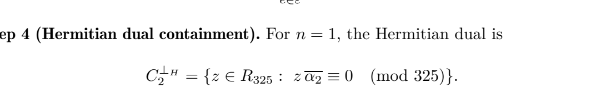

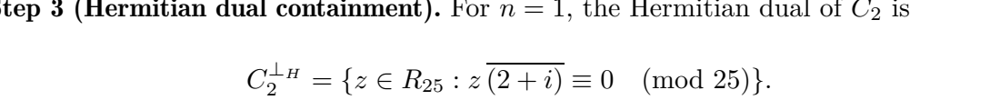

**5.2 Lemma 1 hiçbir tek tanım altında tutarlı değil** — doğru dual ile (1) yanlış, (2)–(3) doğru (`lemma1`, tüm α ∈ R için q ∈ {5, 13, 25, 65, 85}; Z325 için tüm 36 ideal):

| Özellik | Gerçek tümleyen | Tanım 6 |
|---|---|---|
| (1) gcd(N(α), q) = 1 ⇒ σ(C^⊥H) = C | **yanlış** (1/1; α birim ⇒ C = R, C^⊥H = {0}) | doğru (her durumda) |
| (2) \|C\|·\|C^⊥H\| = q² | doğru (0 ihlal) | **yanlış** (ör. Z325: 30/36 ideal) |
| (3) C1 ⊆ C2 ⇒ C2^⊥H ⊆ C1^⊥H | doğru (0 ihlal) | **yanlış** (Z325: 288/288 içerme çifti) |

**5.3 Tablo 1–2, Z9 satırı.** C1 = ⟨3⟩, C2 = Z9: C2'nin dualı {0} (boyut 1; Tablo 1: 3); Teorem 4 formülü K = 9/3 = 3 (Tablo 2: K = 1).
Z9 makalenin hipotezinin dışındadır: 9'un tek asal böleni 3 ≡ 3 (mod 4) (makalenin Tablo 1 notu da Z9'un Gauss tamsayı
halkası olmadığını, yalnızca gösterim için verildiğini söyler). Satır yine de kendi içinde tutarsızdır; ilgili iki FAIL
silinmedi, sınıfı "mathematical (paper table entry; case outside the paper's own hypothesis)" olarak güncellendi.
Remark 8 ise K'yı |C1|/|C2^⊥H| ile verir; iki formül yalnızca |C1|² = |R|ⁿ olduğunda çakışır (Z5[i]⁴'te 625² = 25⁴ olduğu için çakışıyor).

**5.4 Teorem 4'ün hipotezi.** Komütasyon için yalnızca C1 ⊆ C2 yeterlidir. Z25[i]'de C1 = ⟨10−5i⟩ ⊆ C2 = ⟨2+i⟩,
C2^⊥H ⊄ C1 çifti için stabilizerler komütatif ve kod boyutu |C2|/|C1| = 25 (iz formülü, yapısal sayım, yoğun null-space):
`phase4_supplement-20261015T005904Z-DESKTOP-RR5J4T0-84a7d8adef`. Dual-içerme koşulu bu yapı için gereksizdir — bu bir
hata değil, fazla bir varsayımdır.

**Teoremin geçerli olduğu kod sınıfı (B4).** Teorem 4 "additive codes" der; makalenin Tanım 4'ü "additive code"u
temel ideal (dolayısıyla R_Q-alt-modülü) olarak tanımlar ve teorem bu sınıfta doğrudur. Genel toplamsal kodlarda
(Z_q-alt-grupları) |C||C^⊥H| = |R|ⁿ geçerli değildir:

| kod | \|C\| | R-modül | \|C^⊥H\| | \|C^⊥Tr\| (sol) | \|C\|·\|C^⊥H\| | \|C\|·\|C^⊥Tr\| | \|R\| |
|---|---|---|---|---|---|---|---|
| C = Z_q·1 (Z25[i]) | 25 | hayır | 1 | 25 | 25 | 625 | 625 |

Toplamsal çift C1 = Z_q·1 ⊂ C2 = Z_q·1 + Z_q·5i (K = |C2|/|C1| = 5) için S = ⟨X(C1), Z(D)⟩:

| D | \|D\| | komütatif olmayan çift | kod boyutu (yapısal) | kod boyutu (yoğun) |
|---|---|---|---|---|
| hermitian dual | 1 | 0 | 25 | 25 |
| trace dual left | 5 | 0 | 5 | 5 |
| trace dual right | 5 | 80 | 0 | 0 |

Deney `review_checks-20261015T202600Z-DESKTOP-RR5J4T0-e771f0665e`.

Modül olmayan kodlarda doğru dual, komütasyon eşleşmesinin dualidir: **sol iz duali** {v : Tr⟨v, c⟩_H = 0 ∀c ∈ C}.
Makalenin izi Tr(a+bi) = a+b σ-değişmez olmadığından (Tr(σ t) = a−b) sağ iz duali {y : Tr⟨c, y⟩_H = 0} komütatif
bir grup vermez. R_Q-alt-modüllerinde üç dual (Hermitian, sol iz, sağ iz) çakışır (`test_trace_sides_agree_for_ideals`).

**5.5 Önerme 5'in ispatındaki hata (X-tipi okuma).** İspat "sıfır sendrom ⇒ operatör tüm stabilizerlerle komütatif ⇒ e_i − e_j ∈ C1"
der. X(e) hataları için komütasyon C1'e değil **normalizatöre** (C2^⊥H)^⊥H = C2'ye üyeliği verir. ε ⊂ C2 olduğundan e_i − e_j ∈ C2
her zaman sıfır sendrom üretir. Aynı karışıklık Örnek 8 "Quantum context" paragrafında vardır; Teorem 4'ün kendi 4. adımı
X(C2)/X(C1)'in **lojik operatörler** olduğunu söyler. Z(e) okumasında ise sendrom çekirdeği C1^⊥H'dir ve sonuç
(ε−ε) ∩ C1^⊥H = {0} koşuluna bağlıdır (Bölüm 8.2). Ayrıntı ve sayısal kanıt: Bölüm 8.

**Remark 4 (A6).** "Artık hata C1'dedir, dolayısıyla zararsızdır" ifadesi yanlıştır. Doğru başarı koşulu:
X tarafında artık e − ê ∈ **C1** (X-stabilizer grubu), Z tarafında artık f − f̂ ∈ **C2^⊥H** (Z-stabilizer grubu).
Sendrom eşitliği X tarafında yalnızca e − ê ∈ C2'yi, Z tarafında f − f̂ ∈ C1^⊥H'yi garanti eder; aradaki fark
(C2/C1 ve C1^⊥H/C2^⊥H) lojik operatörlerdir.

**5.6 Bölüm 4 metni.** "Z[i]/⟨2+i⟩ ile üretilen 25 elemanlı halka": Z[i]/(2+i) 5 elemanlıdır; 25 elemanlı aday
Z[i]/(5) (= Z5[i]) veya Z[i]/((2+i)²) = Z[i]/(3+4i). Her ikisi de ayrı varyant olarak simüle edildi.
**5.7 Karakter konvansiyonu (C2).** Makaleden kelimesi kelimesine (s. 10–11): "We fix a faithful additive character
χ : R_Q → ℂ×, χ(t) = exp(2πi/q · Tr(t)), where Tr : R_Q → ℤ_q is a non-degenerate ℤ_q-linear map"; Tanım 8:
"X(u)|x⟩ := |x + u⟩, Z(v)|x⟩ := χ(⟨v, x⟩_H)|x⟩"; Remark 3: "A concrete non-degenerate trace is obtained by setting
Tr(a + bi) = (a + b) mod q". Bu çalışmanın kullandığı faz exp(2πi[(c+d)a + (d−c)b]/q) (v = c+di, x = a+bi) tam olarak
Tr(v·σ(x)) = (c+d)a + (d−c)b ile **makalenin konvansiyonudur** (farklı değil). Karakter kodda tek bir yerde
(`GaussianRing.trace`) sabitlenmiştir; alternatif Tr = 2·Re (χ = ω^(2Re)) ile Bölüm 4–5 kontrolleri tekrarlandı:

| kod | Tr | Pauli bağıntısı max hata | iz duali = Hermitian dual | komütatif olmayan çift | K (yapısal / formül) | X-okuması: C2'de sıfırdan farklı sendrom | Z-okuması: farklı sendrom / \|ε\| |
|---|---|---|---|---|---|---|---|
| Z25 | paper | 4.44e-15 | ✓ | 0 | 5 / 5 | 0 | 5 / 5 |
| Z25 | 2re | 4.57e-15 | ✓ | 0 | 5 / 5 | 0 | 5 / 5 |
| Z85 | paper | 7.39e-15 | ✓ | 0 | 17 / 17 | 0 | 17 / 17 |
| Z85 | 2re | 7.17e-15 | ✓ | 0 | 17 / 17 | 0 | 17 / 17 |
| Z325 | paper | 6.15e-15 | ✓ | 0 | 5 / 5 | 0 | 5 / 5 |
| Z325 | 2re | 6.78e-15 | ✓ | 0 | 5 / 5 | 0 | 5 / 5 |

Deney `review_checks-20261015T202600Z-DESKTOP-RR5J4T0-e771f0665e`.

Kapı düzeyi devre de aynı konvansiyonla çalıştırıldı (`gate_level_css_2re-20261015T204106Z-DESKTOP-RR5J4T0-67be2ec235`, Tr = 2re): adımlar 1_math PASS, 2_encoder_B PASS, 3_cycle_B_reuse PASS, 4_negative_control_B PASS, 5_Z_reading_B PASS; tam döngü 50 çalışma, min sadakat 1 − 1.3e-15, yerel MCM çapraz kontrol max |fark| 7.77e-16.

Modüller için her iki iz aynı duali verir; kapı düzeyi devrelerde faz kestirimi çekirdeği ω^(+jk) ile ölçülen değer
s = Tr⟨f, u'⟩·p^f/q olarak **aynı Tr ile** yorumlanır (çözücü tablosu da aynı `trace` ile kurulur), bu yüzden
konvansiyon değişince çekirdeğin ω^(2jk) olması gerekmez; tutarlılık `test_X_Z_gates_match_reference_and_commutation[2re-*]`
testiyle devre düzeyinde de doğrulandı.

---

## 6. Phase 3 — AWGN simülasyonları (Şekil 1–3)

Deney: `phase3_awgn-20261015T003413Z-DESKTOP-RR5J4T0-ae42b10bbd` (GPU, 24.7 s) · Komutlar:
`python experiments/phase3_awgn.py` ve `python experiments/plot_awgn.py`

**Kategori: bağımsız yeniden kurulum (independent reconstruction).** Makale simülasyon kodunu, sembol
sayısını, tohumu ve "R_Q" takımyıldızı/alıcısını yayımlamadığı için hiçbir eğri "exact reproduction" değildir.
Kullanılan parametreler (`configs/phase3_awgn.toml`):

* Es = 1 (iletilen kümenin ortalama enerjisi; düzgün öncül), SNR = Es/N0, karmaşık AWGN σ² = N0/2 boyut başına.
* Her SNR noktası: ≥ 500 hata veya 5·10⁷ sembol; 2·10⁶'lık yığınlar; tohum = 2026 + 1000·eğri + round(1000·SNR).
* %95 Clopper–Pearson güven aralıkları; sıfır hatalı noktalar çizilmez (CSV'de üst sınır vardır).
* Alıcılar: ML (sonlu takımyıldızda en yakın nokta), "halka alıcısı" (Ek A.2: yuvarla + mod w), koset decoder
  (Bölüm 4.2: yuvarla → mod 25 → S = y mod (2+i) → ĉ = y − S).
* Doğrulama: 16/256/1024-QAM simülasyonları kapalı form SER ile güven aralığı içinde uyuşur (`test_16qam_ser_matches_closed_form_cpu`).

**Makale figürleriyle karşılaştırma** (`figures/awgn_fig{1,2,3}_side_by_side.png`; makale figürleri PDF'ten
raster olarak çıkarıldı). Makale değerleri **raster görüntüden göz ile okunmuş yaklaşık değerlerdir (≈), kesin sayı değildir.**

| Nokta | Makale (≈ görsel) | Bu çalışma |
|---|---|---|
| Şekil 1, 16-QAM, 18 dB | ≈ 6×10⁻⁴ | 5.46×10⁻⁴ |
| Şekil 1, 32-QAM, 20 dB | ≈ 2.7×10⁻³ | 2.55×10⁻³ |
| Şekil 1, 25-el. R_Q, 20 dB | ≈ 1.5×10⁻³ | 6.6×10⁻⁴ – 1.05×10⁻³ (varyanta göre) |
| Şekil 1, 25-el. R_Q, 0 dB | ≈ 0.83 | 0.82 (ML) / 0.92 (halka alıcısı) |
| Şekil 2, 256-QAM, 30 dB | ≈ 1.3×10⁻³ | 1.12×10⁻³ |
| Şekil 2, 625-el. Z25[i], 34 dB | ≈ 1.1×10⁻³ | 1.04×10⁻³ (halka) / 9.8×10⁻⁴ (ML) |
| Şekil 2, 1024-QAM, 34 dB | ≈ 1.3×10⁻² | 1.28×10⁻² |
| Şekil 3, kodsuz 625, 30 dB | ≈ 5.3×10⁻² | 5.58×10⁻² |
| Şekil 3, kodlu ⟨2+i⟩, 26 / 28 / 30 dB | ≈ 2.6×10⁻² / 5.7×10⁻³ / 5.7×10⁻⁴ | 2.76×10⁻² / 6.66×10⁻³ / 8.07×10⁻⁴ |

Gözlemler: (i) QAM referansları ve Şekil 2–3 yakın uyumludur; Şekil 3'ün kodlu eğrisinin "halka alıcısı +
koset decoder" ile yakından örtüşmesi, yazarların Ek A.2 tabanlı sert-karar alıcısını kullandığını düşündürür
(çıkarım, kanıt değil). (ii) Şekil 1'de 25 elemanlı eğrinin hangi takımyıldız/alıcıyla üretildiği belirlenemedi;
20 dB'de en yakın varyant bile ~1.4–2.3 kat düşük SER verir. (iii) Şekil 2'de 256-QAM'in 32 dB'de eksen altına
düşmesi, makaledeki sembol sayısının ~3×10⁴'ten az olduğunu düşündürür (bizde 32 dB: 2.77×10⁻⁵, 553 hata).

**Kodlama kazancı denetimi (Şekil 3).** 125 noktalı kodlu küme 6.97 bit/sembol, kodsuz 625 nokta 9.29 bit/sembol
taşır; Şekil 3 farklı hızları aynı Es/N0 ekseninde karşılaştırır. Ek eğriler: aynı 125 noktanın ML ile çözümü ve
eşit hızlı (7 bit) kodsuz çapraz 128-QAM. 125 noktalı kümenin d²min/Es = 0.0481, 128-QAM'in 0.0488'dir (geometrik
olarak eşdeğer). Gereken Es/N0 (log-doğrusal enterpolasyon, `crossings.json`):

| Sistem | bit/sembol | SER 10⁻² | SER 10⁻³ | SER 10⁻⁴ |
|---|---:|---:|---:|---:|
| Kodsuz 625, halka alıcısı | 9.29 | 32.13 dB | — | — |
| Kodlu ⟨2+i⟩, koset decoder | 6.97 | 27.48 dB | 29.81 dB | 31.39 dB |
| Aynı 125 nokta, ML | 6.97 | 25.02 dB | 26.90 dB | 28.28 dB |
| Kodsuz 128-QAM (eşit hız), ML | 7.00 | 25.00 dB | 26.88 dB | 28.22 dB |

Kodsuz 625'e göre "kazanç" 10⁻²'de 4.65 dB (Es/N0) / 3.40 dB (Eb/N0) görünür; ancak eşit hızdaki kodsuz
128-QAM'e göre koset decoder **2.48 dB (10⁻²) – 2.93 dB (10⁻³) daha kötüdür**. Kazanç kodlamadan değil hız
düşüşünden gelir; sert-karar koset decode ise aynı noktaların ML çözümüne göre ~2.9 dB kaybettirir.
Bu deneyler klasik AWGN deneyleridir; kuantum hata düzeltme başarısı olarak yorumlanamaz.

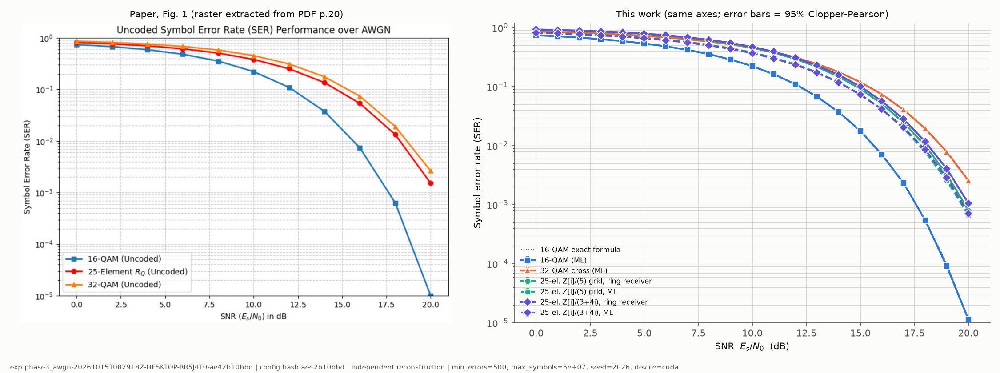

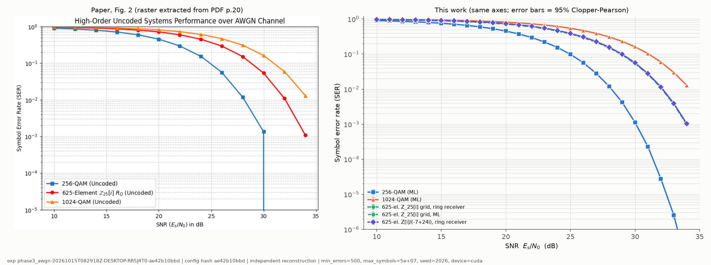

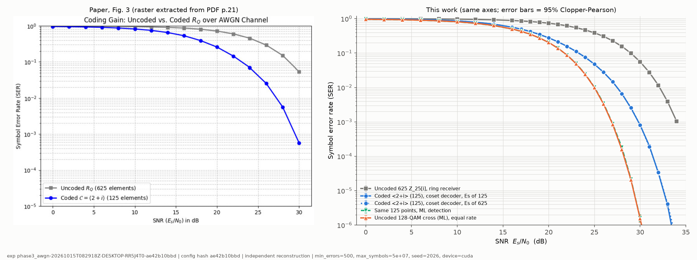

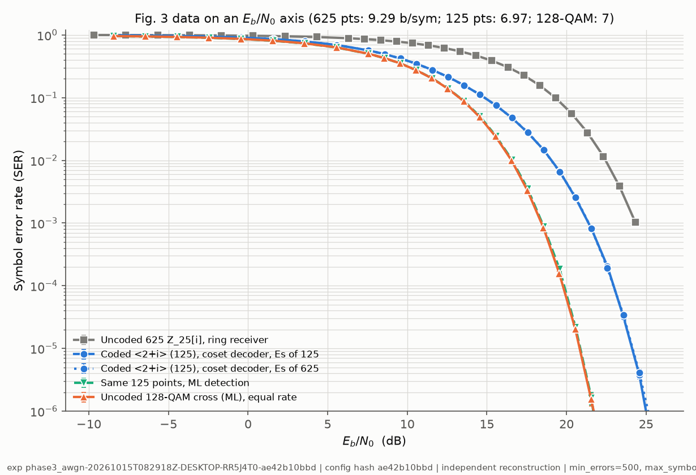

---

## 7. Phase 4 — Genelleştirilmiş Pauli ve stabilizer doğrulaması

Deney: `phase4_stabilizer-20261015T003729Z-DESKTOP-RR5J4T0-dd69ad0b68` (PASS, 1126 s). Tüm operatörler
matris-içermeyen biçimde (X: permütasyon indeksi, Z: faz vektörü) uygulandı; yoğun matris yalnızca ≤ 625 boyutta
bağımsız kontrol için kuruldu.

| Kontrol | Z5 (test) | Z25[i] | Z85[i] | Z325[i] | Z5[i]⁴ |
|---|:-:|:-:|:-:|:-:|:-:|
| Hilbert boyutu | 25 | 625 | 7225 | 105 625 | 390 625 |
| X(u) permütasyon / Z(v) birim modül | ✓ | ✓ (tüm u) | ✓ (tüm u) | ✓ (örnek) | ✓ (örnek) |
| Z(v)X(u) = χ(⟨v,u⟩_H) X(u)Z(v) | exhaustive | exhaustive (390 625 çift) | 3000 çift | 3000 çift | 3000 çift |
| Stabilizerler komütatif (C1 × C2^⊥H tüm çiftler) | ✓ | ✓ 125 | ✓ 425 | ✓ 21 125 | ✓ 15 625 |
| \|S\| = \|C1\|·\|C2^⊥H\| (farklı operatör sayısı) | 5 | 125 | 425 | 21 125 | 15 625 |
| Kod boyutu: iz formülü = yapısal = (yoğun) | 5 | 5 = 5 = 5 | 17 | 5 | 25 |
| Lojik durumlar ortonormal, stabilize | ✓ | ✓ | ✓ | ✓ | ✓ |
| P = Σ\|ψ_e⟩⟨ψ_e\| (rastgele vektörlerde) | ✓ | ✓ | ✓ | ✓ | ✓ |
| Lojik Z grubu \|C1^⊥H\|/\|C2^⊥H\| | 5 | 5 | 17 | 5 | 25 |

Maksimum sayısal hata ≤ 2×10⁻¹⁶ (komütasyon ilişkisi). Skaler katlı eleman: yalnızca özdeşlik.
**Tanım 6 dualiyle**: Z25'te 3125 çiftin 2800'ü, Z85'te 122 825'in 117 776'sı, Z325'te 13 203 125'in 13 050 000'i
komütatif değildir ve üreteçlerin ortak +1 özuzayı **0 boyutludur** (yapısal sayım; Z25'te yoğun null-space ile de 0).
K = |C2|/|C1| ifadesi yalnızca gerçek dual ile hesaplanan +1 özuzay boyutuna eşittir.

---

## 8. Phase 5 — Önerme 5 ve fiziksel hata düzeltme

Üç kavram ayrı tutuldu: (1) klasik koset üyeliği (Bölüm 4: doğru çalışıyor), (2) stabilizer ölçümüyle fiziksel
hatanın tanımlanması, (3) kodlanmış kuantum bilginin geri kazanılması.

### 8.1 Makalenin okuması: X(e), e ∈ ε ⊂ C2 (Remark 4, Tanım 10, Örnek 8)

Deney: `phase5_prop5-20261015T005713Z-DESKTOP-RR5J4T0-c31d61471e (status PASS, 1729 s)`

| Kod | dim H | K | C2 elemanı (exhaustive) | sıfırdan farklı sendrom | sendrom çekirdeği = C2 | farklı sendrom / \|ε\| | max \|⟨ψ₀\|X(e)\|ψ₀⟩\|² (e≠0) | max sadakat X(e)ψ vs ψ (e≠0) | KL sapması {X(e)} | Z(e) okuması: farklı sendrom |
|---|---|---|---|---|---|---|---|---|---|---|
| Z5_small | 25 | 5 | 25 | 0 | ✓ | 1 / 5 | 0 | 0.104 | 2.236 | 5 / 5 |
| Z25 | 625 | 5 | 125 | 0 | ✓ | 1 / 5 | 0 | 0.322 | 2.236 | 5 / 5 |
| Z85 | 7225 | 17 | 1445 | 0 | ✓ | 1 / 17 | 0 | 0.16 | 4.123 | 17 / 17 |
| Z325 | 105625 | 5 | 8125 | 0 | ✓ | 1 / 5 | 0 | 0.363 | 2.236 | 5 / 5 |
| Z5n4 | 390625 | 25 | 15625 | 0 | ✓ | 1 / 25 | 0 | 0.103 | 5 | 5 / 25 |

* Sendrom eşlemesinin çekirdeği R üzerinde exhaustive olarak **tam C2'dir** (C1 değil). Dolayısıyla tüm ε
  elemanları **aynı (sıfır) sendromu** üretir; Önerme 5 bu hata modeli için yanlıştır.
* X(e), e ∈ ε∖{0}, kod uzayını terk etmez ve lojik bir kaydırmadır: ⟨ψ₀|X(e)|ψ₀⟩ = 0. Knill–Laflamme koşulu
  {X(e) : e ∈ ε} için ihlal edilir (sapma √K: Z25'te 2.236, Z85'te 4.123) → **makalenin seçtiği X(ε) hata kümesi için
  hiçbir kurtarma işlemi yoktur** (yalnızca bu decoder değil). Bu, kodun kusuru değildir: aynı stabilizer, doğru hata
  kümesiyle sadakat 1.0 ile düzeltme yapar (8.3; kapı düzeyinde 8.6).
* Somut karşı-örnek (Z25[i]): |ψ₀⟩ = |C1⟩ = (1/5)Σ_{u∈C1}|u⟩, E = X(2+i). Tüm stabilizer üreteçleri E|ψ₀⟩ üzerinde
  özdeğer 1 verir (sendrom (0 | 0)), ama E|ψ₀⟩ = |ψ₁⟩ ve ⟨ψ₀|ψ₁⟩ = 0. Test: `test_x_errors_in_C2_are_logical_operators`.

### 8.2 Ek okuma (makalede yok): Z(e), e ∈ ε

X-tipi stabilizerlerle ölçülen Z(f) hatalarının sendrom çekirdeği C1^⊥H'dir (R üzerinde exhaustive doğrulandı).
Makalenin üç örneğinde C1^⊥H ⊆ C1 olduğundan Z(e), e ∈ ε, |ε| farklı sendrom verir ve sendrom C1+e kosetleri
üzerinde sabittir (tablodaki son sütun). Bu, Önerme 5'in **faz hatası** okumasında bu üç örnek için doğru
olabileceğini gösterir. Ancak (i) makale bu okumayı yapmaz; (ii) bağımsız Z5[i]⁴ yapılandırmasında bu okuma da
başarısızdır (25 temsilci için yalnızca 5 farklı sendrom) — yani sonuç genel değildir, ek bir koşula
(ör. (ε − ε) ∩ C1^⊥H = {0}) bağlıdır; (iii) Remark 4'teki "artık C1'de, dolayısıyla zararsız" sonucu bu okumada da
geçersizdir (Z(C1) stabilizer grubunda değildir).

**Koşulun sistematik testi (C1).** q ∈ {25, 65, 85, 125, 325} için Teorem 4 hipotezlerini sağlayan **tüm** ideal çiftleri
(C1 ⊊ C2, C2^⊥H ⊆ C1) ve Z5[i]⁴ üzerinde, dört ε seçimiyle "(ε−ε) ∩ C1^⊥H = {0} ⟺ Z(ε) \|ε\| farklı sendrom üretir"
denkliği test edildi (sendromlar C1 üreteçlerine karşı gerçek Tr⟨e, u_k⟩_H değerleri; koşul C1^⊥H koset etiketleriyle,
küçük durumlarda doğrudan fark kümesiyle):

Deney `zreading_condition-20261015T220347Z-DESKTOP-RR5J4T0-54e3c09d11` (durum PASS, 409 s; çift başına ayrıntı `pairs.csv`).

| q | ε seçimi | geçerli çift | ε transversal değil | değerlendirilen | koşul sağlanıyor | \|ε\| farklı sendrom | denklik ihlali |
|---|---|---|---|---|---|---|---|
| 25 | greedy | 14 | 0 | 14 | 9 | 9 | 0 |
| 25 | canonical | 14 | 0 | 14 | 9 | 9 | 0 |
| 25 | paper_multiples | 14 | 6 | 8 | 8 | 8 | 0 |
| 25 | random | 14 | 0 | 14 | 9 | 9 | 0 |
| 65 | greedy | 27 | 0 | 27 | 17 | 17 | 0 |
| 65 | canonical | 27 | 0 | 27 | 17 | 17 | 0 |
| 65 | paper_multiples | 27 | 11 | 16 | 16 | 16 | 0 |
| 65 | random | 27 | 0 | 27 | 16 | 16 | 0 |
| 85 | greedy | 27 | 0 | 27 | 17 | 17 | 0 |
| 85 | canonical | 27 | 0 | 27 | 17 | 17 | 0 |
| 85 | paper_multiples | 27 | 11 | 16 | 16 | 16 | 0 |
| 85 | random | 27 | 0 | 27 | 17 | 17 | 0 |
| 125 | greedy | 40 | 0 | 40 | 25 | 25 | 0 |
| 125 | canonical | 40 | 0 | 40 | 25 | 25 | 0 |
| 125 | paper_multiples | 40 | 20 | 20 | 20 | 20 | 0 |
| 125 | random | 40 | 0 | 40 | 25 | 25 | 0 |
| 325 | greedy | 102 | 0 | 102 | 62 | 62 | 0 |
| 325 | canonical | 102 | 0 | 102 | 62 | 62 | 0 |
| 325 | paper_multiples | 102 | 50 | 52 | 52 | 52 | 0 |
| 325 | random | 102 | 0 | 102 | 58 | 58 | 0 |
| 5 (n=4) | greedy | 1 | 0 | 1 | 0 | 0 | 0 |
| 5 (n=4) | random ×20 | 20 | 0 | 20 | 0 | 0 | 0 |

ε seçimleri: *greedy* = Teorem 2 (indeks sırası); *canonical* = yazarların `find_epsilon_canonical` kuralı (r·α₂, (a,b) sırasıyla, yeni koset açanlar); *paper_multiples* = {0, α₂, …, (K−1)α₂} (yalnızca transversal olduğunda); *random* = tohumlu rastgele transversal. Denklik her çiftte ve her seçimde sağlanır (ihlal sütunu); koşulun kendisi ise ε seçimine ve çifte bağlıdır — Z-okuması genel bir önerme değildir.

C1^⊥H ⊆ C1 yeterli koşuldur: ε, C2/C1'in bir transversali olduğundan i ≠ j için e_i − e_j ∉ C1 ⊇ C1^⊥H, dolayısıyla (ε−ε) ∩ C1^⊥H = {0}. Gerekli değildir: C1^⊥H ⊄ C1 olan bazı durumlarda da koşul sağlanır.

|  | değerlendirme (çift × ε seçimi) | koşul sağlanıyor | q'ya göre |
|---|---|---|---|
| C1^⊥H ⊆ C1 | 481 | 481 | q=25: 35/35, q=65: 64/64, q=85: 64/64, q=125: 95/95, q=325: 223/223 |
| C1^⊥H ⊄ C1 | 282 | 16 | q=25: 0/15, q=65: 2/33, q=85: 3/33, q=125: 0/45, q=325: 11/135, q=5 (n=4): 0/21 |

Makalenin kendi ayarında (n = 1, Teorem 4 hipotezleri) karşı-örnek: Z25[i]'de C1 = ⟨10−5i⟩ ⊂ C2 = ⟨2−i⟩ (K = 25). Burada C1^⊥H = C2 (ve C2^⊥H = C1); ε ⊂ C2 olduğundan ε − ε ⊂ C1^⊥H, yani her Z(e) tüm X-tipi üreteçlerle değişir ve sendromu 0'dır. Bu çift için Z-okuması hiçbir ε seçiminde sağlanmaz. Veride: 3 ε seçimi (greedy, canonical, random), her birinde \|ε\| = 25 ve 1 farklı sendrom; C1^⊥H = C2 eşitliği `hermitian_dual` ile ayrıca doğrulandı. Konjuge çift (⟨10+5i⟩ ⊂ ⟨2+i⟩) aynı sonucu verir.

### 8.3 Alternatif tasarım (makalenin sonucu DEĞİL, ayrı deneysel öneri)

Aynı Teorem 4 stabilizer grubu için düzeltilebilir hata kümesi standart CSS mantığıyla seçildi:
X(a), a ∈ T_X (R/C2 transversali, en küçük Lee ağırlığı) ve Z(b), b ∈ T_Z (R/C1^⊥H transversali).
\|T_X\| = \|C2^⊥H\|, \|T_Z\| = \|C1\|. Z25'te T_X = {0, ±1, ±i}.

Deney: `phase5_prop5-20261015T005713Z-DESKTOP-RR5J4T0-c31d61471e`

| Kod | \|T_X\| | \|T_Z\| | test edilen (a,b) | tam düzeltilen | min sadakat | KL sapması | ağırlık-2 X hatası düzeltilen |
|---|---|---|---|---|---|---|---|
| Z5_small | 1 | 5 | 5 (exhaustive) | 5 | 1 | 2.22e-16 (exhaustive) | 0 / 8 |
| Z25 | 5 | 25 | 125 (exhaustive) | 125 | 1 | 4.44e-16 (exhaustive) | 0 / 8 |
| Z85 | 5 | 85 | 425 (exhaustive) | 425 | 1 | 5.66e-16 (sampled 3000 pairs) | 0 / 8 |
| Z325 | 13 | 1625 | 21125 (exhaustive) | 21125 | 1 | 1.31e-16 (sampled 3000 pairs) | 8 / 8 |
| Z5n4 | 25 | 625 | 400 (sampled 400) | 400 | 1 | 1.50e-17 (sampled 60 pairs) | 16 / 128 |

Son sütun karşılaştırma içindir: ağırlık-2 X-hataları, T_X onları içermiyorsa düzeltilemez (beklenen; Z25 ve Z85'te T_X yalnızca {0, ±1, ±i}); Z325'te T_X 13 elemanlıdır ve tüm ağırlık-≤2 kaymaları içerdiği için hepsi düzeltildi; Z5n4'te kısmen.

### 8.4 PennyLane devreleri

Deney: `phase5_pennylane-20261015T004417Z-DESKTOP-RR5J4T0-ea5245775d (942 s, süreç tepe çalışma kümesi 2208.9 MB)` · cihaz `lightning.qubit` (PennyLane 0.45.1)

* **Kodlama (önemli kısıt — bu bölüm, Düzen A)**: Bu bölümdeki deneylerde lojik durumlar tüm kayıt üzerinde
  `qml.StatePrep` ile **genlik yükleme** yoluyla hazırlandı (Z325'te 2²⁴ genlik); bu bir kapı-düzeyi kodlayıcı değildir.
  Kapı düzeyi kodlayıcı daha sonra **Düzen B** (split koordinatlar) için yazıldı ve doğrulandı (Bölüm 8.6); Düzen A
  için kapı düzeyi kodlayıcı yoktur. Bu bölümde kapı düzeyinde olan kısımlar: Pauli hataları X(u)/Z(v), sendrom
  çıkarımı ve kurtarma.
* **Gömme**: x = a + bi → |a⟩_re|b⟩_im, her kayıt ⌈log₂q⌉ kubit (Z25: 10, Z85: 14, Z325: 18 veri kubiti).
  Görevde önerilen 10/13/17 kubit, yoğun a·q+b kodlamasına karşılık gelir; o kodlamada X(u) ayrışmayan bir
  mod-q² toplamaya dönüştüğü için kullanılmadı.
* **X(u)** = `qml.Adder(c, re, mod=q)` · `qml.Adder(d, im, mod=q)` (2 yardımcı kubit). **Z(v)** = her veri kubitine bir
  `PhaseShift` (faz χ(⟨v,x⟩_H) = exp(2πi[(c+d)a + (d−c)b]/q) bit ağırlıklarına ayrışır). Yoğun üniter kullanılmadı.
* **PennyLane'de hazır olmayanlar**: Z_N Fourier dönüşümü (N ≠ 2ᵏ) → X-sendromu için yalnızca ancilla kaydında
  küçük bir `QubitUnitary` (Z25: 32×32, Z85: 128×128); qudit-üstü (d > 3) cihaz ve genelleştirilmiş Pauli kapıları
  yok (kubit gömmesi gerekli).

**Devre şemaları** (Z25[i]; `experiments/draw_circuits.py`, Phase 5'te simüle edilen aynı `RingCircuits` yöntemleriyle
çizildi; tel adları: re0..re4 = a'nın bitleri, im0..im4 = b'nin bitleri, sZ/sX = sendrom ancilla'ları, w0/w1 = Adder
yardımcı kubitleri):

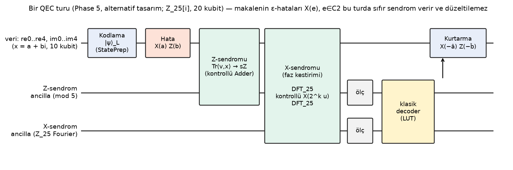

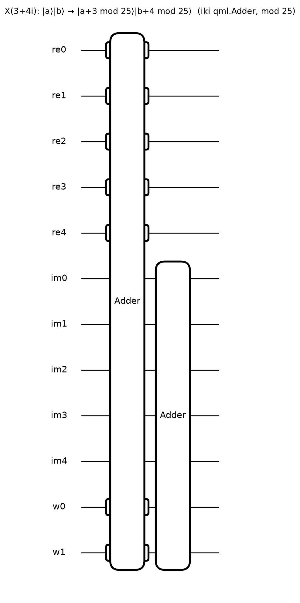

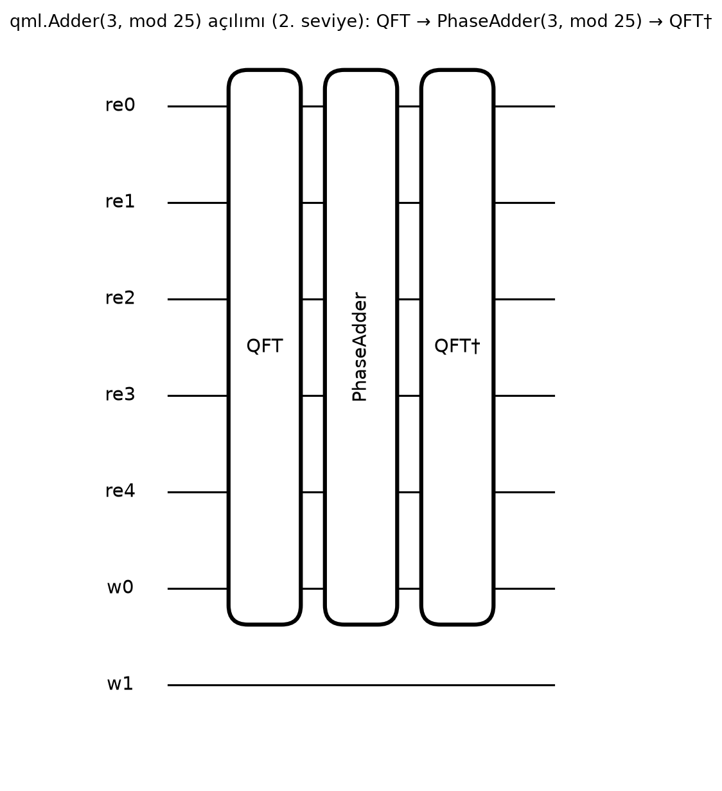

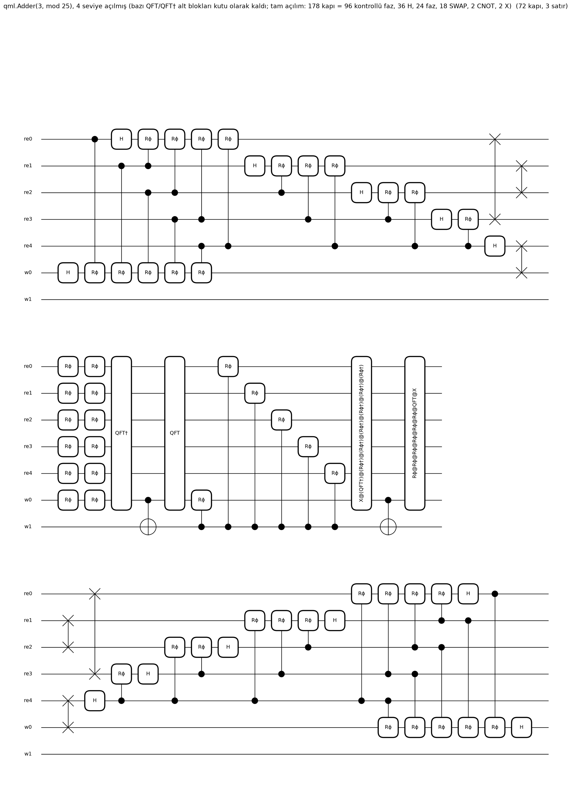

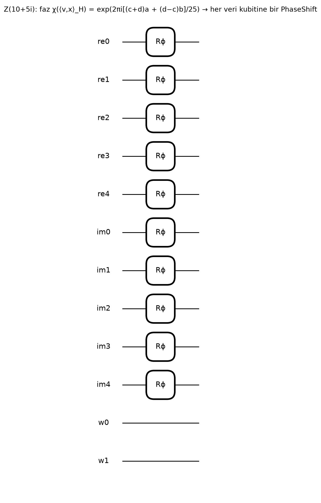

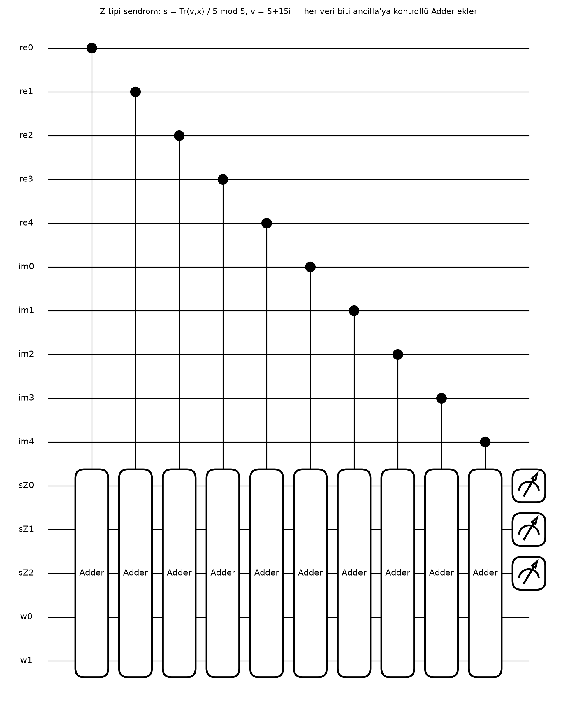

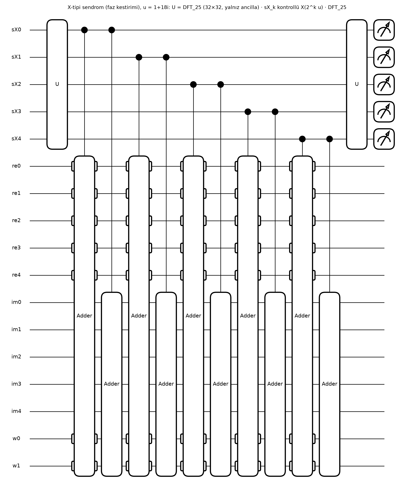

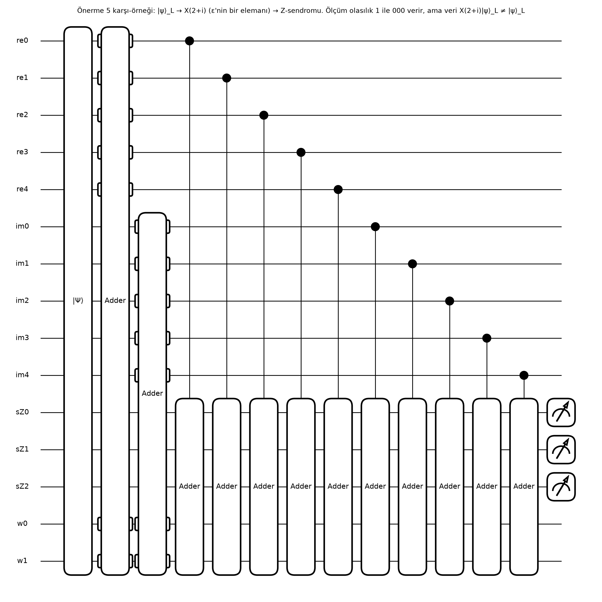

**(a) `qml.Adder` sızıntı testi** (her taban girdisi; yardımcı kubitler |00⟩):

| Halka | kayıt kubiti | k sayısı | geçerli girdi doğru | yardımcılar temiz | geçersiz girdi sayısı | geçersiz → geçersiz kalır | yöntem |
|---|---|---|---|---|---|---|---|
| Z25 | 5 | 25 | ✓ | ✓ | 7 | hayır | qml.matrix (dense, verification only) |
| Z85 | 7 | 85 | ✓ | ✓ | 43 | hayır | qml.matrix (dense, verification only) |
| Z325 | 9 | 6 | ✓ | ✓ | 187 | hayır | basis-state simulation, lightning.qubit |

Geçerli hesaplama altuzayından sızıntı yoktur. Geçersiz girdiler (a ≥ q) geçerli bölgeye dönebilir ve yardımcı kubitleri kirli bırakabilir — gürültü bir durumu altuzay dışına itmişse sonraki aritmetik onu tanımsız biçimde geri getirebilir (Bölüm 9'daki sızıntı ölçümü).

**(b) Kapı ayrıştırmaları vs. matris-içermeyen referans** (rastgele ring durumları):

| Halka | tel | X(u) max hata | Z(v) max hata | sızıntı/kirli yardımcı |
|---|---|---|---|---|
| Z25 | 12 | 1.49e-15 | 2.11e-16 | 1.29e-14 |
| Z85 | 16 | 6.43e-16 | 1.12e-16 | 1.77e-14 |
| Z325 | 20 | 2.17e-15 | 3.84e-17 | 2.58e-14 |

**(c) Devre içinde Önerme 5** (rastgele lojik durum → X(e), e ∈ ε → Z-tipi sendrom ancilla'ya):

| Halka | durum | tel | ölçülen farklı sendrom / \|ε\| | min sendrom olasılığı | min sadakat(veri, X(e)ψ) | max sadakat(veri, ψ) e≠0 | toplam s |
|---|---|---|---|---|---|---|---|
| Z25 | RUN | 15 | 1 / 5 | 1 | 1 | 0.00737 | 1.75 |
| Z85 | RUN | 19 | 1 / 17 | 1 | 1 | 0.231 | 14.8 |
| Z325 | RUN | 24 | 1 / 5 | 1 | 1 | 0.225 | 313 |

**(d) X-tipi sendrom (faz kestirimi, DFT_N ancilla) — Z(f) hataları, f ∈ T_Z:**

| Halka | durum | tel | ancilla mertebesi | cebirle uyum | hata sayısı | toplam s |
|---|---|---|---|---|---|---|
| Z25 | RUN | 17 | [25] | ✓ | 8 | 4.74 |
| Z85 | RUN | 23 | [85] | ✓ | 8 | 430 |

**(e) Tam QEC döngüsü — ALTERNATİF TASARIM** (X(a)Z(b) → iki sendrom orta-devre ölçümü → `qml.cond` ile geri besleme → veri yoğunluk matrisi):

| Halka | durum | tel | MCM yöntemi | (a,b) çifti | min sadakat |
|---|---|---|---|---|---|
| Z25 | RUN | 20 | deferred | 12 | 1 |

**(f) Kaynak sayımı** (ayrıştırılmış kapı kümesi; X-sendrom turu Z325 için yalnızca sayıldı, simüle edilmedi):

| Halka | devre | tel | kapı | derinlik | Toffoli | QubitUnitary |
|---|---|---|---|---|---|---|
| Z25 | X(u) one generator | 20 | 356 | 172 | 0 | 0 |
| Z25 | Z(v) one generator | 20 | 10 | 1 | 0 | 0 |
| Z25 | Z-type syndrome round | 20 | 4907 | 4174 | 140 | 1600 |
| Z25 | X-type syndrome round | 20 | 10578 | 9034 | 200 | 3842 |
| Z85 | X(u) one generator | 26 | 568 | 224 | 0 | 0 |
| Z85 | Z(v) one generator | 26 | 14 | 1 | 0 | 0 |
| Z85 | Z-type syndrome round | 26 | 6865 | 5839 | 196 | 2240 |
| Z85 | X-type syndrome round | 26 | 25787 | 22160 | 364 | 9858 |
| Z325 | X(u) one generator | 36 | 414 | 138 | 0 | 0 |
| Z325 | Z(v) one generator | 36 | 18 | 1 | 0 | 0 |
| Z325 | Z-type syndrome round | 36 | 13272 | 11395 | 252 | 4680 |
| Z325 | X-type syndrome round | 36 | 59683 | 51539 | 672 | 23524 |

**Bu fazda kendi kodumda bulunan hata**: ilk çalıştırmada X(u) devresi süperpozisyon girdisinde referanstan 0.18
saptı; neden: kuyruk bağlamında oluşturulan `qml.Adder` ikinci kez `qml.apply` ile kuyruğa eklenmişti (X(2u)).
Referans karşılaştırma testi yakaladı; düzeltildi; FAIL kaydı silinmedi
(`phase5_pennylane-20261015T004245Z-DESKTOP-RR5J4T0-9a87023139`). Sınıf: implementation (this project).

### 8.5 lightning.gpu (cuStateVec) — WSL2 Ubuntu

Windows'ta kurulamayan `pennylane-lightning-gpu` aynı makinedeki WSL2 Ubuntu 26.04 içinde kuruldu
(`wsl/setup_wsl_gpu.sh`; Python 3.12, aynı paket sürümleri, torch 2.11 cu128, custatevec-cu12). Windows'ta
genişlik nedeniyle çalıştırılamayan devreler burada GPU'da koşturuldu; sonuçlar aynı `results/` ağacına yazıldı.
Z325 X-sendromu tek devrede 32 tel gerektirdiği için her X-üreteci ayrı devrede ölçüldü (Pauli hatalı durumlar
ortak özdurum olduğundan her sendrom biti deterministiktir; eşdeğer ölçüm). Büyük döngüde geri besleme koherent
(ancilla kayıtlarına koşullu düzeltme kapıları; ertelenmiş ölçüm ilkesi) uygulandı.

Deney: `phase5_pennylane_gpu-20261015T090000Z-DESKTOP-RR5J4T0-bbdaa60415` (durum PASS, 1692 s) · platform `Linux-6.18.54.1-microsoft-standard-WSL2-x86_64-with-glibc2.43` · PennyLane 0.45.1 · cihaz `lightning.gpu` · complex128 · GPU NVIDIA GeForce RTX 5060 Ti

| halka | devre | tel | sonuç | toplam s |
|---|---|---|---|---|
| Z25 | X/Z kapıları vs referans | 12 | 1.10e-15 / 2.94e-16 | 0.367 |
| Z85 | X/Z kapıları vs referans | 16 | 7.61e-16 / 5.74e-17 | 0.29 |
| Z325 | X/Z kapıları vs referans | 20 | 1.74e-15 / 4.07e-17 | 0.804 |
| Z25 | Önerme 5 (X(e), Z-sendromu) | 15 | 1/5 sendrom; min sadakat X(e)ψ 1 | 1.75 |
| Z85 | Önerme 5 (X(e), Z-sendromu) | 19 | 1/17 sendrom; min sadakat X(e)ψ 1 | 9.24 |
| Z325 | Önerme 5 (X(e), Z-sendromu) | 24 | 1/5 sendrom; min sadakat X(e)ψ 1 | 18.8 |
| Z25 | X-sendromu (all generators in one circuit) | [17] | cebirle uyum ✓, 8 hata | 1.85 |
| Z85 | X-sendromu (all generators in one circuit) | [23] | cebirle uyum ✓, 8 hata | 17.1 |
| Z325 | X-sendromu (one circuit per generator) | [23, 29] | cebirle uyum ✓, 8 hata | 1.46e+03 |
| Z25 | tam döngü, qml.measure + qml.cond | 20 | min sadakat 1, 6 çift | 5.36 |
| Z25 | tam döngü, koherent geri besleme | 20 | min sadakat 1, 4 çift | 2.31 |
| Z85 | tam döngü, koherent geri besleme | 26 | min sadakat 1, 4 çift | 84 |

**Cihaz karşılaştırması** (aynı devre, aynı WSL2 ortamı; `bench_pennylane_devices-20261015T092814Z-DESKTOP-RR5J4T0-cc0f358284`; GPU belleği nvidia-smi ile cihaz geneli, ekran ve diğer süreçler dahil):

| devre | tel | cihaz | hassasiyet | en iyi s | hızlanma vs lightning.qubit | sadakat vs lightning.qubit c128 | GPU kullanılan MB |
|---|---|---|---|---|---|---|---|
| Z25 Prop.5 Z-syndrome round | 15 | lightning.qubit | complex128 | 0.0718 | 1 | 1 | — |
| Z25 Prop.5 Z-syndrome round | 15 | lightning.gpu | complex128 | 0.158 | 0.455 | 1 | 1.64e+03 |
| Z25 Prop.5 Z-syndrome round | 15 | lightning.gpu | complex64 | 0.123 | 0.582 | 0.999988747685 | 1.64e+03 |
| Z85 Prop.5 Z-syndrome round | 19 | lightning.qubit | complex128 | 0.356 | 1 | 1 | — |
| Z85 Prop.5 Z-syndrome round | 19 | lightning.gpu | complex128 | 0.219 | 1.63 | 1 | 1.65e+03 |
| Z85 Prop.5 Z-syndrome round | 19 | lightning.gpu | complex64 | 0.187 | 1.91 | 0.999981286951 | 1.66e+03 |
| Z85 X-syndrome round (phase estimation) | 23 | lightning.qubit | complex128 | 27.4 | 1 | 1 | — |
| Z85 X-syndrome round (phase estimation) | 23 | lightning.gpu | complex128 | 2.14 | 12.8 | 1 | 1.74e+03 |
| Z85 X-syndrome round (phase estimation) | 23 | lightning.gpu | complex64 | 1.07 | 25.7 | 0.999969621041 | 1.68e+03 |
| Z325 Prop.5 Z-syndrome round | 24 | lightning.qubit | complex128 | 46.2 | 1 | 1 | — |
| Z325 Prop.5 Z-syndrome round | 24 | lightning.gpu | complex128 | 3.32 | 13.9 | 1 | 1.87e+03 |
| Z325 Prop.5 Z-syndrome round | 24 | lightning.gpu | complex64 | 1.84 | 25.1 | 0.999970654581 | 1.74e+03 |

### 8.6 Kapı düzeyi CSS simülasyonu — Düzen A ve Düzen B (kodlayıcı, sıralı sendrom, kurtarma)

Deney `gate_level_css-20261015T201001Z-DESKTOP-RR5J4T0-ffe8a2b77f` (durum PASS, 284 dk) · PennyLane 0.45.1 · cihaz `lightning.qubit` · karakter Tr = paper · `experiments/gate_level_css.py`, `src/epsqec/pl_circuits/split_layout.py`, `cycle.py`.

**Düzen B (split koordinatlar).** CRT + ayırma ile Z_q[i] ≅ Π_b Z_{p^e} × Z_{p^e}, a+bi ↦ (a+s·b, a−s·b), s² ≡ −1 (Z25'te s = 7). Bu bir **halka izomorfizmidir** (çarpım bileşen bazında; σ bileşenleri takas eder) — Z25 ve Z65'te tüm çiftlerde doğrulandı. Her bileşen taban-p rakamlarla yazılır; her rakam ⌈log₂p⌉ kubitte (p = 5: 3 kubit, 3 geçersiz seviye). Her ideal rakam başına bir p-kuvveti idealidir, dolayısıyla C1 ⊆ C2 için her rakam **ölü** (hep 0), **etiket** (lojik rakam) veya **serbest** (düzgün) olur ve kod durumu rakamlar üzerinde çarpım durumudur. **Kodlayıcı**: serbest → DFT_p (yalnızca o rakamın kubitleri üzerinde QubitUnitary), etiket → lojik telden "taşıma" (CSHIFT(L→etiket), CSHIFT⁻¹(etiket→L); L |0⟩'a döner), ölü → kapı yok. Tüm küçük bloklar geçersiz seviyelerde birimdir (sızıntı yok). **X(u)**: rakam bazında sabit ekleme (taşımalar kontrollü kaydırmalarla). **Z(v)**: her kubite bir PhaseShift (faz χ(⟨v,x⟩_H), Tr = makalenin izi). **Sendromlar**: Z-tipi = Tr⟨v,x⟩ değerinin rakam ancilla'larına kontrollü sabit eklemelerle birikimi; X-tipi = her asal kuvvet p^f için X(u') faz kestirimi (rakam başına DFT_p, kontrollü X(c·p^pos·u'), taban-p Fourier dönüşümü: f = 2 için DFT_p, ikiz faz (ControlledPhaseShift), DFT_p — yoğun 25×25 DFT ile birebir aynı).

**Orta-devre ölçümü.** Sendromlar **sıralı** ölçülür (sıra parametre: ZX = önce Z-tipi + X-düzeltmesi, sonra X-tipi + Z-düzeltmesi; XZ = tersi); ölçülen ancilla ölçülen değere çöker, kod çözme bu değerden yapılır; ortak ancilla yeniden kullanıldığında açıkça sıfırlanır (`reset=True`), ayrı kayıt varyantında sıfırlanmaz. Doğrulama **gidiş-dönüş** ile: girdi U_in|0⟩ (taban durumu ya da Möttönen ile rastgele süperpozisyon) → kodlayıcı → hata → sendromlar → düzeltme → kod çözücü → U_in† ; P(L = 0, veri = 0) tam olarak lojik sadakattir. Motor: PennyLane-yerel MCM `lightning.qubit` üzerinde çöktü (faz kestiriminden sonra ~10⁻³¹ olasılıklı sayısal gürültü dalını normalize etmeye çalışıyor); bu yüzden asıl motor, Lightning üzerinde **kesin segmentli simülasyon** (her ölçümde durum vektöründen kesin dağılım, çöküş + isteğe bağlı sıfırlama, ölçülen değerle klasik ileri besleme; atılan olasılık kütlesi raporlanır), ve her kodda rastgele çalışmalar **PennyLane-yerel MCM** (`default.qubit`, tree-traversal, `qml.measure`/`qml.cond`) ile yeniden simüle edildi. Segmentli motor, her orta-devre ölçümünden sonra çökmüş (ve gerekiyorsa sıfırlanmış) durumu bir sonraki segmentin başında `qml.StatePrep` ile yeniden yükler. Bu bir simülasyon kontrol noktasıdır, kodlayıcı değildir (kodlayıcı tamamen kapı düzeyidir); PennyLane-yerel MCM çapraz kontrolünde StatePrep yoktur ve iki motor aynı dağılımı verir.

| halka | adım | durum | sonuç | s |
|---|---|---|---|---|
| Z25 | 1_math | PASS | komütatif olmayan 0, K 5/5, Gram−I 2.22e-16, kapalı form dual ✓ | 7.54e-04 |
| Z25 | 2_encoder_B | PASS | en kötü sadakat 1 (sapma < 10⁻¹⁵), süperpozisyon 1 + 1.3e-15, sızıntı 0; tel: veri 12, L 3, ancilla 6 | 0.538 |
| Z25 | 3_cycle_B_reuse | PASS | tüm (a,b) çifti × 2 sıra + süperpozisyonlar = 300 çalışma; F = 1 olan 300/300, min F 1 − 2.0e-15; 21 tel; atılan olasılık ≤ 5.79e-31; yerel MCM çapraz kontrol 12 çalışma, max \|fark\| 1.11e-15 | 505 |
| Z25 | 3_cycle_B | PASS | örneklenen 40/125 (a,b) çifti × 2 sıra + süperpozisyonlar = 130 çalışma; F = 1 olan 130/130, min F 1 − 2.2e-15; 24 tel; atılan olasılık ≤ 5.64e-31; yerel MCM çapraz kontrol 2 çalışma, max \|fark\| 1.67e-15 | 1.06e+03 |
| Z25 | 3_cycle_A | PASS | tüm (a,b) çifti × 2 sıra + süperpozisyonlar = 300 çalışma; F = 1 olan 300/300, min F 1 − 9.0e-14; 20 tel; atılan olasılık ≤ 1.54e-28 | 1.08e+03 |
| Z25 | 4_negative_control_B | PASS | 4 hata X(e), e ∈ ε∖{0}: tüm sendromlar 0 ✓, max \|⟨ψ₀\|X(e)\|ψ₀⟩\|² = 0 → Önerme 5 karşı-örneği yeniden üretildi | 2.51 |
| Z25 | 5_Z_reading_B | PASS | Z(e), e ∈ ε: 5/5 farklı sendrom; (ε−ε)∩C1^⊥H = {0}: evet; denklik ✓; ölçülen = beklenen ✓ | 1.05 |
| Z65 | 1_math | PASS | komütatif olmayan 0, K 5/5, Gram−I 6.66e-16, kapalı form dual ✓ | 0.00321 |
| Z65 | 2_encoder_B | PASS | en kötü sadakat 1 (sapma < 10⁻¹⁵), süperpozisyon 1 (sapma < 10⁻¹⁵), sızıntı 0; tel: veri 14, L 3, ancilla 4 | 0.579 |
| Z65 | 3_cycle_B_reuse | PASS | örneklenen 40/845 (a,b) çifti × 2 sıra + süperpozisyonlar = 130 çalışma; F = 1 olan 130/130, min F 1 − 1.8e-15; 21 tel; atılan olasılık ≤ 2.58e-30; yerel MCM çapraz kontrol 12 çalışma, max \|fark\| 2.00e-15 | 982 |
| Z65 | 4_negative_control_B | PASS | 4 hata X(e), e ∈ ε∖{0}: tüm sendromlar 0 ✓, max \|⟨ψ₀\|X(e)\|ψ₀⟩\|² = 0 → Önerme 5 karşı-örneği yeniden üretildi | 5.41 |
| Z65 | 5_Z_reading_B | PASS | Z(e), e ∈ ε: 5/5 farklı sendrom; (ε−ε)∩C1^⊥H = {0}: evet; denklik ✓; ölçülen = beklenen ✓ | 2.49 |
| Z85 | 1_math | PASS | komütatif olmayan 0, K 17/17, Gram−I 5.55e-16, kapalı form dual ✓ | 0.00814 |
| Z85 | 2_encoder_B | PASS | en kötü sadakat 1 (sapma < 10⁻¹⁵), süperpozisyon 1 + 1.3e-15, sızıntı 0; tel: veri 16, L 5, ancilla 5 | 159 |
| Z85 | 3_cycle_B_reuse | PASS | örneklenen 30/425 (a,b) çifti × 2 sıra + süperpozisyonlar = 80 çalışma; F = 1 olan 80/80, min F 1 − 2.4e-15; 26 tel; atılan olasılık ≤ 1.07e-29; yerel MCM çapraz kontrol 1 çalışma, max \|fark\| 2.22e-16 | 1.22e+04 |
| Z85 | 4_negative_control_B | PASS | 16 hata X(e), e ∈ ε∖{0}: tüm sendromlar 0 ✓, max \|⟨ψ₀\|X(e)\|ψ₀⟩\|² = 0 → Önerme 5 karşı-örneği yeniden üretildi | 699 |
| Z85 | 5_Z_reading_B | PASS | Z(e), e ∈ ε: 17/17 farklı sendrom; (ε−ε)∩C1^⊥H = {0}: evet; denklik ✓; ölçülen = beklenen ✓ | 266 |

Düzen A satırları (3_cycle_A): ikili |a⟩|b⟩ kayıtları, X(u) = `qml.Adder`, aynı sıralı sendrom/düzeltme; Düzen A için kapı düzeyi kodlayıcı yoktur, giriş/çıkış Möttönen durum hazırlamasıyla yüklendi (sadakatteki ~10⁻¹³ sapma bu hazırlamanın yuvarlamasından gelir).

**Düzen B devre şemaları (Z25[i])** — `experiments/draw_circuits.py`, simülasyondaki aynı `SplitCircuits` yöntemleriyle; tel adları rakam adlarıdır (U5d1 = U bileşeni, p = 5, rakam 1):

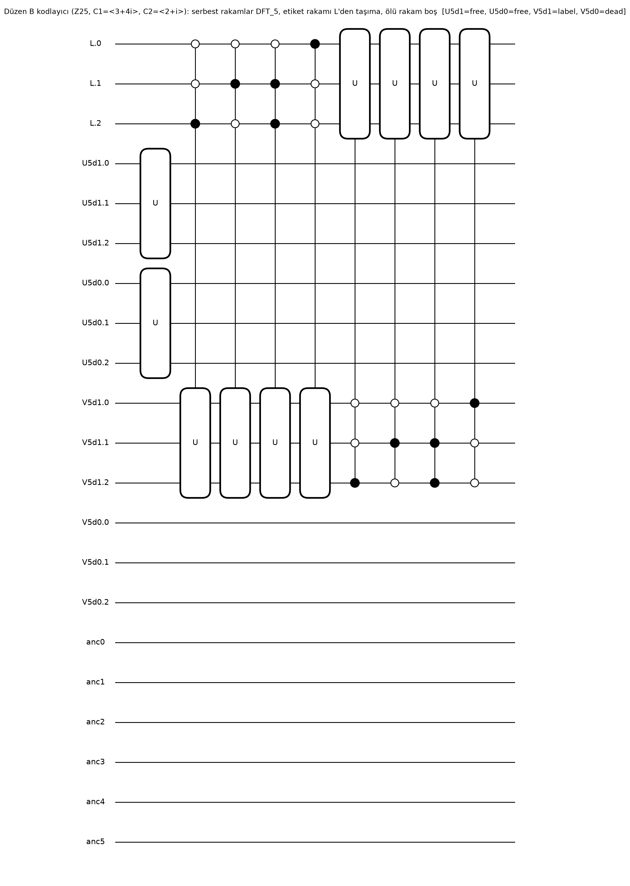

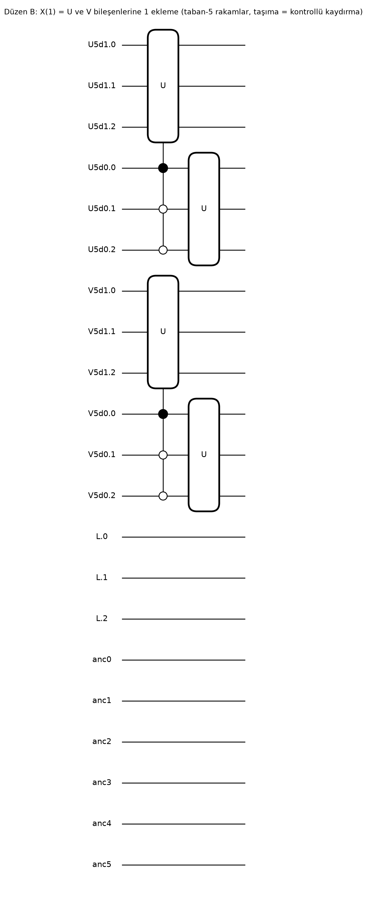

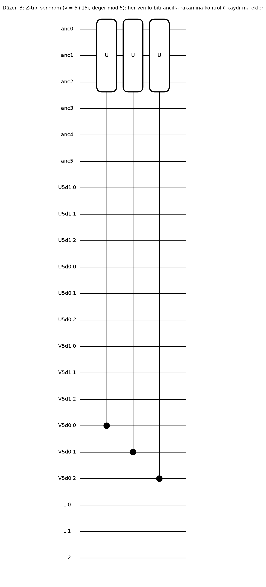

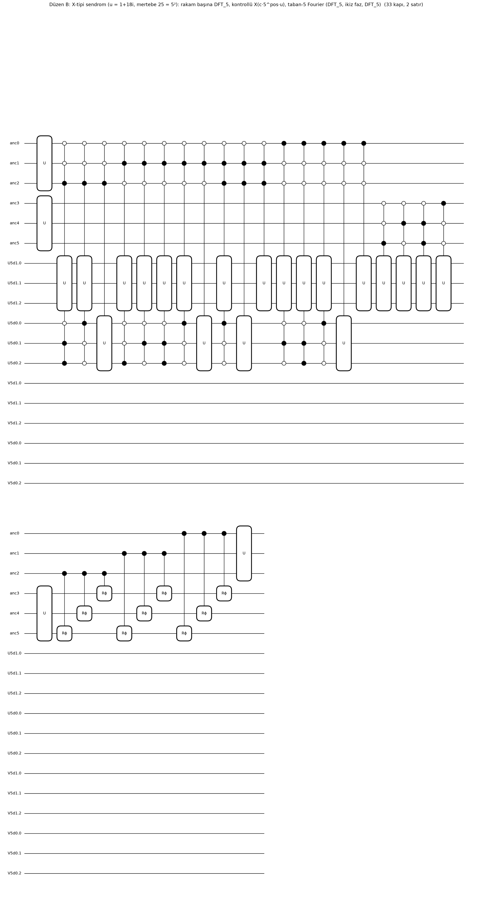

---

## 9. Phase 6 — Gürültü deneyleri

**Gürültü modeli: kod-kapasitesi.** Her fiziksel kubite bir kez bağımsız tek-kubit kanal uygulanır; kodlama,
sendrom çıkarımı ve kurtarma idealdir. Kapı sayıları ayrıca raporlanır (aşağıda) — gürültülü kapılar modellenmedi.

**Karşılaştırmanın kapsamı (B3).** (i) 10 kubitlik halka kodunu 3 kubitlik kodlamasız sistemle karşılaştırmak kaynak
bakımından adil değildir; bu yüzden aşağıda aynı kayıt ve aynı kubit sayısıyla kodlamasız referanslar da verildi.
(ii) İkili gömmede bit-flip'lerin çoğu halka elemanında büyük bir sıçramadır (Düzen A: a'nın en anlamlı biti ±16; yalnızca
a ve b'nin en düşük bitleri ±1/±i kaymasıdır; Düzen B: bir rakam içinde ±1, ±2, ±4 ya da geçersiz seviye); kod ise birim kaymalara (±1, ±i) göre tasarlanmıştır. "Halka kodu kodlamasızdan
kötü" sonucu bu gömmeye özgüdür. (iii) Kodun tasarlandığı qudit düzeyi birim-kayma gürültüsünde sonuç terstir:

Deney `noise_layouts-20261016T005404Z-DESKTOP-RR5J4T0-a65fa71371` (kapı düzeyi kaynak: `gate_level_css-20261015T201001Z-DESKTOP-RR5J4T0-ffe8a2b77f`; adımlar 1–5 geçenler: Z25, Z65, Z85).

| kod | dim | K | p | **kod: birim-kayma** | kodlamasız K-qudit (birim-kayma) | kodlamasız halka qudit'i (birim-kayma) | kod: qudit depolarizasyon | kodlamasız K-qudit depol. |
|---|---|---|---|---|---|---|---|---|
| Z25 | 625 | 5 | 0.001 | 1.00e-06 | 0.002 | 0.00399 | 9.60e-04 | 0.001 |
| Z25 | 625 | 5 | 0.01 | 1.00e-04 | 0.0199 | 0.0394 | 0.0096 | 0.01 |
| Z25 | 625 | 5 | 0.1 | 0.01 | 0.19 | 0.344 | 0.096 | 0.1 |
| Z65 | 4225 | 5 | 0.001 | 0 | 0.002 | 0.00399 | 9.60e-04 | 0.001 |
| Z65 | 4225 | 5 | 0.01 | 0 | 0.0199 | 0.0394 | 0.0096 | 0.01 |
| Z65 | 4225 | 5 | 0.1 | 0 | 0.19 | 0.344 | 0.096 | 0.1 |
| Z85 | 7225 | 17 | 0.001 | 1.00e-06 | 0.002 | 0.00399 | 9.97e-04 | 0.001 |
| Z85 | 7225 | 17 | 0.01 | 1.00e-04 | 0.0199 | 0.0394 | 0.00997 | 0.01 |
| Z85 | 7225 | 17 | 0.1 | 0.01 | 0.19 | 0.344 | 0.0997 | 0.1 |

Birim-kayma modeli: her X- ve Z-koordinatı (gerçel/sanal) bağımsız olarak p olasılıkla ±1 kayar. Kodlamasız K-qudit: aynı model, bir X ve bir Z koordinatı (LER = 1 − (1−p)²). Depolarizasyonda qudit düzeyinde avantaj ihmal edilebilir düzeydedir: LER = p·(1 − (N_X·N_Z − 1)/(d² − 1)); Z25 ve Z65'te ≈ 0.96·p, Z85'te ≈ 0.997·p (kod d² Pauli'nin yalnızca N_X·N_Z tanesini düzeltir; rastgele Pauli'lerin çoğu birim kayma değildir).

Monte Carlo (p = 0.05) kesin değere karşı:

| kod | cihaz | deneme | MC LER | kesin | kesin %95 GA içinde | s |
|---|---|---|---|---|---|---|
| Z25 | cpu | 40000 | 0.002 | 0.0025 | ✗ | 0.643 |
| Z25 | cuda | 40000 | 0.002 | 0.0025 | ✗ | 0.317 |
| Z65 | cpu | 20000 | 0 | 0 | ✓ | 2.5 |
| Z65 | cuda | 20000 | 0 | 0 | ✓ | 0.233 |
| Z85 | cpu | 20000 | 0.00255 | 0.0025 | ✓ | 4.43 |
| Z85 | cuda | 20000 | 0.00255 | 0.0025 | ✓ | 0.503 |

Bu tablodaki çalıştırma durumu (PASS) yalnızca çalıştırmanın tamamlandığını gösterir; istatistiksel kontrol GA sütunu ve aşağıdaki bağımsız tohum takibidir.

Z25 satırında kesin değer %95 GA'nın hemen dışında kaldı (CPU ve GPU aynı tohumu kullandığı için tek bir örnek). Bağımsız tohumlarla takip (`mc_seed_check-20261016T011645Z-DESKTOP-RR5J4T0-08a0c41aff`): 10 tohum × 40 000 deneme, birleşik LER 0.00256 vs kesin 0.0025 (z = 0.73), kesin değer birleşik GA içinde; 10 tohumun 10'unda GA kesin değeri içeriyor → istatistiksel dalgalanma, simülatörde yanlılık yok.

**Birim-kayma desenleri ve depolarizasyon için düzeltilebilir Pauli sayıları** (`qudit_depolarizing_mc-20261016T014151Z-DESKTOP-RR5J4T0-b47fcc1ffb`):

| kod | d = \|R\| | X-desen düzeltilen | düzeltilemeyen X-kaymaları | Z-desen düzeltilen | düzeltilemeyen Z-kaymaları | N_X | N_Z |
|---|---|---|---|---|---|---|---|
| Z25 | 625 | 5/9 | (-1, -1) (-1, 1) (1, -1) (1, 1) | 9/9 | — | 125 | 125 |
| Z65 | 4225 | 9/9 | — | 9/9 | — | 845 | 845 |
| Z85 | 7225 | 5/9 | (-1, -1) (-1, 1) (1, -1) (1, 1) | 9/9 | — | 425 | 425 |

Z65'te birim-kayma LER'i tam olarak 0'dır, çünkü 9 X-kayma deseninin ve 9 Z-kayma deseninin hepsi düzeltilir. Z25 ve Z85'te Z-desenlerinin 9'u, X-desenlerinin 5'i düzeltilir; düzeltilemeyen 4 desen (±1, ±1)'dir ve her birinin olasılığı p²/4 olduğundan LER = p².

Qudit depolarizasyon Monte Carlo'su kesin değere karşı (vuruş = Pauli uygulanan deneme; koşullu test: başarısızlık \| vuruş ~ Binom(vuruş, 1 − (N_X·N_Z − 1)/(d² − 1))):

| kod | p | tohum | deneme | vuruş | başarısız | MC LER | %95 GA | kesin | GA içinde | koşullu p-değeri | cihaz |
|---|---|---|---|---|---|---|---|---|---|---|---|
| Z25 | 0.05 | 1548870650 | 40000 | 2049 | 1965 | 0.0491 | [0.047, 0.0513] | 0.048 | ✓ | 0.821 | cuda |
| Z25 | 0.2 | 654150503 | 40000 | 8011 | 7683 | 0.192 | [0.188, 0.196] | 0.192 | ✓ | 0.648 | cuda |
| Z65 | 0.05 | 1337111886 | 40000 | 2019 | 1935 | 0.0484 | [0.0463, 0.0505] | 0.048 | ✓ | 0.691 | cuda |
| Z65 | 0.2 | 1416426816 | 40000 | 7993 | 7660 | 0.192 | [0.188, 0.195] | 0.192 | ✓ | 0.441 | cuda |
| Z85 | 0.05 | 1471706967 | 40000 | 2046 | 2043 | 0.0511 | [0.0489, 0.0533] | 0.0498 | ✓ | 0.181 | cuda |
| Z85 | 0.2 | 2974996551 | 40000 | 7972 | 7947 | 0.199 | [0.195, 0.203] | 0.199 | ✓ | 0.703 | cuda |

Geçme ölçütü: her satırda koşullu binom p-değeri > 0.05 / satır sayısı (Bonferroni); aksi halde çalıştırma FAIL olarak işaretlenir. Koşulsuz %95 GA sütunu raporlanır ama ölçüt değildir (6 satırda en az bir GA ıskası ~%26 olasılıkla beklenir). Ölçüt ikinci çalıştırmanın verisi incelendikten sonra eklendi; en küçük koşullu p-değeri 0.18 olduğundan karar bu seçime duyarlı değildir. Bu çalıştırmada eşik 0.00833, en küçük koşullu p-değeri 0.181, durum **PASS**.

Depolarizasyon Monte Carlo'su (her (kod, p) için bağımsız tohum) kesin formülle uyumludur. İlk çalıştırma tüm kodlar için aynı tohumu kullanmıştı; p = 0.2'de üç kodun ortak vuruş sayısı beklenenden ~2σ fazlaydı ve Z25 ile Z65'te kesin değer %95 GA'nın hemen dışında kaldı. Bu tek bir ortak dalgalanmadır, simülatör hatası değildir; o çalıştırma silinmedi. İlk çalıştırma: `qudit_depolarizing_mc-20261016T012657Z-DESKTOP-RR5J4T0-0f77349380` (2/6 satırda kesin değer GA dışında; o sırada geçme ölçütü yoktu ve durum PASS olarak yazıldı).

Tüm karşılaştırmalar **aynı lojik kapasitede (K = 5)**:

| Kod | Fiziksel kubit | Not |
|---|---:|---|
| Halka kodu Z25[i] (Teorem 4 + alternatif kurtarma) | 10 | 625 boyut gömülü 1024'e |
| Standart qudit CSS, Z₆₂₅ (C1 = 25Z, C2 = 5Z, C2^⊥ = 125Z) | 10 | aynı Hilbert boyutu (625) ve K |
| Kodlamasız (5 seviye) | 3 | |
| [[5,1,3]] × 3 (standart kubit stabilizer kodu, 8 seviyeli lojik kayıt) | 15 | |

Metrikler: lojik hata oranı = 1 − F_e (lojik kanalın dolanıklık sadakati), ortalama sadakat (K·F_e+1)/(K+1),
kurtarma başarısı (taban girdiler için ⟨j|çıktı|j⟩ ortalaması), sızıntı (gömülü altuzay dışına çıkan nüfus).
Hesaplar tam yoğunluk matrisi (CPU complex128); 10 kubitlik kodlar GPU'da complex64 ile tekrarlandı.

Deney: `phase6_noise-20261015T005615Z-DESKTOP-RR5J4T0-3c97259dd1` · Şekil: `figures/noise_qubit_level_LER.png`

**Lojik hata oranı (1 − F_e), kubit düzeyi kod-kapasitesi gürültüsü:**

| kanal | p | halka Z25[i] (10q) | standart Z625 (10q) | kodlamasız (3q) | [[5,1,3]]×3 (15q) | halka: sızıntı | halka: kurtarmasız LER |
|---|---|---|---|---|---|---|---|
| bit_flip | 0.0001 | 9.07e-04 | 8.99e-04 | 3.00e-04 | 2.78e-07 | 1.36e-04 | 1.00e-03 |
| bit_flip | 0.001 | 0.00904 | 0.00896 | 0.003 | 2.77e-05 | 0.00136 | 0.00996 |
| bit_flip | 0.01 | 0.087 | 0.0862 | 0.0297 | 0.00272 | 0.0134 | 0.0956 |
| bit_flip | 0.1 | 0.606 | 0.596 | 0.271 | 0.21 | 0.12 | 0.651 |
| phase_flip | 0.0001 | 8.84e-04 | 5.34e-04 | 2.56e-04 | 3.00e-07 | 0 | 9.67e-04 |
| phase_flip | 0.001 | 0.0088 | 0.00533 | 0.00256 | 2.99e-05 | 0 | 0.00963 |
| phase_flip | 0.01 | 0.0842 | 0.0519 | 0.0254 | 0.00294 | 0 | 0.0926 |
| phase_flip | 0.1 | 0.552 | 0.405 | 0.234 | 0.225 | 0 | 0.638 |
| depolarizing | 0.0001 | 8.99e-04 | 7.78e-04 | 2.85e-04 | 2.85e-07 | 9.07e-05 | 9.89e-04 |
| depolarizing | 0.001 | 0.00896 | 0.00775 | 0.00285 | 2.85e-05 | 9.06e-04 | 0.00985 |
| depolarizing | 0.01 | 0.0863 | 0.075 | 0.0283 | 0.00279 | 0.00899 | 0.0946 |
| depolarizing | 0.1 | 0.6 | 0.545 | 0.259 | 0.21 | 0.0834 | 0.647 |
| amplitude_damping | 0.0001 | 3.86e-04 | 3.97e-04 | 1.00e-04 | 7.22e-08 | 0 | 4.32e-04 |
| amplitude_damping | 0.001 | 0.00385 | 0.00396 | 1.00e-03 | 7.22e-06 | 0 | 0.00431 |
| amplitude_damping | 0.01 | 0.038 | 0.039 | 0.00999 | 7.16e-04 | 0 | 0.0424 |
| amplitude_damping | 0.1 | 0.329 | 0.334 | 0.099 | 0.0645 | 0 | 0.362 |
| phase_damping | 0.0001 | 2.21e-04 | 1.34e-04 | 6.40e-05 | 1.88e-08 | 0 | 2.42e-04 |
| phase_damping | 0.001 | 0.00221 | 0.00134 | 6.40e-04 | 1.87e-06 | 0 | 0.00242 |
| phase_damping | 0.01 | 0.0219 | 0.0133 | 0.0064 | 1.87e-04 | 0 | 0.024 |
| phase_damping | 0.1 | 0.2 | 0.127 | 0.0642 | 0.0186 | 0 | 0.222 |

GPU (complex64) ile CPU (complex128) arasındaki en büyük LER farkı: 6.85e-07.

Halka kodunun kodlamasız 3 kubitten **daha iyi** olduğu (kanal, p) noktaları: **hiçbiri**.

**Tüm metrikler, p = 0.01** (ortalama sadakat = (K·F_e+1)/(K+1); kurtarma başarısı = taban girdiler için ⟨j|çıktı|j⟩ ortalaması; süre = CPU complex128 / GPU complex64 tek nokta):

| kanal | kod | LER | ort. sadakat | kurtarma başarısı | sızıntı | CPU s | GPU s | GPU tepe MB |
|---|---|---|---|---|---|---|---|---|
| bit_flip | ring Z_25[i] | 0.087 | 0.927481 | 0.922404 | 0.0134 | 4.75 | 0.614 | 1.21e+03 |
| bit_flip | modular Z_625 (standard qudi | 0.0862 | 0.928175 | 0.9232 | 0.0106 | 4.7 | 0.636 | 1.21e+03 |
| bit_flip | no QEC (5 levels in 3 qubits | 0.0297 | 0.975249 | 0.970299 | 0.00994 | 0.00109 | — | — |
| bit_flip | [[5,1,3]] x 3 (15 qubits) | 0.00272 | 0.997731 | 0.99853 | 0 | 0.00162 | — | — |
| phase_flip | ring Z_25[i] | 0.0842 | 0.929867 | 1 | 0 | 5.05 | 0.667 | 1.21e+03 |
| phase_flip | modular Z_625 (standard qudi | 0.0519 | 0.956721 | 1 | 0 | 5.03 | 0.626 | 1.21e+03 |
| phase_flip | no QEC (5 levels in 3 qubits | 0.0254 | 0.978853 | 1 | 0 | 0.00113 | — | — |
| phase_flip | [[5,1,3]] x 3 (15 qubits) | 0.00294 | 0.997552 | 0.997063 | 0 | 0.00155 | — | — |
| depolarizing | ring Z_25[i] | 0.0863 | 0.928124 | 0.947568 | 0.00899 | 8.7 | 1.14 | 1.21e+03 |
| depolarizing | modular Z_625 (standard qudi | 0.075 | 0.937515 | 0.9481 | 0.00706 | 8.65 | 1.1 | 1.21e+03 |
| depolarizing | no QEC (5 levels in 3 qubits | 0.0283 | 0.976448 | 0.980133 | 0.00664 | 0.00151 | — | — |
| depolarizing | [[5,1,3]] x 3 (15 qubits) | 0.00279 | 0.997677 | 0.998045 | 0 | 0.0036 | — | — |
| amplitude_damping | ring Z_25[i] | 0.038 | 0.968367 | 0.96694 | 0 | 4.85 | 0.649 | 1.21e+03 |
| amplitude_damping | modular Z_625 (standard qudi | 0.039 | 0.967471 | 0.96582 | 0 | 4.82 | 0.617 | 1.21e+03 |
| amplitude_damping | no QEC (5 levels in 3 qubits | 0.00999 | 0.991675 | 0.99002 | 0 | 0.00124 | — | — |
| amplitude_damping | [[5,1,3]] x 3 (15 qubits) | 7.16e-04 | 0.999403 | 0.999443 | 0 | 0.00163 | — | — |
| phase_damping | ring Z_25[i] | 0.0219 | 0.98176 | 1 | 0 | 4.86 | 0.588 | 1.21e+03 |
| phase_damping | modular Z_625 (standard qudi | 0.0133 | 0.988916 | 1 | 0 | 4.79 | 0.608 | 1.21e+03 |
| phase_damping | no QEC (5 levels in 3 qubits | 0.0064 | 0.994665 | 1 | 0 | 0.00131 | — | — |
| phase_damping | [[5,1,3]] x 3 (15 qubits) | 1.87e-04 | 0.999844 | 0.999813 | 0 | 0.00204 | — | — |

CPU belleği satır başına ölçülmedi; çalıştırma başına süreç tepe çalışma kümesi 3724.0 MB (`status.json`), toplam süre 578 s. Devre derinliği ve kapı sayısı bu tablodaki kodlar için aşağıdaki kaynak tablosundadır (gürültü kod-kapasitesi modelinde kapılara uygulanmadı).

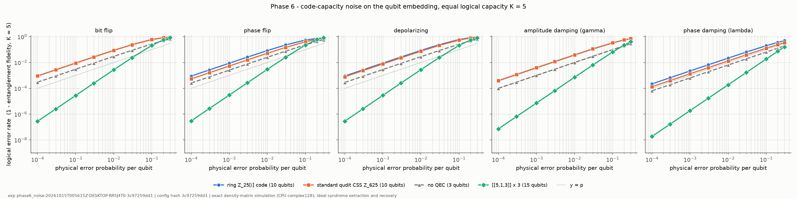

**Düzen A ve Düzen B, aynı kayıtla kodlamasız referanslar** (`noise_layouts`; yalnızca kapı düzeyi adımlar 1–5'in
geçtiği kodlar için çalıştırıldı):

| kanal | p | ring layout A (10 q) | ring layout B (12 q) | no QEC minimal (3 q) | no QEC same register A (10 q, strict) | no QEC same register B (12 q, strict) | no QEC layout B, label digit only (12 q) | [[5,1,3]] x 3 (15 q) |
|---|---|---|---|---|---|---|---|---|
| bit_flip | 0.001 | 0.00904 | 0.00797 | 0.003 | 0.00996 | 0.0119 | 0.003 | 2.77e-05 |
| bit_flip | 0.01 | 0.087 | 0.0771 | 0.0297 | 0.0956 | 0.114 | 0.0297 | 0.00272 |
| bit_flip | 0.1 | 0.606 | 0.56 | 0.271 | 0.651 | 0.718 | 0.271 | 0.21 |
| phase_flip | 0.001 | 0.0088 | 0.00689 | 0.00256 | 0.00892 | 0.00256 | 0.00256 | 2.99e-05 |
| phase_flip | 0.01 | 0.0842 | 0.0666 | 0.0254 | 0.0853 | 0.0254 | 0.0254 | 0.00294 |
| phase_flip | 0.1 | 0.552 | 0.481 | 0.234 | 0.558 | 0.234 | 0.234 | 0.225 |
| depolarizing | 0.001 | 0.00896 | 0.00839 | 0.00285 | 0.00961 | 0.00882 | 0.00285 | 2.85e-05 |
| depolarizing | 0.01 | 0.0863 | 0.0809 | 0.0283 | 0.0924 | 0.085 | 0.0283 | 0.00279 |
| depolarizing | 0.1 | 0.6 | 0.574 | 0.259 | 0.633 | 0.602 | 0.259 | 0.21 |
| amplitude_damping | 0.001 | 0.00385 | 0.00209 | 1.00e-03 | 0.00399 | 1.00e-03 | 1.00e-03 | 7.22e-06 |
| amplitude_damping | 0.01 | 0.038 | 0.0207 | 0.00999 | 0.0393 | 0.00999 | 0.00999 | 7.16e-04 |
| amplitude_damping | 0.1 | 0.329 | 0.194 | 0.099 | 0.335 | 0.099 | 0.099 | 0.0645 |
| phase_damping | 0.001 | 0.00221 | 0.00173 | 6.40e-04 | 0.00224 | 6.40e-04 | 6.40e-04 | 1.87e-06 |
| phase_damping | 0.01 | 0.0219 | 0.0172 | 0.0064 | 0.0222 | 0.0064 | 0.0064 | 1.87e-04 |
| phase_damping | 0.1 | 0.2 | 0.161 | 0.0642 | 0.203 | 0.0642 | 0.0642 | 0.0186 |

Düzen B (12 kubit) GPU'da complex64 ile hesaplandı; p = 0.01'de CPU complex128 ile en büyük fark 1.47e-07.

**Sızıntı, Düzen A ve Düzen B** (aynı çalıştırma, `qubit_level.csv`):

| kanal | p | sızıntı: ring layout A (10 q) | sızıntı: ring layout B (12 q) | LER: ring layout A (10 q) | LER: ring layout B (12 q) |
|---|---|---|---|---|---|
| bit_flip | 0.001 | 0.00136 | 0.003 | 0.00904 | 0.00797 |
| bit_flip | 0.01 | 0.0134 | 0.0297 | 0.087 | 0.0771 |
| bit_flip | 0.1 | 0.12 | 0.271 | 0.606 | 0.56 |
| phase_flip | 0.001 | 0 | 0 | 0.0088 | 0.00689 |
| phase_flip | 0.01 | 0 | 0 | 0.0842 | 0.0666 |
| phase_flip | 0.1 | 0 | 0 | 0.552 | 0.481 |
| depolarizing | 0.001 | 9.06e-04 | 0.002 | 0.00896 | 0.00839 |
| depolarizing | 0.01 | 0.00899 | 0.0199 | 0.0863 | 0.0809 |
| depolarizing | 0.1 | 0.0834 | 0.187 | 0.6 | 0.574 |
| amplitude_damping | 0.001 | 0 | 0 | 0.00385 | 0.00209 |
| amplitude_damping | 0.01 | 0 | 0 | 0.038 | 0.0207 |
| amplitude_damping | 0.1 | 0 | 0 | 0.329 | 0.194 |
| phase_damping | 0.001 | 0 | 0 | 0.00221 | 0.00173 |
| phase_damping | 0.01 | 0 | 0 | 0.0219 | 0.0172 |
| phase_damping | 0.1 | 0 | 0 | 0.2 | 0.161 |

Sızıntı = gürültüden sonra, temel girdiler üzerinden ortalama, geçerli halka-elemanı seviyelerinin dışındaki popülasyon (kurtarma bunu kaybeder). Gürültüsüz devrede sızıntı yoktur: Düzen B kodlayıcısının sızıntısı 0'dır (adım 2) ve tam döngülerde min F ≥ 1 − 10⁻¹² olduğundan döngü sonundaki sızıntı ≤ 1 − F. Gürültülü sızıntı kanaldan gelir; Düzen B'de geçerli seviye oranı daha düşüktür (A: (25/32)² ≈ 0.61, B: (5/8)⁴ ≈ 0.15).

Kodlamasız referanslar: *minimal* = 5 seviye 3 kubitte; *aynı kayıt (strict)* = lojik j, kodun kaydında tek taban durumu |t_j⟩ olarak saklanır ve kayıttaki her değişiklik hata sayılır; *etiket rakamı* = Düzen B kaydında yalnızca etiket rakamı okunur (diğer kubitler boşta) — bu, minimal referansla aynı sonucu verir (beklenen; doğrulama). Deney `noise_layouts-20261016T005404Z-DESKTOP-RR5J4T0-a65fa71371`, süre 22 dk.

**Qudit düzeyi genelleştirilmiş kanallar (kesin sayım)** — deney `phase6_noise-20261015T005407Z-DESKTOP-RR5J4T0-3c97259dd1`. Birim-kayma modeli: her bileşenin reel/sanal koordinatı bağımsız olarak p olasılıkla ±1 kayar (X için kayma, Z için faz-tekmesi). Qudit depolarizasyonu: p olasılıkla tüm d²−1 Pauli'den düzgün biri. ε-modeli: p olasılıkla X(e), e ∈ ε düzgün.

| kod | dim | K | p | LER birim-kayma | LER qudit depolarizasyon | kodlamasız K-qudit depol. | LER makalenin ε-modeli |
|---|---|---|---|---|---|---|---|
| Z25 | 625 | 5 | 0.01 | 1.00e-04 | 0.0096 | 0.01 | 0.008 |
| Z25 | 625 | 5 | 0.1 | 0.01 | 0.096 | 0.1 | 0.08 |
| Z85 | 7225 | 17 | 0.01 | 1.00e-04 | 0.00997 | 0.01 | 0.00941 |
| Z85 | 7225 | 17 | 0.1 | 0.01 | 0.0997 | 0.1 | 0.0941 |
| Z325 | 105625 | 5 | 0.01 | 0 | 0.0096 | 0.01 | 0.008 |
| Z325 | 105625 | 5 | 0.1 | 0 | 0.096 | 0.1 | 0.08 |
| Z5n4 | 390625 | 25 | 0.01 | 0.00267 | 0.00998 | 0.01 | 0.0096 |
| Z5n4 | 390625 | 25 | 0.1 | 0.197 | 0.0998 | 0.1 | 0.096 |

**Monte-Carlo yörünge simülatörü (birim-kayma, p = 0.05) — kesin değere karşı doğrulama:**

| kod | dim | cihaz | deneme | MC LER | kesin LER | kesin %95 GA içinde | s | µs/deneme | GPU tepe MB |
|---|---|---|---|---|---|---|---|---|---|
| Z25 | 625 | cpu | 20000 | 0.0028 | 0.0025 | ✓ | 0.342 | 17.1 | — |
| Z25 | 625 | cuda | 20000 | 0.0028 | 0.0025 | ✓ | 0.337 | 16.8 | 128 |
| Z85 | 7225 | cpu | 20000 | 0.0031 | 0.0025 | ✓ | 5.26 | 263 | — |
| Z85 | 7225 | cuda | 20000 | 0.0031 | 0.0025 | ✓ | 0.389 | 19.5 | 672 |
| Z325 | 105625 | cpu | 6000 | 0 | 0 | ✓ | 25.5 | 4.25e+03 | — |
| Z325 | 105625 | cuda | 6000 | 0 | 0 | ✓ | 2.17 | 362 | 2.83e+03 |
| Z5n4 | 390625 | cpu | 1000 | 0.063 | 0.0585 | ✓ | 61.7 | 6.17e+04 | — |
| Z5n4 | 390625 | cuda | 1000 | 0.063 | 0.0585 | ✓ | 4.36 | 4.36e+03 | 2.88e+03 |

**Kaynak maliyeti** (bir X- + Z-sendrom turu + bir kurtarma; `qml.transforms.decompose` ile {CNOT, RZ, RY,
RX, PhaseShift, ControlledPhaseShift, H, X, Toffoli, QubitUnitary, …} kapı kümesine ayrıştırılmış):

| kod | tel (veri+ancilla+yardımcı) | kapı | derinlik | 2-kubit | Toffoli |
|---|---|---|---|---|---|
| ring Z_25[i] | 20 | 15673 | 13294 | 8577 | 340 |
| modular Z_625 | 20 | 22453 | 19105 | 12435 | 300 |
| [[5,1,3]] x 3 | 27 | 72 | 10 | 48 | 0 |
| no QEC | 3 | 0 | 0 | 0 | 0 |

---

## 10. GPU performans ve bellek ölçümleri

Deney: `bench_cpu_gpu-20261015T081654Z-DESKTOP-RR5J4T0-be531b5a19` (makine boştayken, 3 tekrar; GPU: NVIDIA GeForce RTX 5060 Ti, sürücü CUDA 12.9, torch CUDA 12.8).

| iş yükü | cihaz | durum | medyan s | min s | hızlanma (CPU/GPU) | GPU tepe MB | Msembol/s |
|---|---|---|---|---|---|---|---|
| awgn_ml_1024qam | cpu | RUN | 7.47 | 7.46 | — | — | 0.541 |
| awgn_ml_1024qam | cuda | RUN | 0.428 | 0.427 | 17.5 | 1.61e+03 | 9.36 |
| awgn_ring_625 | cpu | RUN | 0.521 | 0.489 | — | — | 38.4 |
| awgn_ring_625 | cuda | RUN | 0.0199 | 0.0198 | 26.2 | 204 | 1.04e+03 |
| awgn_coset_125 | cpu | RUN | 0.622 | 0.618 | — | — | 31.5 |
| awgn_coset_125 | cuda | RUN | 0.0306 | 0.0304 | 20.3 | 220 | 666 |
| dm_ring_ad | cpu | RUN | 4.43 | 4.37 | — | — | — |
| dm_ring_ad | cuda | RUN | 0.557 | 0.548 | 7.94 | 1.21e+03 | — |
| mc_ring_z325 | cpu | RUN | 22.9 | 22.9 | — | — | — |
| mc_ring_z325 | cuda | RUN | 1.96 | 1.94 | 11.7 | 2.83e+03 | — |

Notlar: GPU satırları complex64, CPU yoğunluk-matrisi satırı complex128 kullanır (sonuç farkı Bölüm 9'da). PennyLane devreleri Windows'ta `lightning.qubit` (CPU, OpenMP) üzerinde koştu; PennyLane için CPU/GPU karşılaştırması WSL2'deki `lightning.gpu` ile Bölüm 8.5'tedir. Monte-Carlo CPU/GPU karşılaştırması Bölüm 9 tablosundadır.

---

## 11. Çalıştırılamayan / kısmen çalıştırılan deneyler

* **lightning.gpu / cuQuantum (native Windows)**: kurulamıyor (`custatevec-cu12` Windows dağıtımı yok). Çözüm olarak aynı makinedeki WSL2 Ubuntu'da kuruldu ve kullanıldı (Bölüm 8.5).
* **Z325[i] X-tipi sendromu tek devrede**: 32 tel (2³² genlik; complex128 ≈ 69 GB) bu GPU'ya sığmaz → NOT RUN. Bunun yerine her üreteç ayrı devrede ölçüldü (genişlikler [23, 29]), 8 Z-hatası için; cebirle uyum: ✓ (Bölüm 8.5). Daha fazla hata denenmedi (hata başına dakikalar mertebesinde süre).
* **Tam QEC döngüsü**: Z25'te orta-devre ölçümü + `qml.cond` ile (Windows ve GPU); Z25, Z85 için koherent geri beslemeyle GPU'da (Bölüm 8.5); Z325 için NOT RUN — koherent geri besleme ancilla yeniden kullanamadığı için 36 tel (2³⁶ genlik) gerektirir; gerçek orta-devre ölçüm + sıfırlama ile 29 tel yeterli olurdu, denenmedi.
* **Kubit düzeyi gürültü Z85/Z325 gömmelerinde**: yoğunluk matrisi 2¹⁴×2¹⁴ (Z85) / 2¹⁸×2¹⁸ (Z325) — Z325 için imkânsız, Z85 için 17²=289 girişin her biri 4.3 GB; çalıştırılmadı. Qudit düzeyinde aynı kodlar kesin sayımla ve GPU Monte-Carlo ile çalıştırıldı.
* **Gürültülü kapılar / devre-düzeyi gürültü (circuit-level)**: yapılmadı; ~10⁴ kapılık sendrom devreleri için bunun sonucu kod-kapasitesi sonuçlarından yalnızca daha kötü olabilir.
* **Kapı-düzeyi kodlayıcı (encoder)**: Düzen B (split koordinatlar) için yazıldı ve her j için referansla sadakat 1.0 doğrulandı (Bölüm 8.6). Düzen A (ikili a, b kayıtları) için kapı düzeyi kodlayıcı **yok** (NOT RUN); Düzen A deneylerinde giriş/çıkış genel bir kapı düzeyi durum hazırlama (Möttönen) ile yüklendi.
* **Makalenin "exact reproduction" kategorisindeki AWGN deneyleri**: yazar simülasyon kodu ve parametreleri olmadığı için mümkün değil; tümü bağımsız yeniden kurulum.
* **Stim**: kuruldu ama kullanılmadı — halka kodları qudit/aritmetik (Clifford olmayan) yapıdadır; kubit tabanı [[5,1,3]] için 5 kubitlik tam yoğunluk-matrisi hesabı örneklemeden daha kesin olduğundan tercih edildi; Stim genlik sönümünü temsil edemez.
* **SageMath**: kurulu değil; gerekmedi (tüm cebir doğrudan sayımla yapıldı).
* **Makaledeki Z5[i]⁴ örneğinin kendisi**: üreteçler yayımlanmadığı için yalnızca aynı boyutlarda bağımsız bir yapılandırma test edildi.

---

## 12. Sonraki deneyler için somut gereksinimler

1. **Yazarlardan istenmesi gerekenler**: (i) Şekil 1–3 simülasyon betiği, sembol sayısı ve tohumlar; (ii) "25 elemanlı R_Q" takımyıldızının tanımı (Z[i]/(5) mi, Z[i]/(3+4i) mi) ve alıcı; (iii) Z5[i]⁴ örneğinin üreteçleri; (iv) Tanım 6 ile Örnek 6–7 arasındaki dual tanımının hangisinin kastedildiği ve Önerme 5'in hangi hata modeli (X mi Z mi) için iddia edildiği.
2. **Önerme 5'in düzeltilmiş biçimi** (ayrı çalışma olarak): X-hataları için doğru ifade "sendrom ⇔ e + C2 kosetini belirler" (çekirdek C2), Z-hataları için "sendrom ⇔ f + C1^⊥H". Z-okumasındaki "(ε−ε) ∩ C1^⊥H = {0} ⟺ |ε| farklı sendrom" denkliği n = 1'de q ∈ {25, 65, 85, 125, 325} için tüm geçerli ideal çiftlerinde ve Z5[i]⁴'te sayısal olarak doğrulandı (Bölüm 8.2). Hata kümesi tam olarak Z(ε) ise ayırt edilebilirlik düzeltilebilirliğe denktir (tanımlanan hatanın tersi uygulanır, artık 0; Knill–Laflamme), bu yüzden bu kısım açık değildir. C1^⊥H ⊆ C1 yeterli koşuldur (fark e_i − e_j ∉ C1 ⊇ C1^⊥H; 481/481 durumda sağlandı) ama gerekli değildir (16 durumda C1^⊥H ⊄ C1 iken de sağlanıyor). Kalan iş: koşulun ideal üreteçleri ve ε seçimi cinsinden gerekli-yeterli bir karakterizasyonu.
3. **Adil fiziksel karşılaştırma**: ikili kubit gömmelerinde (Düzen A ve B) halka kodu kodlamasızdan kötü; qudit düzeyi birim-kayma gürültüsünde iyi. Anlamlı bir avantaj için ya doğal qudit donanımı (d = 25 veya 625 seviyeli sistem; ör. trapped-ion/süperiletken qudit) için gerçekçi bir gürültü modeli (yakın-komşu seviye geçişleri ≈ birim-kayma modeli) ya da tek-bit hatalarını birim kaymaya eşleyen (Gray-kodu benzeri) bir rakam gömmesi gerekir. Düzen B'nin rakam yapısı (`SplitLayout`) bu tür bir gömme için hazır başlangıç noktasıdır.
4. **Devre-düzeyi gürültü**: sendrom çıkarımında 10⁴ mertebesinde kapı var; eşik analizi için gürültülü kapı simülasyonu (Monte-Carlo, GPU) ve daha ucuz modüler toplayıcılar (QFT'siz, Toffoli tabanlı) gerekli.
5. **Büyük devreler**: Z325 tam döngüsü için koherent geri besleme 36 tel ister (bu GPU'ya sığmaz); gerçek orta-devre ölçüm + sıfırlama (ör. PennyLane `mcm_method="tree-traversal"` / one-shot) ile ancilla yeniden kullanımıyla 29 tel (complex128 8.6 GB) yeterlidir — WSL2'deki `lightning.gpu` ile denenebilir.
6. **AWGN**: eşit hızlı karşılaştırmayı yumuşak-karar (soft-decision) koset/ML decoder ile tekrar etmek ve Eb/N0 ekseninde sunmak; makaledeki "kodlama kazancı" ifadesinin hız-ayarlı yeniden değerlendirmesi.

---

## 13. Test sonuçları

Kaynak: `results/tests/test_report.json` (2026-10-16T01:39:22 UTC). Özet: **PASS 135, FAIL 14, NOT RUN 0**.

| test sınıfı | PASS | FAIL | NOT RUN |
|---|---|---|---|
| matematiksel iddia | 33 | 13 | 0 |
| uygulama | 102 | 1 | 0 |

| FAIL testi | dosya | test sınıfı | hata sınıfı | mesaj |
|---|---|---|---|---|
| test_definition6_dual_satisfies_examples_containment[Z25] | test_ideals_duals.py | matematiksel iddia | mathematical (paper definitions mutually inconsistent) | <sigma(alpha2)> has 125 elements and is not inside C1 (\|C1\|=25) |
| test_definition6_dual_satisfies_examples_containment[Z85] | test_ideals_duals.py | matematiksel iddia | mathematical (paper definitions mutually inconsistent) | <sigma(alpha2)> has 1445 elements and is not inside C1 (\|C1\|=85) |
| test_definition6_dual_satisfies_examples_containment[Z325] | test_ideals_duals.py | matematiksel iddia | mathematical (paper definitions mutually inconsistent) | <sigma(alpha2)> has 8125 elements and is not inside C1 (\|C1\|=1625) |
| test_paper_lemma1_property2_under_definition6 | test_ideals_duals.py | matematiksel iddia | mathematical (paper claim does not hold) | 125 * 125 != 625 |
| test_lemma1_property1_under_true_dual | test_ideals_duals.py | matematiksel iddia | mathematical (paper definitions mutually inconsistent) | sigma(C^perpH) has 1 elements, C has 625 |
| test_paper_lemma1_property3_under_definition6 | test_ideals_duals.py | matematiksel iddia | mathematical (paper claim does not hold) | \|<sigma(alpha2)>\| = 125 is not inside \|<sigma(alpha1)>\| = 25 |
| test_paper_table1_z9_dual_size | test_ideals_duals.py | matematiksel iddia | mathematical (paper table entry; case outside the paper's own hypothesis) | computed 1, Table 1 says 3 (Z9: 3 = 3 mod 4, outside the hypothesis) |
| test_paper_table2_z9_K_equals_theorem4_formula | test_ideals_duals.py | matematiksel iddia | mathematical (paper table entry; case outside the paper's own hypothesis) | \|C2\|/\|C1\| = 3, Table 2 says K = 1 (Z9 outside the hypothesis) |
| test_original_hermitian_dual_twice_returns_C | test_original_source.py | uygulama | implementation (original source) | double dual has 625 elements, C has 25 |
| test_theorem4_stabilizers_commute_with_definition6_dual[Z25] | test_stabilizer.py | matematiksel iddia | mathematical (paper definitions mutually inconsistent) | {'pairs': 3125, 'noncommuting_pairs': 2800, 'first_noncommuting': {'v': '(0+5i)', 'u': '(1+18i)', 'Tr<v,u>': 2 |
| test_theorem4_stabilizers_commute_with_definition6_dual[Z85] | test_stabilizer.py | matematiksel iddia | mathematical (paper definitions mutually inconsistent) | {'pairs': 122825, 'noncommuting_pairs': 117776, 'first_noncommuting': {'v': '(0+5i)', 'u': '(1+13i)', 'Tr<v,u> |
| test_paper_proposition5_distinct_syndromes_for_X_errors[Z25] | test_stabilizer.py | matematiksel iddia | mathematical (paper claim does not hold) | X-reading: 1 distinct syndrome(s) for \|eps\| = 5 |
| test_paper_proposition5_distinct_syndromes_for_X_errors[Z85] | test_stabilizer.py | matematiksel iddia | mathematical (paper claim does not hold) | X-reading: 1 distinct syndrome(s) for \|eps\| = 17 |
| test_paper_proposition5_distinct_syndromes_for_X_errors[Z325] | test_stabilizer.py | matematiksel iddia | mathematical (paper claim does not hold) | X-reading: 1 distinct syndrome(s) for \|eps\| = 5 |

NOT RUN testleri: yok.

Gevşetilmiş veya gizlenmiş test yoktur. `paper_claim` testleri makale ifadesini aynen doğrular; FAIL olmaları makale iddiasının sağlanmadığı anlamına gelir. Bu projenin uygulama testlerinin tamamı PASS'tir; tek 'implementation (original source)' FAIL'i yazar kodundaki gizli çift-dual hatasıdır (Bölüm 3). İnceleme sonrası sınıf güncellemeleri: Z9 satırı testleri ek olarak `outside_hypothesis` ile işaretlendi (makalenin hipotezi dışında); Tanım 6 ile ilgili testler `definition_consistency` sınıfında kaldı; Önerme 5 testi açıkça "X-tipi okuma" olarak belgelendi. Hiçbir FAIL silinmedi.

---

## Ek A — Yeniden üretilebilir komutlar

```powershell
cd epsilon_qec_research
.venv\Scripts\python.exe run_all.py --list          # tüm adımlar
.venv\Scripts\python.exe experiments\phase1_original.py
.venv\Scripts\python.exe experiments\phase2_algebra.py
.venv\Scripts\python.exe experiments\phase3_awgn.py ; .venv\Scripts\python.exe experiments\plot_awgn.py
.venv\Scripts\python.exe experiments\phase4_stabilizer.py ; .venv\Scripts\python.exe experiments\phase4_supplement.py
.venv\Scripts\python.exe experiments\phase5_prop5.py ; .venv\Scripts\python.exe experiments\phase5_pennylane.py
.venv\Scripts\python.exe experiments\phase6_noise.py ; .venv\Scripts\python.exe experiments\plot_noise.py
.venv\Scripts\python.exe experiments\bench_cpu_gpu.py
# ikinci yazar incelemesi ve kapı düzeyi spesifikasyon
.venv\Scripts\python.exe experiments\review_checks.py          # A1, A3, A4, B4, C2   (~15 s)
.venv\Scripts\python.exe experiments\zreading_condition.py     # C1, tüm geçerli çiftler (~7 dk)
.venv\Scripts\python.exe experiments\gate_level_css.py         # adımlar 1-5, Z25/Z65/Z85 (~4.7 sa, CPU)
.venv\Scripts\python.exe experiments\gate_level_css.py --config gate_level_css_2re.toml   # C2, Tr = 2a (~2 dk)
.venv\Scripts\python.exe experiments\noise_layouts.py          # adım 6 (adımlar 1-5 geçtiyse; ~22 dk)
.venv\Scripts\python.exe experiments\mc_seed_check.py ; .venv\Scripts\python.exe experiments\qudit_depolarizing_mc.py
.venv\Scripts\python.exe experiments\apply_review_changes.py   # degisiklikler.py -> şablon/özet (Ek C)
.venv\Scripts\python.exe run_all.py --phases W   # WSL2 lightning.gpu adımları
.venv\Scripts\python.exe -m pytest -q
.venv\Scripts\python.exe experiments\draw_circuits.py ; .venv\Scripts\python.exe experiments\make_report.py ; .venv\Scripts\python.exe experiments\make_pdf.py
```

Her çalıştırma `results/<kategori>/<deney-kimliği>/` altında `config.json`, `env.json` (GPU, sürücü, CUDA,
Python, paket sürümleri, tohum), `results.json`, CSV ve `status.json` (PASS/FAIL/ERROR, süre, bellek) üretir.

## Ek B — Tüm deney çalıştırmaları

| kategori | deney kimliği | durum | süre s | not / hata |
|---|---|---|---|---|
| original | `phase1_fixed_impact-20261015T082424Z-DESKTOP-RR5J4T0-5402557e8c` | PASS | 4.32 |  |
| original | `phase1_fixed_impact-20261015T082713Z-DESKTOP-RR5J4T0-5402557e8c` | PASS | 4.25 |  |
| original | `phase1_original-20261015T001749Z-DESKTOP-RR5J4T0-d3f0ec9876` | PASS | 4.98 |  |
| original | `phase1_original-20261015T082707Z-DESKTOP-RR5J4T0-d3f0ec9876` | PASS | 4.83 |  |
| algebra | `phase2_algebra-20261015T002135Z-DESKTOP-RR5J4T0-37dbf23676` | PASS | 7.71 |  |
| algebra | `phase2_algebra-20261015T002158Z-DESKTOP-RR5J4T0-37dbf23676` | ERROR | 39.5 | ValueError: operands could not be broadcast together with shapes (7225,1,1,2) (1,17,1,1,2) |
| algebra | `phase2_algebra-20261015T002351Z-DESKTOP-RR5J4T0-37dbf23676` | PASS | 119 |  |
| algebra | `phase2_algebra-20261015T082717Z-DESKTOP-RR5J4T0-37dbf23676` | PASS | 118 |  |
| algebra | `review_checks-20261015T201135Z-DESKTOP-RR5J4T0-e771f0665e` | PASS | 13 |  |
| algebra | `review_checks-20261015T202600Z-DESKTOP-RR5J4T0-e771f0665e` | PASS | 16.2 |  |
| algebra | `zreading_condition-20261015T201236Z-DESKTOP-RR5J4T0-54e3c09d11` | INCOMPLETE | — | status.json yok: işlem dışarıdan sonlandırıldı (zaman aşımı ya da yavaşlık nedeniyle elle durduruldu); sonuç kullanılmadı, aynı yapılandırmanın sonraki tam çalıştırması kullanıldı |
| algebra | `zreading_condition-20261015T211208Z-DESKTOP-RR5J4T0-54e3c09d11` | INCOMPLETE | — | status.json yok: işlem dışarıdan sonlandırıldı (zaman aşımı ya da yavaşlık nedeniyle elle durduruldu); sonuç kullanılmadı, aynı yapılandırmanın sonraki tam çalıştırması kullanıldı |
| algebra | `zreading_condition-20261015T220347Z-DESKTOP-RR5J4T0-54e3c09d11` | PASS | 409 |  |
| awgn | `phase3_awgn-20261015T003111Z-DESKTOP-RR5J4T0-72b93f19d7` | PASS | 21.9 |  |
| awgn | `phase3_awgn-20261015T003413Z-DESKTOP-RR5J4T0-ae42b10bbd` | PASS | 24.7 |  |
| awgn | `phase3_awgn-20261015T082918Z-DESKTOP-RR5J4T0-ae42b10bbd` | PASS | 24.8 |  |
| quantum | `gate_level_css-20261015T201001Z-DESKTOP-RR5J4T0-ffe8a2b77f` | PASS | 1.70e+04 |  |
| quantum | `gate_level_css_2re-20261015T204106Z-DESKTOP-RR5J4T0-67be2ec235` | PASS | 98.2 |  |
| quantum | `gate_level_css_devtest-20261015T195918Z-DESKTOP-RR5J4T0-22272f0190` | FAIL | 4.79 | Z25: step 3_cycle_B_reuse ERROR |
| quantum | `gate_level_css_devtest-20261015T200442Z-DESKTOP-RR5J4T0-2b68806d87` | PASS | 293 |  |
| quantum | `mc_seed_check-20261016T011645Z-DESKTOP-RR5J4T0-08a0c41aff` | PASS | 2.18 |  |
| quantum | `noise_layouts-20261016T005404Z-DESKTOP-RR5J4T0-a65fa71371` | PASS | 1.32e+03 |  |
| quantum | `phase4_stabilizer-20261015T003706Z-DESKTOP-RR5J4T0-dd69ad0b68` | PASS | 9.14 |  |
| quantum | `phase4_stabilizer-20261015T003729Z-DESKTOP-RR5J4T0-dd69ad0b68` | PASS | 1.13e+03 |  |
| quantum | `phase4_supplement-20261015T005904Z-DESKTOP-RR5J4T0-84a7d8adef` | PASS | 9.78 |  |
| quantum | `phase5_pennylane-20261015T004245Z-DESKTOP-RR5J4T0-9a87023139` | FAIL | 13.1 | Z25: gate decomposition disagrees with reference; Z25: full QEC cycle did not restore the state |
| quantum | `phase5_pennylane-20261015T004338Z-DESKTOP-RR5J4T0-9a87023139` | PASS | 12.1 |  |
| quantum | `phase5_pennylane-20261015T004417Z-DESKTOP-RR5J4T0-ea5245775d` | PASS | 942 |  |
| quantum | `phase5_pennylane_devtest-20261015T084215Z-DESKTOP-RR5J4T0-9a11e17785` | PASS | 6.63 |  |
| quantum | `phase5_pennylane_gpu-20261015T084955Z-DESKTOP-RR5J4T0-a0b7d507b0` | PASS | 580 |  |
| quantum | `phase5_pennylane_gpu-20261015T090000Z-DESKTOP-RR5J4T0-bbdaa60415` | PASS | 1.69e+03 |  |
| quantum | `phase5_prop5-20261015T003835Z-DESKTOP-RR5J4T0-d2d4551928` | PASS | 2.82 | Z5_small: Proposition 5 refuted for X-type errors (1 syndrome pattern(s) for \|eps\|=5); Z25: Proposition 5 refuted for X- |
| quantum | `phase5_prop5-20261015T005713Z-DESKTOP-RR5J4T0-c31d61471e` | PASS | 1.73e+03 | Z5_small: Proposition 5 refuted for X-type errors (1 syndrome pattern(s) for \|eps\|=5); Z25: Proposition 5 refuted for X- |
| quantum | `phase6_noise-20261015T005407Z-DESKTOP-RR5J4T0-3c97259dd1` | PASS | 110 |  |
| quantum | `phase6_noise-20261015T005615Z-DESKTOP-RR5J4T0-3c97259dd1` | PASS | 578 |  |
| quantum | `qudit_depolarizing_mc-20261016T012657Z-DESKTOP-RR5J4T0-0f77349380` | PASS | 4.15 | Z25 p=0.2: exact outside 95% CI; Z65 p=0.2: exact outside 95% CI |
| quantum | `qudit_depolarizing_mc-20261016T012934Z-DESKTOP-RR5J4T0-e3cc5542fb` | PASS | 4.06 |  |
| quantum | `qudit_depolarizing_mc-20261016T013319Z-DESKTOP-RR5J4T0-e3cc5542fb` | PASS | 4.06 |  |
| quantum | `qudit_depolarizing_mc-20261016T014151Z-DESKTOP-RR5J4T0-b47fcc1ffb` | PASS | 4.19 |  |
| benchmarks | `bench_cpu_gpu-20261015T081654Z-DESKTOP-RR5J4T0-be531b5a19` | PASS | 120 |  |
| benchmarks | `bench_pennylane_devices-20261015T084640Z-DESKTOP-RR5J4T0-cc0f358284` | FAIL | 172 | Z25 Prop.5 Z-syndrome round lightning.gpu complex64: fidelity 0.9999887476846312; Z85 Prop.5 Z-syndrome round lightning. |
| benchmarks | `bench_pennylane_devices-20261015T092814Z-DESKTOP-RR5J4T0-cc0f358284` | PASS | 171 |  |

Hiçbir çalıştırma silinmedi. ERROR/FAIL kayıtları geliştirme sırasında bulunan ve düzeltilen hatalara aittir (Phase 2: `multiples_transversal` şekil hatası; Phase 5 PennyLane: çift-kuyruklanan `qml.Adder`; PennyLane cihaz karşılaştırması: complex64 için fazla sıkı 1e-5 sadakat eşiği — ölçülen 0.99997–0.99999 değerleri tek hassasiyet yuvarlamasıdır, eşik 1e-4 yapıldı; `gate_level_css_devtest`: `lightning.qubit` yerel MCM tree-traversal'ın ~1e-31 olasılıklı sayısal gürültü dalında çökmesi — segmentli motora geçişin nedeni; `review_checks` ilk çalıştırması: sağ iz duali kullanılmıştı, sol iz duali düzeltmesinden sonra yeniden çalıştırıldı; INCOMPLETE `zreading_condition` kayıtları: yavaş Python döngüleri nedeniyle durduruldu, vektörleştirmeden sonra tam çalıştırıldı); her biri düzeltmeden sonra aynı yapılandırmayla yeniden çalıştırılmış ve PASS olmuştur. Kısmi çalıştırmalar (`--only`, `--codes`) geliştirme amaçlıdır; rapor tabloları en son tam çalıştırmalardan üretilir.

## Ek C — İnceleme sonrası değişen ifadeler (eski → yeni)

Bu ek, ikinci yazarın incelemesinden sonra raporda, özet dosyasında ve üretilen metinde değişen her ifadenin eski ve yeni halini listeler (kaynak: `reports/degisiklikler.py` → `reports/degisiklikler.json`; uygulayan betik `experiments/apply_review_changes.py` eski metin bulunamazsa durur). "Eski: —" yeni eklenen metin demektir. Hiçbir FAIL kaydı silinmedi; sınıf güncellemeleri Bölüm 13'tedir.

**C01** · inceleme maddesi A1 · 0 (özet, satır 3) · dosya `reports/teknik_rapor.template.md`

*Gerekçe:* Kapalı form ve Tanım 6'nın örtüştüğü durumlar eklendi; 'örneklerde geçersiz' ifadesi α₁ ve α₂ için ayrı ayrı kontrol edildi.

*Eski:*

> | 3 | Tanım 6: C^⊥H := ⟨σ(α)⟩ | **Örnek 6–7 ile çelişkili**: bu tanımla örneklerdeki dual-içerme sağlanmıyor ve Teorem 4 stabilizerleri komütatif değil (kod uzayı 0 boyutlu) | Phase 2, Phase 4; 5 `definition_consistency` testi |

*Yeni:*

> | 3 | Tanım 6: C^⊥H := ⟨σ(α)⟩ | **Hatalı tanım.** Doğru dual: C^⊥H = Ann(σ(α)) = σ(Ann(α)) = ⟨σ(q/δ)⟩, δ = gcd(α, q) (Z[i]'de) — q ∈ {25, 65, 85, 125, 325} için tüm idealler (9/16/16/16/36) ve q başına 300 rastgele üreteçle doğrulandı. Tanım 6 yalnızca Ann(α) = ⟨α⟩ iken doğru (bu halkalarda tek durum: Z25'te ⟨5⟩); makale örneklerinin **α₂** üreteçlerinde de **α₁** üreteçlerinde de doğru değil. Tanım 6 ile örneklerdeki dual-içerme sağlanmaz ve Teorem 4 stabilizerleri komütatif olmaz (kod uzayı 0 boyutlu) | `review_checks`; `test_closed_form_*`, `test_definition6_*`; 5 `definition_consistency` testi |

**C02** · inceleme maddesi A2 · 0 (özet, satır 4) · dosya `reports/teknik_rapor.template.md`

*Gerekçe:* Doğru dual altındaki durum öne alındı.

*Eski:*

> | 4 | Lemma 1 (1)–(3) (Tanım 6 ile, yazıldığı gibi) | (1) doğru; **(2) ve (3) yanlış**. Gerçek tümleyenle (2)–(3) doğru, (1) yanlış → tek bir tanım altında birlikte doğru değil | Phase 2 `lemma1`; 2 `paper_claim` + 1 `definition_consistency` testi |

*Yeni:*

> | 4 | Lemma 1 (1)–(3) | Doğru dual (Ann) ile: **(1) yanlış** (α birim ⇒ C = R, C^⊥H = {0}), **(2) ve (3) doğru**. Tanım 6 ile (yazıldığı gibi): (1) doğru, (2) ve (3) yanlış → tek bir tanım altında üçü birlikte doğru değil | Phase 2 `lemma1`; 2 `paper_claim` + 1 `definition_consistency` testi |

**C03** · inceleme maddesi A4 · 0 (özet, satır 5) · dosya `reports/teknik_rapor.template.md`

*Gerekçe:* Z9'un hipotez dışında olduğu notu ve FAIL sınıfı güncellemesi.

*Eski:*

> | 5 | Tablo 1–2'deki Z9 satırı (\|C2^⊥H\| = 3, K = 1) | **Hatalı** (hesaplanan: 1 ve 3) | 2 `paper_claim` testi |

*Yeni:*

> | 5 | Tablo 1–2'deki Z9 satırı (\|C2^⊥H\| = 3, K = 1) | **Hatalı** (hesaplanan: 1 ve 3). Not: Z9 makalenin kendi hipotezinin dışındadır (3 ≡ 3 mod 4; makale de "yalnızca gösterim için" der); satır yine de kendi içinde tutarsız | 2 `paper_claim` + `outside_hypothesis` testi (sınıf güncellendi) |

**C04** · inceleme maddesi A7, B4 · 0 (özet, satır 9) · dosya `reports/teknik_rapor.template.md`

*Gerekçe:* Hipotezin 'gereksiz' olduğunun hata değil fazla varsayım olduğu; teoremin geçerli olduğu kod sınıfı ve toplamsal kod karşı-örneği.

*Eski:*

> | 9 | Teorem 4: stabilizer kodu, boyut K | **Doğrulandı** (gerçek dual ile; 3 bağımsız boyut hesabı). Dual-içerme hipotezi bu yapı için gereksiz | Phase 4, Phase 4 ek |

*Yeni:*

> | 9 | Teorem 4: stabilizer kodu, boyut K | **Doğrulandı** — R_Q-alt-modülleri için (makalenin Tanım 4'ündeki "additive code" = temel ideal), gerçek dual ile, 3 bağımsız boyut hesabı. Dual-içerme hipotezi bu yapı için gereksiz (hata değil, fazla varsayım). Genel toplamsal (Z_q-alt-grup) kodlarda \|C\|\|C^⊥H\| = \|R\|ⁿ bozulur (karşı-örnek C = Z_q·1: \|C^⊥H\| = 1); orada Hermitian dual yerine **sol iz duali** {v : Tr⟨v,c⟩_H = 0} gerekir | Phase 4, Phase 4 ek, `review_checks` B4 |

**C05** · inceleme maddesi A5, B1 · 0 (özet, satır 10) · dosya `reports/teknik_rapor.template.md`

*Gerekçe:* Bölüm 8.2'nin Z-okuması sonucu özete taşındı.

*Not:* bu metnin bir kısmı sonradan C24 ile yeniden değişti.

*Eski:*

> | 10 | **Önerme 5**: farklı ε temsilcileri farklı sendrom üretir | **Çürütüldü** (makalenin X(e) hata modeli için): C2'nin tüm elemanları sıfır sendrom üretir ve lojik operatördür | Phase 5 (sayısal + PennyLane), 3 `paper_claim` testi |

*Yeni:*

> | 10 | **Önerme 5**: farklı ε temsilcileri farklı sendrom üretir | **X-tipi okumada çürütüldü** (makalenin Tanım 10 / Remark 4 / Örnek 8 okuması, hatalar X(e), e ∈ ε ⊂ C2): sendrom çekirdeği C2, X(ε) lojik operatör. **Z-tipi okumada** (hatalar Z(e)) koşula bağlı: \|ε\| farklı sendrom ⟺ (ε−ε) ∩ C₁^⊥H = {0}; makalenin üç örneğinde sağlanıyor, genel değil (Z5[i]⁴ karşı-örneği; tüm geçerli ideal çiftleri üzerinde denklik Bölüm 8.2'de) | Phase 5 (sayısal + PennyLane), `zreading_condition`, 3 `paper_claim` testi |

**C06** · inceleme maddesi B1, B2 · 0 (özet, satır 13) · dosya `reports/teknik_rapor.template.md`

*Gerekçe:* 'Uygulanamaz' ifadesinin kapsamı X okumasıyla ve makalenin seçtiği hata kümesiyle sınırlandı.

*Not:* bu metnin bir kısmı sonradan C25 ile yeniden değişti.

*Eski:*

> | 13 | Fiziksel kuantum hata düzeltme (makalenin ε çerçevesiyle) | **Uygulanamaz** (ε hataları tespit edilemeyen lojik hatalardır). Ayrı etiketli alternatif tasarımla gerçek sendrom+recovery çalışıyor ama kubit gömmede kodlamasızdan kötü | Phase 5–6 |

*Yeni:*

> | 13 | Fiziksel kuantum hata düzeltme (makalenin ε çerçevesiyle) | **X-tipi okuma için yanlış**: makalenin seçtiği X(ε) hata kümesi tespit edilemeyen lojik hatalardır; *bu hata kümesi için* hiçbir kurtarma yoktur (Knill–Laflamme). **Z-tipi okumada** (ε−ε) ∩ C₁^⊥H = {0} koşulu altında çalışıyor, ama genel değil (Z5[i]⁴). Aynı stabilizer, doğru hata kümesiyle (R/C2 ve R/C1^⊥H transversalleri) kapı düzeyi devrede (kodlayıcı dahil) sadakat 1.0 ile düzeltme yapıyor (Bölüm 8.3, 8.6) | Phase 5–6, `gate_level_css` |

**C07** · inceleme maddesi B3 · 0 (özet, yeni satır 14) · dosya `reports/teknik_rapor.template.md`

*Gerekçe:* Gürültü sonucunun gömmeye özgü olduğu, karşılaştırmanın adilliği ve qudit düzeyi sonuç özete eklendi.

*Not:* bu metnin bir kısmı sonradan C26 ile yeniden değişti.

*Eski:*

> —

*Yeni:*

> | 14 | (Makalede yok) gürültü altında davranış | Kod-kapasitesi modeli. **Qudit düzeyinde**, kodun tasarlandığı birim-kayma gürültüsünde Z25 kodu p = 0.01'de LER = 1.0×10⁻⁴ (aynı modelde kodlamasız K = 5 qudit: 1.99×10⁻²; K-qudit depolarizasyonunda kodlamasız LER = p = 10⁻²). **İkili kubit gömmesinde** (Düzen A: 10 kubit, Düzen B: 12 kubit) kod kodlamasızdan kötü: tek bir bit-flip halka elemanında büyük bir sıçramadır (ör. a'nın en anlamlı biti ±16), kod ise birim kaymalara göre tasarlanmıştır — sonuç gömmeye özgüdür. 10/12 kubitlik kodla 3 kubitlik kodlamasızın karşılaştırması kaynak bakımından adil değildir; aynı kayıt ve kubit sayısıyla kodlamasız referans da raporlandı (Bölüm 9) | Phase 6, `noise_layouts` |

**C08** · inceleme maddesi B1, B2, B3 · 0 (kısa sonuç) · dosya `reports/teknik_rapor.template.md`

*Gerekçe:* Özet maddeleriyle tutarlı hale getirildi.

*Eski:*

> Kısa sonuç: Makalenin **cebirsel çekirdeği** (halka, idealler, boyutlar, koset decoder, Teorem 4 kodu)
> sayısal olarak doğru; **kuantum hata düzeltme iddiası** (Önerme 5, Örnek 8 "Quantum context",
> Remark 4) matematiksel olarak geçerli değil; **AWGN kodlama kazancı** yorumu eşit hız karşılaştırmasında
> geçerliliğini yitiriyor.

*Yeni:*

> Kısa sonuç: Makalenin **cebirsel çekirdeği** (halka, idealler, boyutlar, koset decoder, Teorem 4 kodu)
> sayısal olarak doğru; Tanım 6'daki dual hatalı (doğrusu ⟨σ(q/δ)⟩). **Kuantum hata düzeltme iddiası**
> (Önerme 5, Örnek 8 "Quantum context", Remark 4) makalenin **X-tipi okumasıyla** geçerli değil; **Z-tipi okumada**
> (ε−ε) ∩ C₁^⊥H = {0} koşulu altında geçerli, ama genel değil. Teorem 4'ün stabilizer kodu, doğru hata kümesiyle
> kapı düzeyinde (kodlayıcı, sıralı sendrom ölçümü, kurtarma) sadakat 1.0 ile çalışıyor. Gürültü altında ikili kubit
> gömmesinde kodlamasızdan kötü, qudit düzeyi birim-kayma gürültüsünde ise belirgin şekilde iyi. **AWGN kodlama
> kazancı** yorumu eşit hız karşılaştırmasında geçerliliğini yitiriyor.

**C09** · inceleme maddesi A1, A3 · 5.1 · dosya `reports/teknik_rapor.template.md`

*Gerekçe:* Kapalı form, Tanım 6 örtüşme listesi ve basılı koşulun kelimesi kelimesine kontrolü eklendi.

*Eski:*

> **5.1 Tanım 6 ↔ Örnek 6–7.** Tanım 6, C^⊥H := ⟨σ(α)⟩ der; Örnek 6–7 ise C2^⊥H = {z : z·σ(α₂) = 0} (gerçek
> annihilator) hesaplar. Karşı-örnek (Z25[i]): c = 2+i ∈ C2, v = σ(2+i) = 2−i ∈ ⟨σ(α₂)⟩, ⟨c, v⟩_H = (2+i)² = 3+4i ≠ 0.
> Tanım 6 ile |C2|·|C2^⊥H| = 125·125 ≠ 625 ve ⟨σ(α₂)⟩ ⊄ C1 (Z85, Z325'te de).

*Yeni:*

> **5.1 Tanım 6 ↔ Örnek 6–7.** Tanım 6, C^⊥H := ⟨σ(α)⟩ der; Örnek 6–7 ise C2^⊥H = {z : z·σ(α₂) = 0} (gerçek
> annihilator) hesaplar. Karşı-örnek (Z25[i]): c = 2+i ∈ C2, v = σ(2+i) = 2−i ∈ ⟨σ(α₂)⟩, ⟨c, v⟩_H = (2+i)² = 3+4i ≠ 0.
> Tanım 6 ile |C2|·|C2^⊥H| = 125·125 ≠ 625 ve ⟨σ(α₂)⟩ ⊄ C1 (Z85, Z325'te de).
> 
> **Doğru dual (kapalı form).** C = ⟨α⟩ için C^⊥H = Ann(σ(α)) = σ(Ann(α)) = ⟨σ(q/δ)⟩, δ = gcd(α, q) (Z[i]'de;
> `hermitian_dual_closed_form`). Tanım 6 ile ancak Ann(α) = ⟨α⟩ iken örtüşür.
> 
> [tablo: review_a1_table]
> 
> **Makaledeki basılı koşul (A3).** Makale PDF'inde (kelimesi kelimesine; eşlenik çizgisi PDF görüntüsünde açıkça
> basılı, düz metin çıkarımında kayboluyor):
> 
> * Örnek 6, Adım 4 (s. 14): "C₂^⊥H = {z ∈ R₃₂₅ : z ᾱ₂ ≡ 0 (mod 325)}" (ᾱ₂: α₂ üzerinde eşlenik çizgisi) — yani **z·σ(α₂) ≡ 0**;
> * Örnek 7, Adım 3 (s. 15): "C₂^⊥H = {z ∈ R₂₅ : z (2 + i)‾ ≡ 0 (mod 25)}" (çizgi (2 + i)'nin tamamının üzerinde) — yani **z·σ(2+i) ≡ 0**.
> 
> Basılı koşul **doğrudur** (z·α₂ ≡ 0 değil). Kontrol: (10+5i)(2−i) = 25 ≡ 0 ama (10+5i)(2+i) = 15+20i ≢ 0 (mod 25);
> (75+50i)(3−2i) ≡ 0 ama (75+50i)(3+2i) = 125+300i ≢ 0 (mod 325). Çizgisiz okunan küme gerçek dualden farklıdır
> (`test_printed_condition_with_conjugate_is_the_true_dual`). Dolayısıyla A3 bir makale hatası değildir; hata
> yalnızca Tanım 6'dadır.
> 
> 
> 
> 

**C10** · inceleme maddesi A2 · 5.2 · dosya `reports/teknik_rapor.template.md`

*Gerekçe:* Doğru dual altındaki sonuç başlığa taşındı.

*Eski:*

> **5.2 Lemma 1 hiçbir tek tanım altında tutarlı değil** (`lemma1`, tüm α ∈ R için q ∈ {5, 13, 25, 65, 85}; Z325 için tüm 36 ideal):

*Yeni:*

> **5.2 Lemma 1 hiçbir tek tanım altında tutarlı değil** — doğru dual ile (1) yanlış, (2)–(3) doğru (`lemma1`, tüm α ∈ R için q ∈ {5, 13, 25, 65, 85}; Z325 için tüm 36 ideal):

**C11** · inceleme maddesi A4 · 5.3 · dosya `reports/teknik_rapor.template.md`

*Gerekçe:* Hipotez dışı notu ve FAIL sınıfı güncellemesi.

*Eski:*

> **5.3 Tablo 1–2, Z9 satırı.** C1 = ⟨3⟩, C2 = Z9: C2'nin dualı {0} (boyut 1; Tablo 1: 3); Teorem 4 formülü K = 9/3 = 3 (Tablo 2: K = 1).

*Yeni:*

> **5.3 Tablo 1–2, Z9 satırı.** C1 = ⟨3⟩, C2 = Z9: C2'nin dualı {0} (boyut 1; Tablo 1: 3); Teorem 4 formülü K = 9/3 = 3 (Tablo 2: K = 1).
> Z9 makalenin hipotezinin dışındadır: 9'un tek asal böleni 3 ≡ 3 (mod 4) (makalenin Tablo 1 notu da Z9'un Gauss tamsayı
> halkası olmadığını, yalnızca gösterim için verildiğini söyler). Satır yine de kendi içinde tutarsızdır; ilgili iki FAIL
> silinmedi, sınıfı "mathematical (paper table entry; case outside the paper's own hypothesis)" olarak güncellendi.

**C12** · inceleme maddesi A7, B4 · 5.4 · dosya `reports/teknik_rapor.template.md`

*Gerekçe:* A7 ifadesi netleştirildi; B4 karşı-örneği ve teoremin kod sınıfı eklendi.

*Eski:*

> `phase4_supplement-20261015T005904Z-DESKTOP-RR5J4T0-84a7d8adef`. Dual-içerme koşulu bu yapı için gereksizdir.

*Yeni:*

> `phase4_supplement-20261015T005904Z-DESKTOP-RR5J4T0-84a7d8adef`. Dual-içerme koşulu bu yapı için gereksizdir — bu bir
> hata değil, fazla bir varsayımdır.
> 
> **Teoremin geçerli olduğu kod sınıfı (B4).** Teorem 4 "additive codes" der; makalenin Tanım 4'ü "additive code"u
> temel ideal (dolayısıyla R_Q-alt-modülü) olarak tanımlar ve teorem bu sınıfta doğrudur. Genel toplamsal kodlarda
> (Z_q-alt-grupları) |C||C^⊥H| = |R|ⁿ geçerli değildir:
> 
> [tablo: review_b4_table]
> 
> Modül olmayan kodlarda doğru dual, komütasyon eşleşmesinin dualidir: **sol iz duali** {v : Tr⟨v, c⟩_H = 0 ∀c ∈ C}.
> Makalenin izi Tr(a+bi) = a+b σ-değişmez olmadığından (Tr(σ t) = a−b) sağ iz duali {y : Tr⟨c, y⟩_H = 0} komütatif
> bir grup vermez. R_Q-alt-modüllerinde üç dual (Hermitian, sol iz, sağ iz) çakışır (`test_trace_sides_agree_for_ideals`).

**C13** · inceleme maddesi A5, A6 · 5.5 · dosya `reports/teknik_rapor.template.md`

*Gerekçe:* X okumasıyla sınırlandı; Remark 4 için doğru başarı koşulu yazıldı.

*Eski:*

> **5.5 Önerme 5'in ispatındaki hata.** İspat "sıfır sendrom ⇒ operatör tüm stabilizerlerle komütatif ⇒ e_i − e_j ∈ C1"
> der. Komütasyon C1'e değil **normalizatöre** (C2^⊥H)^⊥H = C2'ye üyeliği verir. ε ⊂ C2 olduğundan e_i − e_j ∈ C2 her zaman
> sıfır sendrom üretir. Aynı karışıklık Remark 4'te ("artık hata C1'dedir") ve Örnek 8 "Quantum context" paragrafında vardır;
> Teorem 4'ün kendi 4. adımı X(C2)/X(C1)'in **lojik operatörler** olduğunu söyler. Ayrıntı ve sayısal kanıt: Bölüm 8.

*Yeni:*

> **5.5 Önerme 5'in ispatındaki hata (X-tipi okuma).** İspat "sıfır sendrom ⇒ operatör tüm stabilizerlerle komütatif ⇒ e_i − e_j ∈ C1"
> der. X(e) hataları için komütasyon C1'e değil **normalizatöre** (C2^⊥H)^⊥H = C2'ye üyeliği verir. ε ⊂ C2 olduğundan e_i − e_j ∈ C2
> her zaman sıfır sendrom üretir. Aynı karışıklık Örnek 8 "Quantum context" paragrafında vardır; Teorem 4'ün kendi 4. adımı
> X(C2)/X(C1)'in **lojik operatörler** olduğunu söyler. Z(e) okumasında ise sendrom çekirdeği C1^⊥H'dir ve sonuç
> (ε−ε) ∩ C1^⊥H = {0} koşuluna bağlıdır (Bölüm 8.2). Ayrıntı ve sayısal kanıt: Bölüm 8.
> 
> **Remark 4 (A6).** "Artık hata C1'dedir, dolayısıyla zararsızdır" ifadesi yanlıştır. Doğru başarı koşulu:
> X tarafında artık e − ê ∈ **C1** (X-stabilizer grubu), Z tarafında artık f − f̂ ∈ **C2^⊥H** (Z-stabilizer grubu).
> Sendrom eşitliği X tarafında yalnızca e − ê ∈ C2'yi, Z tarafında f − f̂ ∈ C1^⊥H'yi garanti eder; aradaki fark
> (C2/C1 ve C1^⊥H/C2^⊥H) lojik operatörlerdir.

**C14** · inceleme maddesi C2 · 5.7 (yeni) · dosya `reports/teknik_rapor.template.md`

*Gerekçe:* Tanım 8 / Remark 3 aynen aktarıldı; konvansiyon karşılaştırması eklendi.

*Eski:*

> —

*Yeni:*

> **5.7 Karakter konvansiyonu (C2).** Makaleden kelimesi kelimesine (s. 10–11): "We fix a faithful additive character
> χ : R_Q → ℂ×, χ(t) = exp(2πi/q · Tr(t)), where Tr : R_Q → ℤ_q is a non-degenerate ℤ_q-linear map"; Tanım 8:
> "X(u)|x⟩ := |x + u⟩, Z(v)|x⟩ := χ(⟨v, x⟩_H)|x⟩"; Remark 3: "A concrete non-degenerate trace is obtained by setting
> Tr(a + bi) = (a + b) mod q". Bu çalışmanın kullandığı faz exp(2πi[(c+d)a + (d−c)b]/q) (v = c+di, x = a+bi) tam olarak
> Tr(v·σ(x)) = (c+d)a + (d−c)b ile **makalenin konvansiyonudur** (farklı değil). Karakter kodda tek bir yerde
> (`GaussianRing.trace`) sabitlenmiştir; alternatif Tr = 2·Re (χ = ω^(2Re)) ile Bölüm 4–5 kontrolleri tekrarlandı:
> 
> [tablo: review_c2_table]
> 
> Modüller için her iki iz aynı duali verir; kapı düzeyi devrelerde faz kestirimi çekirdeği ω^(+jk) ile ölçülen değer
> s = Tr⟨f, u'⟩·p^f/q olarak **aynı Tr ile** yorumlanır (çözücü tablosu da aynı `trace` ile kurulur), bu yüzden
> konvansiyon değişince çekirdeğin ω^(2jk) olması gerekmez; tutarlılık `test_X_Z_gates_match_reference_and_commutation[2re-*]`
> testiyle devre düzeyinde de doğrulandı.

**C15** · inceleme maddesi B2 · 8.1 · dosya `reports/teknik_rapor.template.md`

*Gerekçe:* 'Hiçbir kurtarma' ifadesi makalenin X(ε) hata kümesiyle sınırlandı.

*Eski:*

> * X(e), e ∈ ε∖{0}, kod uzayını terk etmez ve lojik bir kaydırmadır: ⟨ψ₀|X(e)|ψ₀⟩ = 0. Knill–Laflamme koşulu
>   {X(e) : e ∈ ε} için ihlal edilir (sapma √K: Z25'te 2.236, Z85'te 4.123) → **hiçbir kurtarma işlemi bu hata
>   kümesini düzeltemez** (yalnızca bu decoder değil).

*Yeni:*

> * X(e), e ∈ ε∖{0}, kod uzayını terk etmez ve lojik bir kaydırmadır: ⟨ψ₀|X(e)|ψ₀⟩ = 0. Knill–Laflamme koşulu
>   {X(e) : e ∈ ε} için ihlal edilir (sapma √K: Z25'te 2.236, Z85'te 4.123) → **makalenin seçtiği X(ε) hata kümesi için
>   hiçbir kurtarma işlemi yoktur** (yalnızca bu decoder değil). Bu, kodun kusuru değildir: aynı stabilizer, doğru hata
>   kümesiyle sadakat 1.0 ile düzeltme yapar (8.3; kapı düzeyinde 8.6).

**C16** · inceleme maddesi B1, C1 · 8.2 · dosya `reports/teknik_rapor.template.md`

*Gerekçe:* Z-okuması koşulunun tüm geçerli çiftlerde testi eklendi.

*Eski:*

> (ör. (ε − ε) ∩ C1^⊥H = {0}) bağlıdır; (iii) Remark 4'teki "artık C1'de, dolayısıyla zararsız" sonucu bu okumada da
> geçersizdir (Z(C1) stabilizer grubunda değildir).

*Yeni:*

> (ör. (ε − ε) ∩ C1^⊥H = {0}) bağlıdır; (iii) Remark 4'teki "artık C1'de, dolayısıyla zararsız" sonucu bu okumada da
> geçersizdir (Z(C1) stabilizer grubunda değildir).
> 
> **Koşulun sistematik testi (C1).** q ∈ {25, 65, 85, 125, 325} için Teorem 4 hipotezlerini sağlayan **tüm** ideal çiftleri
> (C1 ⊊ C2, C2^⊥H ⊆ C1) ve Z5[i]⁴ üzerinde, dört ε seçimiyle "(ε−ε) ∩ C1^⊥H = {0} ⟺ Z(ε) \|ε\| farklı sendrom üretir"
> denkliği test edildi (sendromlar C1 üreteçlerine karşı gerçek Tr⟨e, u_k⟩_H değerleri; koşul C1^⊥H koset etiketleriyle,
> küçük durumlarda doğrudan fark kümesiyle):
> 
> [tablo: zreading_table]

**C17** · inceleme maddesi — · 8.4 · dosya `reports/teknik_rapor.template.md`

*Gerekçe:* Kapı düzeyi kodlayıcı Düzen B'de eklendi; ifade güncellendi.

*Eski:*

> * **Kodlama (önemli kısıt)**: Lojik durumlar tüm kayıt üzerinde `qml.StatePrep` ile **genlik yükleme** yoluyla
>   hazırlandı (Z325'te 2²⁴ genlik). Bu bir kapı-düzeyi kodlayıcı değildir; simülatörde ayrıştırılmadan yüklendi.
>   Yapılandırılmış (aritmetik) bir kodlayıcı devresi **yazılmadı/çalıştırılmadı (NOT RUN)**. Kapı düzeyinde olan
>   kısımlar: Pauli hataları X(u)/Z(v), sendrom çıkarımı ve kurtarma. Aşağıdaki "yoğun üniter kullanılmadı" ifadesi
>   yalnızca bu kısımlar için geçerlidir.

*Yeni:*

> * **Kodlama (önemli kısıt — bu bölüm, Düzen A)**: Bu bölümdeki deneylerde lojik durumlar tüm kayıt üzerinde
>   `qml.StatePrep` ile **genlik yükleme** yoluyla hazırlandı (Z325'te 2²⁴ genlik); bu bir kapı-düzeyi kodlayıcı değildir.
>   Kapı düzeyi kodlayıcı daha sonra **Düzen B** (split koordinatlar) için yazıldı ve doğrulandı (Bölüm 8.6); Düzen A
>   için kapı düzeyi kodlayıcı yoktur. Bu bölümde kapı düzeyinde olan kısımlar: Pauli hataları X(u)/Z(v), sendrom
>   çıkarımı ve kurtarma.

**C18** · inceleme maddesi — · 8.6 (yeni) · dosya `reports/teknik_rapor.template.md`

*Gerekçe:* İkinci isteğin (kapı düzeyi spesifikasyon) sonuçları.

*Eski:*

> —

*Yeni:*

> ### 8.6 Kapı düzeyi CSS simülasyonu — Düzen A ve Düzen B (kodlayıcı, sıralı sendrom, kurtarma)
> 
> [tablo: gate_level_section]

**C19** · inceleme maddesi B3 · 9 · dosya `reports/teknik_rapor.template.md`

*Gerekçe:* Adillik, gömmeye özgüllük ve qudit düzeyi sonuç eklendi.

*Not:* bu metnin bir kısmı sonradan C27 ile yeniden değişti.

*Eski:*

> **Gürültü modeli: kod-kapasitesi.** Her fiziksel kubite bir kez bağımsız tek-kubit kanal uygulanır; kodlama,
> sendrom çıkarımı ve kurtarma idealdir. Kapı sayıları ayrıca raporlanır (aşağıda) — gürültülü kapılar modellenmedi.
> Tüm karşılaştırmalar **aynı lojik kapasitede (K = 5)**:

*Yeni:*

> **Gürültü modeli: kod-kapasitesi.** Her fiziksel kubite bir kez bağımsız tek-kubit kanal uygulanır; kodlama,
> sendrom çıkarımı ve kurtarma idealdir. Kapı sayıları ayrıca raporlanır (aşağıda) — gürültülü kapılar modellenmedi.
> 
> **Karşılaştırmanın kapsamı (B3).** (i) 10 kubitlik halka kodunu 3 kubitlik kodlamasız sistemle karşılaştırmak kaynak
> bakımından adil değildir; bu yüzden aşağıda aynı kayıt ve aynı kubit sayısıyla kodlamasız referanslar da verildi.
> (ii) İkili gömmede tek bir bit-flip, halka elemanında büyük bir sıçramadır (Düzen A: a'nın en anlamlı biti ±16;
> Düzen B: bir rakam içinde ±4); kod ise birim kaymalara (±1, ±i) göre tasarlanmıştır. "Halka kodu kodlamasızdan
> kötü" sonucu bu gömmeye özgüdür. (iii) Kodun tasarlandığı qudit düzeyi birim-kayma gürültüsünde sonuç terstir:
> 
> [tablo: qudit_summary_table]
> 
> Tüm karşılaştırmalar **aynı lojik kapasitede (K = 5)**:

**C20** · inceleme maddesi B3 · 9 (yeni tablo) · dosya `reports/teknik_rapor.template.md`

*Gerekçe:* Düzen A/B ve eşit kaynaklı kodlamasız referanslar.

*Eski:*

> —

*Yeni:*

> **Düzen A ve Düzen B, aynı kayıtla kodlamasız referanslar** (`noise_layouts`; yalnızca kapı düzeyi adımlar 1–5'in
> geçtiği kodlar için çalıştırıldı):
> 
> [tablo: noise_layouts_table]

**C21** · inceleme maddesi — · 11 · dosya `experiments/make_report.py`

*Gerekçe:* Kodlayıcı Düzen B'de eklendi.

*Eski:*

> * **Kapı-düzeyi kodlayıcı (encoder)**: yazılmadı; lojik durumlar `qml.StatePrep` ile genlik yüklenerek hazırlandı (Bölüm 8.4).

*Yeni:*

> * **Kapı-düzeyi kodlayıcı (encoder)**: Düzen B (split koordinatlar) için yazıldı ve her j için referansla sadakat 1.0 doğrulandı (Bölüm 8.6). Düzen A (ikili a, b kayıtları) için kapı düzeyi kodlayıcı **yok** (NOT RUN); Düzen A deneylerinde giriş/çıkış genel bir kapı düzeyi durum hazırlama (Möttönen) ile yüklendi.

**C22** · inceleme maddesi B1, C1 · 12 (madde 2) · dosya `experiments/make_report.py`

*Gerekçe:* C1 testi tamamlandı; kalan iş yeniden tanımlandı.

*Not:* bu metnin bir kısmı sonradan C28 ile yeniden değişti.

*Eski:*

> 2. **Önerme 5'in düzeltilmiş biçimi** (ayrı çalışma olarak): X-hataları için doğru ifade "sendrom ⇔ e + C2 kosetini belirler" (çekirdek C2), Z-hataları için "sendrom ⇔ f + C1^⊥H" — halka ideallerinin hangi koşulunda (C1^⊥H ⊆ C1 gibi) ε-kümesinin faz hataları için düzeltilebilir olduğu ispatlanmalı ve genel n için test edilmeli (altyapı hazır: `phase5_prop5.py`, bölüm B).

*Yeni:*

> 2. **Önerme 5'in düzeltilmiş biçimi** (ayrı çalışma olarak): X-hataları için doğru ifade "sendrom ⇔ e + C2 kosetini belirler" (çekirdek C2), Z-hataları için "sendrom ⇔ f + C1^⊥H". Z-okumasındaki "(ε−ε) ∩ C1^⊥H = {0} ⟺ |ε| farklı sendrom" denkliği n = 1'de q ∈ {25, 65, 85, 125, 325} için tüm geçerli ideal çiftlerinde ve Z5[i]⁴'te sayısal olarak doğrulandı (Bölüm 8.2); kalan iş: koşulun ideal üreteçleri cinsinden kapalı bir karakterizasyonu ve ispatı, ayrıca ε'nin Z-hataları için *düzeltilebilir* (yalnızca ayırt edilebilir değil: f − f̂ ∈ C2^⊥H) olduğu durumların sınıflandırılması.

**C23** · inceleme maddesi B3 · 12 (madde 3) · dosya `experiments/make_report.py`

*Gerekçe:* Düzen B eklendi; gürültü sonucunun kapsamı.

*Eski:*

> 3. **Adil fiziksel karşılaştırma**: kubit gömmesinde halka kodları kodlamasızdan kötü; anlamlı bir avantaj için ya doğal qudit donanımı (d = 25 veya 625 seviyeli sistem; ör. trapped-ion/süperiletken qudit) için gerçekçi bir gürültü modeli (yakın-komşu seviye geçişleri ≈ birim-kayma modeli) ya da Gray-kodu benzeri, tek-bit hatalarını birim kaymaya eşleyen bir gömme gerekir. Gereken: gömme seçimini parametrize eden yeni bir `RingRegisterLayout`.

*Yeni:*

> 3. **Adil fiziksel karşılaştırma**: ikili kubit gömmelerinde (Düzen A ve B) halka kodu kodlamasızdan kötü; qudit düzeyi birim-kayma gürültüsünde iyi. Anlamlı bir avantaj için ya doğal qudit donanımı (d = 25 veya 625 seviyeli sistem; ör. trapped-ion/süperiletken qudit) için gerçekçi bir gürültü modeli (yakın-komşu seviye geçişleri ≈ birim-kayma modeli) ya da tek-bit hatalarını birim kaymaya eşleyen (Gray-kodu benzeri) bir rakam gömmesi gerekir. Düzen B'nin rakam yapısı (`SplitLayout`) bu tür bir gömme için hazır başlangıç noktasıdır.

**S01** · inceleme maddesi B1 · Özet dosyası, tablo (Faz 5) · dosya `CALISMA_OZETI.md`

*Gerekçe:* Kapsam X okumasıyla sınırlandı.

*Eski:*

> | ❌ **Önerme 5 yanlış** |

*Yeni:*

> | ❌ **Önerme 5, makalenin X-tipi okumasında yanlış**; Z-tipi okumada koşullu ((ε−ε) ∩ C₁^⊥H = {0}), genel değil |

**S02** · inceleme maddesi B3 · Özet dosyası, tablo (Faz 6) · dosya `CALISMA_OZETI.md`

*Gerekçe:* Gürültü sonucunun kapsamı ve qudit düzeyi sonuç.

*Eski:*

> | ❌ Halka kodu hiçbir noktada kodlamasızdan iyi değil |

*Yeni:*

> | ⚠️ İkili kubit gömmesinde (10/12 kubit) kodlamasızdan kötü — gömmeye özgü, karşılaştırma kaynak bakımından adil değil; kodun tasarlandığı qudit düzeyi birim-kayma gürültüsünde belirgin şekilde iyi (Z₂₅, p = 0.01: LER 1.0×10⁻⁴, kodlamasız K = 5 qudit 1.99×10⁻²) |

**S03** · inceleme maddesi B1, B2 · Özet dosyası, bulgu 2 · dosya `CALISMA_OZETI.md`

*Gerekçe:* X/Z okumaları ayrıldı; 'hiçbir kurtarma' kapsamı sınırlandı.

*Not:* bu metnin bir kısmı sonradan S11 ile yeniden değişti.

*Eski:*

> 2. **Önerme 5 (makalenin kuantum iddiası) yanlış.** Makalenin hata modelinde (X(e), e ∈ C2) bütün hatalar **sıfır sendrom** üretiyor. Bunlar tespit edilemeyen **lojik hatalar**: kodlanmış bilgiyi bozuyorlar ama ölçümde görünmüyorlar. Hiçbir kurtarma işlemi bunları düzeltemez (Knill–Laflamme koşulu ihlal ediliyor). Beş kodda sayısal olarak, PennyLane devrelerinde de (24 kubite kadar) gösterildi.

*Yeni:*

> 2. **Önerme 5 (makalenin kuantum iddiası) X-tipi okumada yanlış.** Makalenin hata modelinde (X(e), e ∈ ε ⊂ C2) bütün hatalar **sıfır sendrom** üretiyor. Bunlar tespit edilemeyen **lojik hatalar**: kodlanmış bilgiyi bozuyorlar ama ölçümde görünmüyorlar. *Makalenin seçtiği bu hata kümesi için* hiçbir kurtarma işlemi yoktur (Knill–Laflamme koşulu ihlal ediliyor); aynı stabilizer doğru hata kümesiyle düzeltme yapıyor. Z-tipi okumada (hatalar Z(e)) önerme, (ε−ε) ∩ C₁^⊥H = {0} koşulu altında doğru — makalenin üç örneğinde sağlanıyor, genel değil (Z₅[i]⁴ karşı-örneği). Beş kodda sayısal olarak, PennyLane devrelerinde de (29 kubite kadar) gösterildi.

**S04** · inceleme maddesi A1, A3, A4 · Özet dosyası, bulgu 3 · dosya `CALISMA_OZETI.md`

*Gerekçe:* A1, A3, A4 bulguları.

*Eski:*

> 3. **Makalede birbiriyle çelişen tanımlar var.** Tanım 6'daki dual ile Örnek 6–7'de hesaplanan dual farklı; Lemma 1 hiçbir tek tanımla tutarlı değil; Tablo 1–2'deki Z₉ satırı hatalı.

*Yeni:*

> 3. **Tanım 6'daki dual hatalı.** Doğrusu C^⊥H = Ann(σ(α)) = ⟨σ(q/δ)⟩, δ = gcd(α, q) (beş halkadaki tüm ideallerde doğrulandı); Tanım 6 yalnızca Ann(α) = ⟨α⟩ iken doğru (ör. Z₂₅'te ⟨5⟩), makale örneklerinin hiçbir üretecinde değil. Örnek 6–7'deki basılı koşul (z·σ(α₂) ≡ 0) doğru. Lemma 1 hiçbir tek tanımla tutarlı değil (doğru dual ile (1) yanlış, (2)–(3) doğru). Tablo 1–2'deki Z₉ satırı hatalı (Z₉ zaten makalenin hipotezi dışında: 3 ≡ 3 mod 4).

**S05** · inceleme maddesi B3 · Özet dosyası, bulgu 6 · dosya `CALISMA_OZETI.md`

*Gerekçe:* Gürültü sonucunun kapsamı, kapı düzeyi sonuç.

*Not:* bu metnin bir kısmı sonradan S12 ile yeniden değişti.

*Eski:*

> 6. **Fiziksel kuantum hata düzeltme:** Makalenin yöntemiyle mümkün değil. Ayrı etiketli bir alternatif tasarımla (aynı stabilizer, doğru seçilmiş hata kümesi) gerçek sendrom ölçümü + kurtarma çalışıyor (sadakat 1.0). Ama 10 kubite gömülünce gürültüye karşı kodlamasız 3 kubitten bile kötü; standart [[5,1,3]] kodu birkaç mertebe daha iyi.

*Yeni:*

> 6. **Fiziksel kuantum hata düzeltme:** Makalenin X(ε) hata kümesiyle mümkün değil. Aynı stabilizer, doğru seçilmiş hata kümesiyle (ayrı etiketli alternatif tasarım) kapı düzeyinde çalışıyor: kodlayıcı + sıralı sendrom ölçümü + kurtarma ile sadakat 1.0 (Z₂₅ için tüm 125 hata çifti, iki ölçüm sırası). Gürültü altında: ikili kubit gömmesinde kodlamasızdan kötü — ama bu gömmeye özgü (tek bit-flip halkada büyük sıçrama, kod ise birim kaymalara göre tasarlanmış) ve 10/12 kubitle 3 kubiti karşılaştırmak kaynak bakımından adil değil; aynı kayıtla kodlamasız referans da raporlandı. Kodun tasarlandığı qudit düzeyi birim-kayma gürültüsünde Z₂₅ kodu p = 0.01'de LER = 1.0×10⁻⁴ (kodlamasız: 1.99×10⁻²).

**S06** · inceleme maddesi B3 · Özet dosyası, grafik açıklaması · dosya `CALISMA_OZETI.md`

*Gerekçe:* Gömmeye özgüllük.

*Eski:*

> **Gürültü altında halka kodu (mavi) ve diğer kodlar** — her kanalda halka kodu kodlamasızdan (gri) kötü,
> [[5,1,3]] (yeşil) en iyisi:

*Yeni:*

> **Gürültü altında halka kodu (mavi) ve diğer kodlar (ikili kubit gömmesi, Düzen A)** — bu gömmede her kanalda halka kodu
> kodlamasızdan (gri) kötü, [[5,1,3]] (yeşil) en iyisi. Bu sonuç ikili gömmeye özgüdür; qudit düzeyi birim-kayma gürültüsünde
> sıralama terstir (bkz. bulgu 6, teknik rapor Bölüm 9):

**S07** · inceleme maddesi — · Özet dosyası, yapılamayanlar · dosya `CALISMA_OZETI.md`

*Gerekçe:* Kodlayıcı Düzen B'de eklendi.

*Eski:*

> - **Kapı düzeyinde kodlayıcı devresi:** Yazılmadı; lojik durumlar doğrudan yüklendi.

*Yeni:*

> - **Kapı düzeyinde kodlayıcı (Düzen A):** Yok; Düzen A'da lojik durumlar genel durum hazırlamayla yüklendi. Düzen B'de (split koordinatlar) kapı düzeyi kodlayıcı var ve doğrulandı.

**C24** · inceleme maddesi B1, C1 · 0 (özet, satır 10) · dosya `reports/teknik_rapor.template.md`

*Gerekçe:* Genelleme iddiası makalenin kendi ayarındaki bir karşı-örneğe dayandırıldı; Z5[i]⁴'ün bağımsız yeniden kurulum olduğu belirtildi.

*Eski:*

> genel değil (Z5[i]⁴ karşı-örneği; tüm geçerli ideal çiftleri üzerinde denklik Bölüm 8.2'de)

*Yeni:*

> genel değil — makalenin kendi ayarında (n = 1, Teorem 4 hipotezleri) bile: Z25[i]'de C1 = ⟨10−5i⟩ ⊂ C2 = ⟨2−i⟩ (K = 25) için 25 temsilci yalnızca 1 farklı sendrom verir. C1^⊥H ⊆ C1 ise koşul her zaman sağlanır (yeterli koşul; 481/481 durum), değilse çoğunlukla sağlanmaz (16/282). Bağımsız yeniden kurulum Z5[i]⁴'te 21 transversalin hiçbirinde sağlanmaz (Bölüm 8.2)

**C25** · inceleme maddesi B1, C1 · 0 (özet, satır 13) · dosya `reports/teknik_rapor.template.md`

*Gerekçe:* Karşı-örnek makalenin kendi ayarından seçildi.

*Eski:*

> ama genel değil (Z5[i]⁴)

*Yeni:*

> ama genel değil (makalenin kendi ayarında karşı-örnek: Z25[i], C1 = ⟨10−5i⟩ ⊂ C2 = ⟨2−i⟩; yeterli koşul C1^⊥H ⊆ C1)

**C26** · inceleme maddesi B3 · 0 (özet, satır 14) · dosya `reports/teknik_rapor.template.md`

*Gerekçe:* 'Tek bit-flip' ifadesi abartılıydı: en düşük bitin çevrilmesi birim kaymadır.

*Eski:*

> tek bir bit-flip halka elemanında büyük bir sıçramadır (ör. a'nın en anlamlı biti ±16)

*Yeni:*

> bit-flip'lerin çoğu halka elemanında büyük bir sıçramadır (ör. a'nın en anlamlı biti ±16; yalnızca en düşük bitler düzeltilebilir ±1/±i kaymasıdır)

**C27** · inceleme maddesi B3 · 9 · dosya `reports/teknik_rapor.template.md`

*Gerekçe:* 'Tek bit-flip' ifadesi abartılıydı.

*Eski:*

> (ii) İkili gömmede tek bir bit-flip, halka elemanında büyük bir sıçramadır (Düzen A: a'nın en anlamlı biti ±16;
> Düzen B: bir rakam içinde ±4)

*Yeni:*

> (ii) İkili gömmede bit-flip'lerin çoğu halka elemanında büyük bir sıçramadır (Düzen A: a'nın en anlamlı biti ±16; yalnızca
> a ve b'nin en düşük bitleri ±1/±i kaymasıdır; Düzen B: bir rakam içinde ±1, ±2, ±4 ya da geçersiz seviye)

**C28** · inceleme maddesi C1 · 12 (madde 2) · dosya `experiments/make_report.py`

*Gerekçe:* Düzeltilebilirlik kısmı açık değil; yeterli koşul eklendi.

*Eski:*

> (Bölüm 8.2); kalan iş: koşulun ideal üreteçleri cinsinden kapalı bir karakterizasyonu ve ispatı, ayrıca ε'nin Z-hataları için *düzeltilebilir* (yalnızca ayırt edilebilir değil: f − f̂ ∈ C2^⊥H) olduğu durumların sınıflandırılması.

*Yeni:*

> (Bölüm 8.2). Hata kümesi tam olarak Z(ε) ise ayırt edilebilirlik düzeltilebilirliğe denktir (tanımlanan hatanın tersi uygulanır, artık 0; Knill–Laflamme), bu yüzden bu kısım açık değildir. C1^⊥H ⊆ C1 yeterli koşuldur (fark e_i − e_j ∉ C1 ⊇ C1^⊥H; 481/481 durumda sağlandı) ama gerekli değildir (16 durumda C1^⊥H ⊄ C1 iken de sağlanıyor). Kalan iş: koşulun ideal üreteçleri ve ε seçimi cinsinden gerekli-yeterli bir karakterizasyonu.

**C29** · inceleme maddesi D · Ek A · dosya `reports/teknik_rapor.template.md`

*Gerekçe:* Yeni deneylerin komutları ve çalışma süreleri eklendi.

*Eski:*

> .venv\Scripts\python.exe experiments\bench_cpu_gpu.py
> .venv\Scripts\python.exe -m pytest -q
> ```

*Yeni:*

> .venv\Scripts\python.exe experiments\bench_cpu_gpu.py
> # ikinci yazar incelemesi ve kapı düzeyi spesifikasyon
> .venv\Scripts\python.exe experiments\review_checks.py          # A1, A3, A4, B4, C2   (~15 s)
> .venv\Scripts\python.exe experiments\zreading_condition.py     # C1, tüm geçerli çiftler (~7 dk)
> .venv\Scripts\python.exe experiments\gate_level_css.py         # adımlar 1-5, Z25/Z65/Z85 (~4.7 sa, CPU)
> .venv\Scripts\python.exe experiments\gate_level_css.py --config gate_level_css_2re.toml   # C2, Tr = 2a (~2 dk)
> .venv\Scripts\python.exe experiments\noise_layouts.py          # adım 6 (adımlar 1-5 geçtiyse; ~22 dk)
> .venv\Scripts\python.exe experiments\mc_seed_check.py ; .venv\Scripts\python.exe experiments\qudit_depolarizing_mc.py
> .venv\Scripts\python.exe experiments\apply_review_changes.py   # degisiklikler.py -> şablon/özet (Ek C)
> .venv\Scripts\python.exe run_all.py --phases W   # WSL2 lightning.gpu adımları
> .venv\Scripts\python.exe -m pytest -q
> .venv\Scripts\python.exe experiments\draw_circuits.py ; .venv\Scripts\python.exe experiments\make_report.py ; .venv\Scripts\python.exe experiments\make_pdf.py
> ```

**C30** · inceleme maddesi B3 · 9 (qudit düzeyi özet) · dosya `experiments/make_report.py`

*Gerekçe:* 'Avantaj yok' kesin değildi: LER ≈ 0.96·p (Z25, Z65), ≈ 0.997·p (Z85); formül ve depolarizasyon Monte Carlo'su eklendi.

*Eski:*

> Depolarizasyonda qudit düzeyinde de avantaj yoktur (kod, birim kaymaları düzeltir; rastgele Pauli'lerin çoğu birim kayma değildir).

*Yeni:*

> Depolarizasyonda qudit düzeyinde avantaj ihmal edilebilir düzeydedir: LER = p·(1 − (N_X·N_Z − 1)/(d² − 1)); Z25 ve Z65'te ≈ 0.96·p, Z85'te ≈ 0.997·p (kod d² Pauli'nin yalnızca N_X·N_Z tanesini düzeltir; rastgele Pauli'lerin çoğu birim kayma değildir).

**C31** · inceleme maddesi C1 · 8.2 · dosya `experiments/make_report.py`

*Gerekçe:* Yeterli koşul, gerekçesi ve pairs.csv'den hesaplanan istatistik eklendi.

*Eski:*

> —

*Yeni:*

> C1^⊥H ⊆ C1 yeterli koşuldur: ε, C2/C1'in bir transversali olduğundan i ≠ j için e_i − e_j ∉ C1 ⊇ C1^⊥H, dolayısıyla (ε−ε) ∩ C1^⊥H = {0}. Gerekli değildir: C1^⊥H ⊄ C1 olan bazı durumlarda da koşul sağlanır.

**C32** · inceleme maddesi B1, C1 · 8.2 · dosya `experiments/make_report.py`

*Gerekçe:* Karşı-örnek makalenin kendi ayarından; C1^⊥H = C2 yapısal açıklaması doğrulandı.

*Eski:*

> —

*Yeni:*

> Makalenin kendi ayarında (n = 1, Teorem 4 hipotezleri) karşı-örnek: Z25[i]'de C1 = ⟨10−5i⟩ ⊂ C2 = ⟨2−i⟩ (K = 25). Burada C1^⊥H = C2 (ve C2^⊥H = C1); ε ⊂ C2 olduğundan ε − ε ⊂ C1^⊥H, yani her Z(e) tüm X-tipi üreteçlerle değişir ve sendromu 0'dır. Bu çift için Z-okuması hiçbir ε seçiminde sağlanmaz.

**C33** · inceleme maddesi spec §5 (StatePrep yok) · 8.6 · dosya `experiments/make_report.py`

*Gerekçe:* Segmentli motorun StatePrep kontrol noktası açıkça belirtildi (kodlayıcı ile karıştırılmasın).

*Eski:*

> —

*Yeni:*

> Segmentli motor, her orta-devre ölçümünden sonra çökmüş (ve gerekiyorsa sıfırlanmış) durumu bir sonraki segmentin başında `qml.StatePrep` ile yeniden yükler. Bu bir simülasyon kontrol noktasıdır, kodlayıcı değildir (kodlayıcı tamamen kapı düzeyidir); PennyLane-yerel MCM çapraz kontrolünde StatePrep yoktur ve iki motor aynı dağılımı verir.

**C34** · inceleme maddesi spec §4 (sızıntı) · 9 (kubit düzeyi) · dosya `experiments/make_report.py`

*Gerekçe:* Düzen A/B sızıntı tablosu ve gürültüsüz sızıntı sınırı eklendi.

*Eski:*

> —

*Yeni:*

> Sızıntı = gürültüden sonra, temel girdiler üzerinden ortalama, geçerli halka-elemanı seviyelerinin dışındaki popülasyon (kurtarma bunu kaybeder). Gürültüsüz devrede sızıntı yoktur: Düzen B kodlayıcısının sızıntısı 0'dır (adım 2) ve tam döngülerde min F ≥ 1 − 10⁻¹² olduğundan döngü sonundaki sızıntı ≤ 1 − F. Gürültülü sızıntı kanaldan gelir; Düzen B'de geçerli seviye oranı daha düşüktür (A: (25/32)² ≈ 0.61, B: (5/8)⁴ ≈ 0.15).

**C35** · inceleme maddesi B3 · 9 (qudit düzeyi özet) · dosya `experiments/make_report.py`

*Gerekçe:* Z65'te LER = 0 sonucu desen sayılarıyla açıklandı (qudit_depolarizing_mc, unit_shift_patterns.csv).

*Eski:*

> —

*Yeni:*

> Z65'te birim-kayma LER'i tam olarak 0'dır, çünkü 9 X-kayma deseninin ve 9 Z-kayma deseninin hepsi düzeltilir. Z25 ve Z85'te Z-desenlerinin 9'u, X-desenlerinin 5'i düzeltilir; düzeltilemeyen 4 desen (±1, ±1)'dir ve her birinin olasılığı p²/4 olduğundan LER = p².

**C36** · inceleme maddesi spec §6 (qudit depolarizasyon MC) · 9 (qudit düzeyi özet) · dosya `experiments/make_report.py`

*Gerekçe:* Depolarizasyon için Monte Carlo eklendi; ilk çalıştırmadaki ortak tohum sorunu raporlandı.

*Eski:*

> —

*Yeni:*

> Depolarizasyon Monte Carlo'su (her (kod, p) için bağımsız tohum) kesin formülle uyumludur. İlk çalıştırma tüm kodlar için aynı tohumu kullanmıştı; p = 0.2'de üç kodun ortak vuruş sayısı beklenenden ~2σ fazlaydı ve Z25 ile Z65'te kesin değer %95 GA'nın hemen dışında kaldı. Bu tek bir ortak dalgalanmadır, simülatör hatası değildir; o çalıştırma silinmedi.

**C37** · inceleme maddesi spec §7 (PASS/FAIL) · 9 (qudit düzeyi özet) · dosya `experiments/make_report.py`

*Gerekçe:* Depolarizasyon MC'sine açık geçme ölçütü eklendi; önceki sürüm her sonucu PASS olarak yazıyordu.

*Eski:*

> —

*Yeni:*

> Geçme ölçütü: her satırda koşullu binom p-değeri > 0.05 / satır sayısı (Bonferroni); aksi halde çalıştırma FAIL olarak işaretlenir. Koşulsuz %95 GA sütunu raporlanır ama ölçüt değildir (6 satırda en az bir GA ıskası ~%26 olasılıkla beklenir). Ölçüt ikinci çalıştırmanın verisi incelendikten sonra eklendi; en küçük koşullu p-değeri 0.18 olduğundan karar bu seçime duyarlı değildir.

**C38** · inceleme maddesi spec §7 (PASS/FAIL) · 9 (qudit düzeyi özet) · dosya `experiments/make_report.py`

*Gerekçe:* noise_layouts'taki MC tablosunda PASS durumunun anlamı açıklandı (Z25 satırı GA dışında iken durum PASS).

*Eski:*

> —

*Yeni:*

> Bu tablodaki çalıştırma durumu (PASS) yalnızca çalıştırmanın tamamlandığını gösterir; istatistiksel kontrol GA sütunu ve aşağıdaki bağımsız tohum takibidir.

**S09** · inceleme maddesi D · Özet dosyası, tablo (Faz 8) · dosya `CALISMA_OZETI.md`

*Gerekçe:* Test sayısı güncellendi.

*Eski:*

> Türkçe teknik rapor, 106 otomatik test, tek komutla tekrar çalıştırma (`run_all.py`).

*Yeni:*

> Türkçe teknik rapor, 149 otomatik test (135 PASS, 14 FAIL), tek komutla tekrar çalıştırma (`run_all.py`).

**S10** · inceleme maddesi D · Özet dosyası, test özeti · dosya `CALISMA_OZETI.md`

*Gerekçe:* Test sayıları ve yeni FAIL sınıfları.

*Eski:*

> **Testler:** 92 PASS, 14 FAIL. FAIL'lerin 13'ü makaledeki yanlış iddialardan, 1'i yazarların kodundaki hatadan geliyor.

*Yeni:*

> **Testler:** 135 PASS, 14 FAIL (matematiksel iddia testleri 33 PASS / 13 FAIL; uygulama testleri 102 PASS / 1 FAIL). 13 matematiksel FAIL: 5'i makalenin sağlanmayan iddiaları, 6'sı makalenin birbiriyle çelişen dual tanımları (Tanım 6), 2'si makalenin kendi hipotezi dışındaki Z₉ tablo satırı. 1 uygulama FAIL'i yazarların kodundaki hatadan.

**S11** · inceleme maddesi B1, C1 · Özet dosyası, bulgu 2 · dosya `CALISMA_OZETI.md`

*Gerekçe:* Karşı-örnek makalenin kendi ayarından seçildi.

*Eski:*

> genel değil (Z₅[i]⁴ karşı-örneği)

*Yeni:*

> genel değil: makalenin kendi ayarında bile karşı-örnek var (Z₂₅[i], C₁ = ⟨10−5i⟩ ⊂ C₂ = ⟨2−i⟩: 25 temsilci, 1 farklı sendrom); C₁^⊥H ⊆ C₁ yeterli koşul

**S12** · inceleme maddesi B3 · Özet dosyası, bulgu 6 · dosya `CALISMA_OZETI.md`

*Gerekçe:* 'Tek bit-flip' ifadesi abartılıydı.

*Eski:*

> (tek bit-flip halkada büyük sıçrama, kod ise birim kaymalara göre tasarlanmış)

*Yeni:*

> (bit-flip'lerin çoğu halkada büyük bir sıçrama, kod ise birim kaymalara göre tasarlanmış)

**S08** · inceleme maddesi D · Özet dosyası, giriş · dosya `CALISMA_OZETI.md`

*Gerekçe:* Yeni ek ve kısa özet.

*Eski:*

> **[reports/teknik_rapor.md](reports/teknik_rapor.md)** (720 satır, 13 bölüm + 2 ek).

*Yeni:*

> **[reports/teknik_rapor.md](reports/teknik_rapor.md)** (13 bölüm + 3 ek; Ek C: inceleme sonrası değişen ifadeler).
> Kapı düzeyi simülasyonun kısa özeti: **[reports/kapi_duzeyi_ozet.md](reports/kapi_duzeyi_ozet.md)**.
